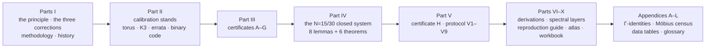
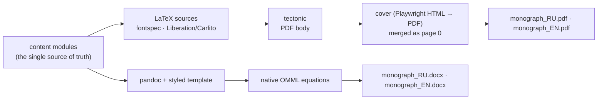

# 📕 The Unified Monograph «The Dynamic Principle»

<div align="center">

[⬆ Main README](../README.md) · [📚 Theorem monographs](../theorems/README.md) · [✅ Verification stack](../verification/README.md) · [🌐 Web suite](../README.md#Live-web-suite-and-the-five-language-analogues)

</div>

The unified monograph of the program: all stands, all certificates,
all theorems with complete proofs — in one connected text. Published
in two formats (PDF and DOCX) and two languages (Russian and English).

The Russian edition is the authoritative research text; the English
edition is its full translation. The LaTeX sources of both are
included, so every formula, table, and figure of the published PDFs
can be rebuilt or quoted exactly.

**The shape of the text** — ten parts from the principle to the
workbook, with the appendices carrying the derivations and the data:



## Files

| File | Language | Format | Size |
|---|---|---|---|
| `hodge_monograph_RU.pdf` | 🇷🇺 Russian | PDF (LaTeX, cover, TOC) | **80 pp.** |
| `hodge_monograph_RU.docx` | 🇷🇺 Russian | DOCX (Word/OnlyOffice/LibreOffice) | — |
| `hodge_monograph_EN.pdf` | 🇬🇧 English | PDF (LaTeX, cover, TOC) | **53 pp.** |
| `hodge_monograph_EN.docx` | 🇬🇧 English | DOCX | — |

## Structure of the Russian edition

```
Part I     The program and the principles
           1. Introduction: the dynamic principle
           2. The three corrections (δ=π/N, γ=δ⁴/k, δ_eff=δ⁵/k, Δ_Ch)
           3. Methodology of the ladder of stands
           4. History of the program: four stages and two errata
           5. Methodology: the five rules of the program
           6. Mathematical background (every notion of the program)

Part II    The calibration stands
           7. Torus: the triple (4,1,4π²), the full derivation of the corrections
           8. K3: 48 lines, ρ=20, (1,19), det 64
           9. Errata E8: 36/28 (the Arf enumeration)
          10. Binary code: 48/212/432/114
          11. Codim-2 cycles on K3×K3
          12. The Heawood operator, the Fano code, the quantum ladder

Part III   The certificates of the program
          13. Certificate A (cycle certifier, kernel 29)
          14. Certificate B (closing the kernel by periods)
          15. Certificates C, D (μ₄-equivariance, the universal theorem)
          16. Certificates E, F, G (termination, rationalization, indices)
          17. The Klein Jacobian: j=−3375, τ, the period by three schemes

Part IV    The stand N=15/30: a closed system
          18–24. Census combinatorics → periods → Γ-identities →
                 Theorem 1 (Riemann) → Theorem 2 (normalization) →
                 Theorem 3 (polarization and indices)

Part V     Certificate H, the protocol V1–V9, the summary results

Parts VI–X Expanded step-by-step derivations (torus, K3, Klein,
           Fermat), the spectral and quantum layers, the full
           protocols of the certificates, the reproduction guide,
           the atlas of 600 dpi diagrams, the formula catalogue,
           the workbook (10 problems with solutions)

Appendices A–L: derivations of the Γ-identities, the Möbius census,
           the complete data tables, notation, glossary, dependency
           trees, the map of integration with the classical sources,
           the Lean reference, line orbits, the CLI reference
```

## Building from sources

The two production pipelines, one content model:



```bash
# PDF (tectonic required: https://tectonic-typesetting.github.io)
cd latex/ru && tectonic main.tex   # → main.pdf (Russian body)
cd latex/en && tectonic main.tex   # → main.pdf (English body)

# Cover (optional): cover_source.html → PDF via Playwright;
# the ready-made PDFs already embed the printed cover.
```

The LaTeX sources are self-sufficient: `fontspec` + the system fonts
Liberation Serif / Carlito / DejaVu Sans Mono; `tectonic` fetches the
remaining packages automatically.

## Reproducing the numbers

Every number of the monograph is reproduced by the laboratory:

```bash
python3 laboratory.py --run all      # protocol + stands + certificates
```

The mapping "monograph section ↔ laboratory menu item" is tabulated
in the reproduction guide (part X of the Russian edition); the
reference values themselves are frozen in
[`../results/baseline_v1_v9.json`](../results/baseline_v1_v9.json).

## Related blocks

* the 16 standalone theorem monographs: [`../theorems/`](../theorems/);
* the machine-checked identities: [`../verification/`](../verification/);
* the citation metadata: [`../CITATION.cff`](../CITATION.cff).

## License

Individual exclusive license of Isaev Iskhak Khamzatovich —
see [`../LICENSE`](../LICENSE). Reading, citing with attribution, and
verifying are welcome; any other use requires the author's written
permission.

<div align="center">

© 2026 Isaev Iskhak Khamzatovich · All rights reserved

</div>
