# 📚 Standalone Theorem Monographs

<p align="center">
  <picture>
    <source media="(prefers-color-scheme: dark)" srcset="assets/banner-hero-animated-dark.svg">
    
  </picture>
</p>

<p align="center">
  <picture>
    <source media="(prefers-color-scheme: dark)" srcset="assets/logo-animated-dark.svg">
    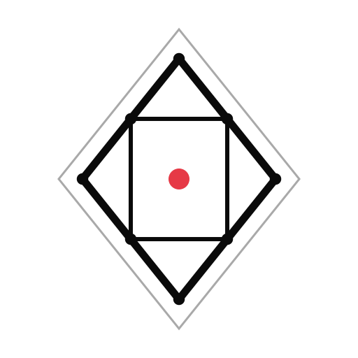
  </picture>
  &nbsp;&nbsp;
  <a href="#-the-motion-identity"></a>
</p>

[](README)
[](README)
[](README)
[](../verification/)
[](README)
[](README)
[](#-the-motion-identity)

**22 self-sufficient studies · 88 documents · PDF + DOCX · RU/EN · complete proofs**

Each theorem of the program is packaged as a standalone monograph:
statement, complete proof, protocol data, summary of what is proved,
and a verification guide. The monographs can be read, cited, and used
individually — at any time and in any order.

Every monograph is verified twice: numerically at 35–70 digits of
precision and exactly — by integer arithmetic or the Lean 4 kernel.
Each theorem folder now opens with its own illustrated, animated
[`README.md`](#-full-index) — a living hero card, the formula, the logical
place of the theorem, and one-touch navigation through the collection.
The [interactive vitrine](https://wild8highlander.github.io/hodge-laboratory/theorems-vitrine/) renders the whole collection as a live site.

---

## 🃏 The gallery — 22 theorem cards

Each card carries the Bauhaus icon of the theorem, the direct links to the
RU/EN PDF monographs, and its engraved cover. Clicking a card opens the
theorem's own animated README — hero emblem, formula, minimap, navigation.
The two ghost cards at the end are the next slots of the roadmap (T23, T24).

<table>
<tr>
<td width="25%" valign="top" align="center"><a href="T01_genus_fermat/">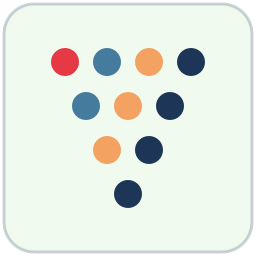</a><br><b><a href="T01_genus_fermat/">T01 · Genus formula</a></b><br><sub><a href="T01_genus_fermat/monograph_EN.pdf">EN&nbsp;PDF</a> · <a href="T01_genus_fermat/monograph_RU.pdf">RU&nbsp;PDF</a> · <a href="assets/covers/t01.png">cover</a></sub><br><sub>g = (N−1)(N−2)/2 · g(15)=91</sub></td>
<td width="25%" valign="top" align="center"><a href="T02_closed_period_form/">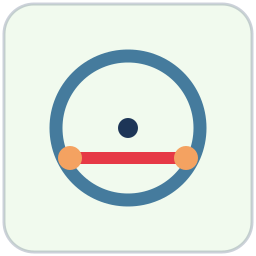</a><br><b><a href="T02_closed_period_form/">T02 · Period form</a></b><br><sub><a href="T02_closed_period_form/monograph_EN.pdf">EN&nbsp;PDF</a> · <a href="T02_closed_period_form/monograph_RU.pdf">RU&nbsp;PDF</a> · <a href="assets/covers/t02.png">cover</a></sub><br><sub>Ω = Γ(a/N)Γ(b/N)/Γ((a+b)/N)</sub></td>
<td width="25%" valign="top" align="center"><a href="T03_gamma_identities/"></a><br><b><a href="T03_gamma_identities/">T03 · Γ-identities</a></b><br><sub><a href="T03_gamma_identities/monograph_EN.pdf">EN&nbsp;PDF</a> · <a href="T03_gamma_identities/monograph_RU.pdf">RU&nbsp;PDF</a> · <a href="assets/covers/t03.png">cover</a></sub><br><sub>Γ(k/N)Γ(1−k/N) = π/sin(πk/N)</sub></td>
<td width="25%" valign="top" align="center"><a href="T04_riemann_relations/">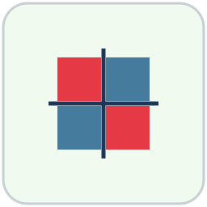</a><br><b><a href="T04_riemann_relations/">T04 · Riemann identity</a></b><br><sub><a href="T04_riemann_relations/monograph_EN.pdf">EN&nbsp;PDF</a> · <a href="T04_riemann_relations/monograph_RU.pdf">RU&nbsp;PDF</a> · <a href="assets/covers/t04.png">cover</a></sub><br><sub>Ωᵀ = Ω · Im Ω ≻ 0</sub></td>
</tr>
<tr>
<td width="25%" valign="top" align="center"><a href="T05_gamma_normalization/"></a><br><b><a href="T05_gamma_normalization/">T05 · Γ-normalization</a></b><br><sub><a href="T05_gamma_normalization/monograph_EN.pdf">EN&nbsp;PDF</a> · <a href="T05_gamma_normalization/monograph_RU.pdf">RU&nbsp;PDF</a> · <a href="assets/covers/t05.png">cover</a></sub><br><sub>b_Ch(15) = (7−√5−√(30−6√5))/8</sub></td>
<td width="25%" valign="top" align="center"><a href="T06_polarization_indices/">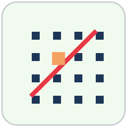</a><br><b><a href="T06_polarization_indices/">T06 · Polarization</a></b><br><sub><a href="T06_polarization_indices/monograph_EN.pdf">EN&nbsp;PDF</a> · <a href="T06_polarization_indices/monograph_RU.pdf">RU&nbsp;PDF</a> · <a href="assets/covers/t06.png">cover</a></sub><br><sub>J² = −1 · Hermite–Smith indices</sub></td>
<td width="25%" valign="top" align="center"><a href="T07_torus_triple/">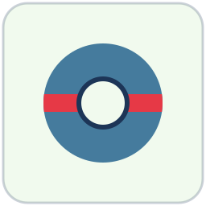</a><br><b><a href="T07_torus_triple/">T07 · Torus triple</a></b><br><sub><a href="T07_torus_triple/monograph_EN.pdf">EN&nbsp;PDF</a> · <a href="T07_torus_triple/monograph_RU.pdf">RU&nbsp;PDF</a> · <a href="assets/covers/t07.png">cover</a></sub><br><sub>Δ_Ch = 39.4880… from first principles</sub></td>
<td width="25%" valign="top" align="center"><a href="T08_k3_stand/">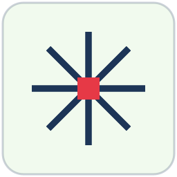</a><br><b><a href="T08_k3_stand/">T08 · K3 stand</a></b><br><sub><a href="T08_k3_stand/monograph_EN.pdf">EN&nbsp;PDF</a> · <a href="T08_k3_stand/monograph_RU.pdf">RU&nbsp;PDF</a> · <a href="assets/covers/t08.png">cover</a></sub><br><sub>ρ = 20 (Shioda) · 48 lines</sub></td>
</tr>
<tr>
<td width="25%" valign="top" align="center"><a href="T09_errata_e8/">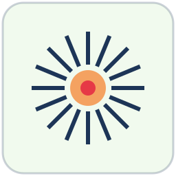</a><br><b><a href="T09_errata_e8/">T09 · Errata E8</a></b><br><sub><a href="T09_errata_e8/monograph_EN.pdf">EN&nbsp;PDF</a> · <a href="T09_errata_e8/monograph_RU.pdf">RU&nbsp;PDF</a> · <a href="assets/covers/t09.png">cover</a></sub><br><sub>36 even / 28 odd (Arf) — enumeration</sub></td>
<td width="25%" valign="top" align="center"><a href="T10_certificate_b/">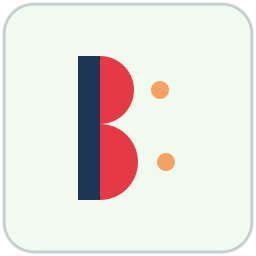</a><br><b><a href="T10_certificate_b/">T10 · Certificate B</a></b><br><sub><a href="T10_certificate_b/monograph_EN.pdf">EN&nbsp;PDF</a> · <a href="T10_certificate_b/monograph_RU.pdf">RU&nbsp;PDF</a> · <a href="assets/covers/t10.png">cover</a></sub><br><sub>kernel 29 closed · 29+2 → 0</sub></td>
<td width="25%" valign="top" align="center"><a href="T11_certificate_c/">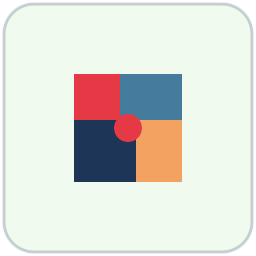</a><br><b><a href="T11_certificate_c/">T11 · Certificate C</a></b><br><sub><a href="T11_certificate_c/monograph_EN.pdf">EN&nbsp;PDF</a> · <a href="T11_certificate_c/monograph_RU.pdf">RU&nbsp;PDF</a> · <a href="assets/covers/t11.png">cover</a></sub><br><sub>22 = 1+7+7+7 · x⁴−1</sub></td>
<td width="25%" valign="top" align="center"><a href="T12_certificate_d/">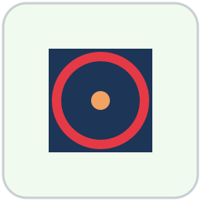</a><br><b><a href="T12_certificate_d/">T12 · Certificate D</a></b><br><sub><a href="T12_certificate_d/monograph_EN.pdf">EN&nbsp;PDF</a> · <a href="T12_certificate_d/monograph_RU.pdf">RU&nbsp;PDF</a> · <a href="assets/covers/t12.png">cover</a></sub><br><sub>[L, P] = 0 · ℤ[i]</sub></td>
</tr>
<tr>
<td width="25%" valign="top" align="center"><a href="T13_certificate_e/">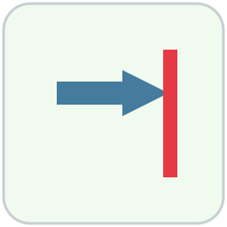</a><br><b><a href="T13_certificate_e/">T13 · Certificate E</a></b><br><sub><a href="T13_certificate_e/monograph_EN.pdf">EN&nbsp;PDF</a> · <a href="T13_certificate_e/monograph_RU.pdf">RU&nbsp;PDF</a> · <a href="assets/covers/t13.png">cover</a></sub><br><sub>t* = lcm(W/gcd(a,W), H/gcd(b,H))</sub></td>
<td width="25%" valign="top" align="center"><a href="T14_certificate_f/"></a><br><b><a href="T14_certificate_f/">T14 · Certificate F</a></b><br><sub><a href="T14_certificate_f/monograph_EN.pdf">EN&nbsp;PDF</a> · <a href="T14_certificate_f/monograph_RU.pdf">RU&nbsp;PDF</a> · <a href="assets/covers/t14.png">cover</a></sub><br><sub>Q = 256 · 4X² − 7</sub></td>
<td width="25%" valign="top" align="center"><a href="T15_certificate_g/">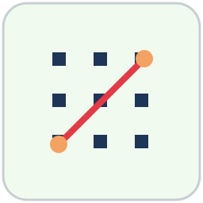</a><br><b><a href="T15_certificate_g/">T15 · Certificate G</a></b><br><sub><a href="T15_certificate_g/monograph_EN.pdf">EN&nbsp;PDF</a> · <a href="T15_certificate_g/monograph_RU.pdf">RU&nbsp;PDF</a> · <a href="assets/covers/t15.png">cover</a></sub><br><sub>λ_{m,n} = (2π)²|mτ−n|²/(Im τ)²</sub></td>
<td width="25%" valign="top" align="center"><a href="T16_certificate_h_klein/"></a><br><b><a href="T16_certificate_h_klein/">T16 · Cert. H + Klein</a></b><br><sub><a href="T16_certificate_h_klein/monograph_EN.pdf">EN&nbsp;PDF</a> · <a href="T16_certificate_h_klein/monograph_RU.pdf">RU&nbsp;PDF</a> · <a href="assets/covers/t16.png">cover</a></sub><br><sub>vol_h = 1125 · j = −3375</sub></td>
</tr>
<tr>
<td width="25%" valign="top" align="center"><a href="T17_certificate_i_hurwitz/">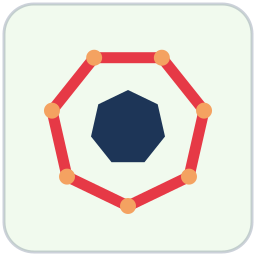</a><br><b><a href="T17_certificate_i_hurwitz/">T17 · Hurwitz N=7</a></b><br><sub><a href="T17_certificate_i_hurwitz/monograph_EN.pdf">EN&nbsp;PDF</a> · <a href="T17_certificate_i_hurwitz/monograph_RU.pdf">RU&nbsp;PDF</a> · <a href="assets/covers/t17.png">cover</a></sub><br><sub>x³+x²−2x−1 · census 15</sub></td>
<td width="25%" valign="top" align="center"><a href="T18_certificate_j_macbeath/">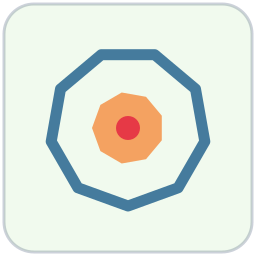</a><br><b><a href="T18_certificate_j_macbeath/">T18 · Macbeath N=9</a></b><br><sub><a href="T18_certificate_j_macbeath/monograph_EN.pdf">EN&nbsp;PDF</a> · <a href="T18_certificate_j_macbeath/monograph_RU.pdf">RU&nbsp;PDF</a> · <a href="assets/covers/t18.png">cover</a></sub><br><sub>x³−3x+1 · census 28</sub></td>
<td width="25%" valign="top" align="center"><a href="T19_quartic_tower/"></a><br><b><a href="T19_quartic_tower/">T19 · Quartic tower</a></b><br><sub><a href="T19_quartic_tower/monograph_EN.pdf">EN&nbsp;PDF</a> · <a href="T19_quartic_tower/monograph_RU.pdf">RU&nbsp;PDF</a> · <a href="assets/covers/t19.png">cover</a></sub><br><sub>b_Ch(30) = (9−√5−√(30+6√5))/8</sub></td>
<td width="25%" valign="top" align="center"><a href="T20_conductor_census/">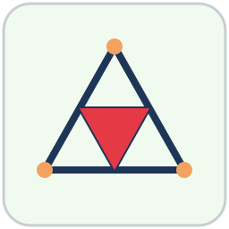</a><br><b><a href="T20_conductor_census/">T20 · Conductor census</a></b><br><sub><a href="T20_conductor_census/monograph_EN.pdf">EN&nbsp;PDF</a> · <a href="T20_conductor_census/monograph_RU.pdf">RU&nbsp;PDF</a> · <a href="assets/covers/t20.png">cover</a></sub><br><sub>406 = 1+6+9+30+84+276</sub></td>
</tr>
<tr>
<td width="25%" valign="top" align="center"><a href="T21_certificate_k_quintic/"></a><br><b><a href="T21_certificate_k_quintic/">T21 · Quintic N=11</a></b><br><sub><a href="T21_certificate_k_quintic/monograph_EN.pdf">EN&nbsp;PDF</a> · <a href="T21_certificate_k_quintic/monograph_RU.pdf">RU&nbsp;PDF</a> · <a href="assets/covers/t21.png">cover</a></sub><br><sub>quintic N=11 · g = 45 · disc 11⁹</sub></td>
<td width="25%" valign="top" align="center"><a href="T22_snf_spectra/">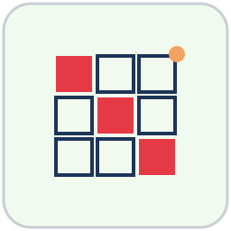</a><br><b><a href="T22_snf_spectra/">T22 · SNF engine</a></b><br><sub><a href="T22_snf_spectra/monograph_EN.pdf">EN&nbsp;PDF</a> · <a href="T22_snf_spectra/monograph_RU.pdf">RU&nbsp;PDF</a> · <a href="assets/covers/t22.png">cover</a></sub><br><sub>SNF spectra of every rung · cert H</sub></td>
<td width="25%" valign="top" align="center"><br><b style="opacity:0.55">T23 · Gross normalization + sine count</b><br><sub style="opacity:0.55">computed vol_h · v1.6+ slot — drafted next</sub></td>
<td width="25%" valign="top" align="center"><br><b style="opacity:0.55">T24 · The Dwork pencil</b><br><sub style="opacity:0.55">invariant cohomology · v1.8 slot — drafted next</sub></td>
</tr>
</table>

<p align="center">
  <picture>
    <source media="(prefers-color-scheme: dark)" srcset="assets/divider-flow-dark.svg">
    
  </picture>
</p>

## 🔢 The collection in three numbers

<p align="center">
  
</p>

The genus ladder below is the backbone of the program — every rung the
laboratory has climbed, from the torus (g=1) to the Fermat curve N=30
(g=406). The bars grow exactly as the conductor census (T20) counts them:

<p align="center">
  
</p>

---

## 🔗 The dependency graph

The logical reading path of the collection — the same map the interactive
[Explorer](https://wild8highlander.github.io/hodge-laboratory/theorems-vitrine/#explorer) renders as a force-directed graph:

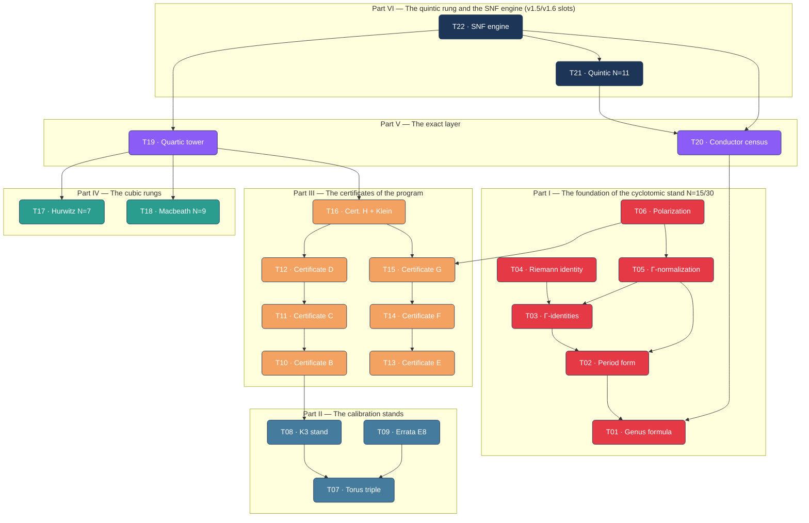

The same map, fully alive — every edge streams and every node breathes
(SMIL; rendered by GitHub through the image proxy):

<p align="center">
  <picture>
    <source media="(prefers-color-scheme: dark)" srcset="assets/graph-animated-dark.svg">
    
  </picture>
</p>

Every monograph is self-sufficient: reading its proof requires none
of the others — the cross-references are navigation, not dependency.
Each theorem folder carries its own animated minimap of exactly this
kind, centered on that theorem.

---

## 🗂 Full index

### Part I. The foundation of the cyclotomic stand N=15/30

| № | Folder | Theorem | Core result |
|---|---|---|---|
| 1 | [`T01_genus_fermat`](T01_genus_fermat/) | **Genus of the Fermat curve** | g = (N−1)(N−2)/2; g(15)=91, g(30)=406 — from Riemann–Hurwitz |
| 2 | [`T02_closed_period_form`](T02_closed_period_form/) | **Closed period form** | P = (1/N)ζ^{ra+sb}Ω_{a,b}; Ω = Γ(a/N)Γ(b/N)/Γ((a+b)/N) |
| 3 | [`T03_gamma_identities`](T03_gamma_identities/) | **Γ-identities** | reflection + Gauss multiplication; the inventory of relations |
| 4 | [`T04_riemann_relations`](T04_riemann_relations/) | **Theorem 1: Riemann as an identity** | Ω^T=Ω; Im Ω ≻ 0 — identically, without numerical checks |
| 5 | [`T05_gamma_normalization`](T05_gamma_normalization/) | **Theorem 2: Γ-normalization** | denominator N; fractional parts of π; radicals b_Ch(15), b_Ch(30) |
| 6 | [`T06_polarization_indices`](T06_polarization_indices/) | **Theorem 3: polarization and indices** | J — a polarization of weight 1; block indices computable (Hermite–Smith) |

### Part II. The calibration stands

| № | Folder | Theorem | Core result |
|---|---|---|---|
| 7 | [`T07_torus_triple`](T07_torus_triple/) | **The torus triple and the corrections** | (4, 1, 4π²); δ=π/4; γ=δ⁴; Δ_Ch = 39.4880 — all from first principles |
| 8 | [`T08_k3_stand`](T08_k3_stand/) | **The K3 stand** | ρ = 20 = max (Shioda); (1,19); det 64; 48 lines; the family ~ h |
| 9 | [`T09_errata_e8`](T09_errata_e8/) | **Errata E8** | 36 even (Arf=0) / 28 odd (Arf=1) on genus 3 — full enumeration |

### Part III. The certificates of the program

| № | Folder | Theorem | Core result |
|---|---|---|---|
| 10 | [`T10_certificate_b`](T10_certificate_b/) | **Certificate B** | closing the kernel 29 by periods; blind spot 29+2 → 0 |
| 11 | [`T11_certificate_c`](T11_certificate_c/) | **Certificate C** | μ₄-equivariance: 22 = 1+7+7+7; the regular representation x⁴−1 |
| 12 | [`T12_certificate_d`](T12_certificate_d/) | **Certificate D** | the universal μ₄-theorem: [L,P]=0; functoriality; ℤ[i] |
| 13 | [`T13_certificate_e`](T13_certificate_e/) | **Certificate E** | flow termination: t* = lcm(W/gcd(a,W), H/gcd(b,H)) |
| 14 | [`T14_certificate_f`](T14_certificate_f/) | **Certificate F** | rationalization: 2ε < 1/Q²; Q=256; LLL: 4X²−7; negative test 4π² |
| 15 | [`T15_certificate_g`](T15_certificate_g/) | **Certificate G** | λ_{m,n}=(2π)²\|mτ−n\|²/(Im τ)²; CM fractions 16π²/d, 4π²/d; π/15, π/30 |
| 16 | [`T16_certificate_h_klein`](T16_certificate_h_klein/) | **Certificate H + Klein** | vol_h = 1125 = √disc; SNF (1,1,5,5,15,15,15,15); j = −3375 |

### Part IV. The cubic rungs

| № | Folder | Theorem | Core result |
|---|---|---|---|
| 17 | [`T17_certificate_i_hurwitz`](T17_certificate_i_hurwitz/) | **Certificate I: the Hurwitz rung N = 7** | census 15 = h₇; x³+x²−2x−1, Vieta (−1,−2,1) exact in ℤ[ζ]/(Φ₇); Cardano with the exact pairing ∛t·∛t̄ = 7/9; phase π/7 |
| 18 | [`T18_certificate_j_macbeath`](T18_certificate_j_macbeath/) | **Certificate J: the Macbeath rung N = 9** | census 28 = 1 + 27; x³−3x+1, Vieta (0,−3,−1); Cardano arguments are roots of unity: ∛ω = ζ₉; phase π/9 |

### Part V. The exact layer

| № | Folder | Theorem | Core result |
|---|---|---|---|
| 19 | [`T19_quartic_tower`](T19_quartic_tower/) | **The quartic tower of N = 15/30** | b_Ch(15) = (7−√5−√(30−6√5))/8, b_Ch(30) = (9−√5−√(30+6√5))/8; minimal quartics with P₃₀(x) = P₁₅(−x); ββ′ = 12√5 — one cyclic field, two rungs; disc = 1125 |
| 20 | [`T20_conductor_census`](T20_conductor_census/) | **The conductor census** | the triangle c(N) = (N−1)(N−2)/2; lifting lemma + Möbius inversion; self-similarity h_d(N) = h_d(d); 15, 28 = 1+27, 91 = 1+6+84, 406 = 1+6+9+30+84+276 — two schemes, bit-for-bit |

### Part VI. The quintic rung and the SNF engine (v1.5/v1.6 slots)

| № | Folder | Theorem | Core result |
|---|---|---|---|
| 21 | [`T21_certificate_k_quintic`](T21_certificate_k_quintic/) | **Certificate K: the cyclic quintic rung N = 11** | census {11: 45}, g = 45; quintic x⁵+x⁴−4x³−3x²+3x+1, Vieta (−1,−4,3,3,−1), GF(2) irreducible; b_Ch(11): −32y⁵+176y⁴−352y³+308y²−110y+11 (casus irreducibilis quinticus); disc 11⁹ and 11⁴ with SNF (1, 11×9) and (1,11,11,11,11); the C₅-resolvent η ∈ ℤ[ζ₅], branches (2,4,4,1,1) — bit-for-bit with VER-HODGE |
| 22 | [`T22_snf_spectra`](T22_snf_spectra/) | **The SNF engine and the computed polarization types** | S1: G = pI−J, SNF = (1, p^{p−2}) for primes; N=7 (1,7×5)/7⁵; N=9 (3,3,3,9,9,9)/3⁹; N=11 (1,11×9)/11⁹; N=15/30 (1,1,5,5,15,15,15,15)/1125² — certificate H bit-for-bit; the dual layer (mirror lemma); real layers and the conductor pattern S3 (1125 in three roles) |

---

## 📐 The uniform structure of every monograph

All 88 documents (PDF and DOCX in both languages) follow one scheme:

```
┌─────────────────────────────────────────────────────┐
│  TITLE: theorem · subtitle · author · number        │
├─────────────────────────────────────────────────────┤
│  1. SETTING — the place of the theorem in the       │
│     program; what exactly is claimed and why        │
│  2. THEOREM/LEMMA — the precise statement in a      │
│     theorem environment                             │
│  3. PROOF — complete, from first principles;        │
│     every formula justified                         │
│  4. PROTOCOL DATA — the exact certificate numbers   │
│     (deviations, ranks, invariants)                 │
│  5. SUMMARY OF WHAT IS PROVED — the result and the  │
│     mechanism (identity / arithmetic / integral)    │
│  6. VERIFICATION — how to reproduce: the            │
│     laboratory.py menu item, the Lean block,        │
│     the exit codes                                  │
└─────────────────────────────────────────────────────┘
```

Files in each folder:

| File | Content |
|---|---|
| `README.md` | the illustrated, animated front page of the theorem: hero emblem, formula, minimap, navigation |
| `monograph_RU.pdf` | the full theorem monograph (Russian, LaTeX/tectonic) |
| `monograph_RU.docx` | Word edition of the same monograph with native OMML equations (Russian) |
| `monograph_EN.pdf` | the full theorem monograph (English, LaTeX/tectonic) |
| `monograph_EN.docx` | Word edition of the same monograph with native OMML equations (English) |
| `latex/ru/monograph.tex` | LaTeX source (Russian) |
| `latex/en/monograph.tex` | LaTeX source (English) |
| `stand_*.py` (T21/T22 only) | the executable verification stand of the monograph (exit 0 = accepted) |

The DOCX editions are generated from the same LaTeX sources
(`scripts/build_theorem_docx.py`: pandoc + a styled reference
template), so the two formats never diverge in content — a proof
edited once appears identically in both.

---

## 🖼 Monograph covers

Every theorem carries an engraved cover (`assets/covers/tNN.png`,
Academic Engraving style: parchment, sepia linework, gold accents —
an emblem per theorem, from the genus triangle to the SNF staircase).
The covers are sized for the PDF title pages and for the card previews
of the interactive vitrine; embed them into the monographs with the
LaTeX snippet:

```latex
\titlepage
\includegraphics[width=0.72\textwidth]{../assets/covers/t01.png}
```

<p align="center">
  <picture>
    <source media="(prefers-color-scheme: dark)" srcset="assets/divider-flow-dark.svg">
    
  </picture>
</p>

## ✨ The motion identity

The collection ships a complete animation system — 60+ assets, every one
pure SMIL or GIF (no JavaScript), so it moves on GitHub, in the PDF toolchain
previews, and in the interactive vitrine alike:

| Asset | Alive |
|---|---|
| animated avatar — [SVG](assets/avatar-animated.svg) · [GIF](assets/avatar-animated.gif) · [PNG](assets/avatar-512.png) |  |
| logo pulse — [SVG](assets/logo-animated-light.svg) · [GIF](assets/logo-pulse.gif) | 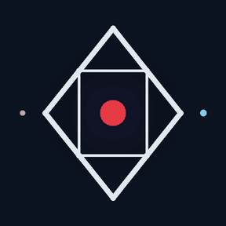 |
| hero cards — one per theorem (22) | <a href="T01_genus_fermat/"></a> |
| hero example — [T16 Klein rosette](T16_certificate_h_klein/) | <a href="T16_certificate_h_klein/"></a> |
| part ribbons (6) | <a href="T04_riemann_relations/"></a> |
| dependency minimaps (22) | <a href="T22_snf_spectra/">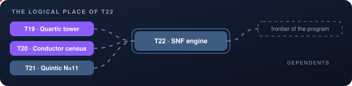</a> |
| flow divider — [light](assets/divider-flow-light.svg) · [dark](assets/divider-flow-dark.svg) | 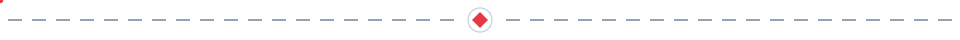 |
| flow strip (GIF) |  |

The avatar doubles as the profile picture (upload `avatar-animated.gif`
or `avatar-512.png`); the `avatar-animated.gif` also works wherever SVG
animation is unavailable. All assets are generated from one data source —
`scripts/theorems_data.py` → `gen_anim_assets.py`, `gen_gifs.py`,
`gen_heroes.py`, `gen_graph_anim.py` — so a future T23/T24 slot
regenerates the entire motion system with one command.
---

## 🧬 How the collection grows

Every newly proved roadmap item becomes a monograph in the same
four-format package, so the collection expands without changing its
shape:

```
1. write  latex/ru/monograph.tex  and  latex/en/monograph.tex
   (the six-block scheme above; theorem environments +
   statusbox/databox/verifybox)
2. build  monograph_RU.pdf / monograph_EN.pdf   (tectonic)
3. build  monograph_RU.docx / monograph_EN.docx
   (scripts/build_theorem_docx.py — pandoc, native OMML,
   styled protocol boxes, RU/EN metadata)
4. register  the row in the index above + the roadmap checkbox
```

Delivered beyond the plan (the v1.5/v1.6 slots, closed by the
research package with executable stands): **T21 = the cyclic
quintic rung N = 11** (certificate K, bit-for-bit with VER-HODGE)
and **T22 = the SNF engine and the computed polarization types**
(the spectral column of every rung, certificate H reproduced).
Next slots: **T23 = the computed Gross normalization and the sine
count** (v1.6+) and **T24 = the Dwork pencil: the invariant
cohomology and the certified periods** (v1.8) — their content is
fixed by the laboratory once the respective roadmap items are
proved.

---

## 🔬 Verification of each theorem

| Theorem | Laboratory entry | Lean block |
|---|---|---|
| 1 genus formula | V1 census; designer N | `genus_fermat` |
| 2 period form | V2/V3/V4; designer | `—` |
| 3 γ-identities | V6 | `—` |
| 4 riemann identity | V7 sanity row | `—` |
| 5 γ-normalization | the N=15/30 stand; the b_Ch plot | `bch_radicals` |
| 6 polarization | certificate H1 | `snf_product, stand_disc` |
| 7 torus triple | Stands → Torus | `—` |
| 8 k3 stand | Stands → K3 (exact rank 20) | `—` |
| 9 errata e8 | Stands → Errata (enumeration) | `errata_e8` |
| 10 certificate b | Certificates → B | `—` |
| 11 certificate c | Certificates → C | `—` |
| 12 certificate d | Certificates → D | `—` |
| 13 certificate e | Certificates → E; designer t* | `termination_lcm` |
| 14 certificate f | Certificates → F | `klein_integers` |
| 15 certificate g | Certificates → G; designer d | `—` |
| 16 cert. h + klein | Certificates → H; Stands → Klein | `stand_disc, klein_integers` |
| 17 hurwitz n=7 | Certificates → I; Stands → N=7 | `—` |
| 18 macbeath n=9 | Certificates → J; Stands → N=9 | `—` |
| 19 quartic tower | Designer item 5; batch bch (N=15/30) | `bch_radicals` |
| 20 conductor census | Protocol V1; --check-baseline | `genus_fermat` |
| 21 quintic n=11 | stand_t21_n11.py (17/17); VER-HODGE cert K | `— (Lean queue 1)` |
| 22 snf engine | stand_t22_snf.py (24/24); --check-baseline | `SnfSpec` |

The exit codes of all implementations: `0` — accepted, `1` — failure.

---

## 📖 How to cite a standalone monograph

```bibtex
@misc{isaev2026t08,
  author = {Isaev, Iskhak Khamzatovich},
  title  = {The K3 Stand: Neron--Severi Rank 20. Standalone Theorem
             Monograph 8/20},
  year   = {2026},
  howpublished = {hodge-laboratory repository},
  url    = {https://github.com/wild8highlander/hodge-laboratory}
}
```

Adjust the number and title per the index above; the repository-level
citation lives in [`../CITATION.cff`](../CITATION.cff) and the main
[`../README.md`](../README.md).

---

## ⚖️ License

Individual exclusive license of Isaev Iskhak Khamzatovich — all
rights to all monographs belong to the author; any use without his
written permission is prohibited. See [`../LICENSE`](../LICENSE).

© 2026 Isaev Iskhak Khamzatovich · All rights reserved
