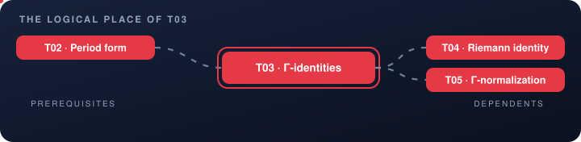
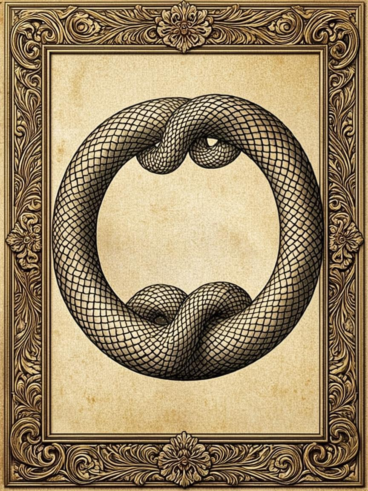

<!-- T03 · generated from scripts/theorems_data.py — edit there, regenerate everywhere -->

# T03 · Γ-identities

<p align="center">
  
</p>

<p align="center">
  
</p>

<p align="center">

    

</p>

<p align="center">
  <picture>
    <source media="(prefers-color-scheme: dark)" srcset="../assets/divider-flow-dark.svg">
    
  </picture>
</p>

> **Γ-identities** — reflection + Gauss multiplication; the inventory of relations

## The statement

$$\Gamma\!\left(\tfrac{k}{N}\right)\Gamma\!\left(1-\tfrac{k}{N}\right)=\frac{\pi}{\sin(\pi k/N)}$$

The emblem above is alive: it encodes the two mirrored interlocking spirals — reflection symmetry made visible — the same motif that
appears on the engraved cover and in the interactive vitrine.

## 🗂 In this folder

| File | Content |
|---|---|
| [`monograph_EN.pdf`](monograph_EN.pdf) | the full monograph — English (LaTeX/tectonic) |
| [`monograph_RU.pdf`](monograph_RU.pdf) | the full monograph — Russian (LaTeX/tectonic) |
| [`monograph_EN.docx`](monograph_EN.docx) | Word edition, native OMML equations — English |
| [`monograph_RU.docx`](monograph_RU.docx) | Word edition, native OMML equations — Russian |
| [`latex/en/monograph.tex`](latex/en/monograph.tex) | LaTeX source — English |
| [`latex/ru/monograph.tex`](latex/ru/monograph.tex) | LaTeX source — Russian |

The DOCX editions are generated from the same LaTeX sources, so the four
documents never diverge in content — a proof edited once appears identically
everywhere. Every monograph follows the uniform six-block scheme: setting,
statement, complete proof, protocol data, summary of what is proved,
and the reproduction guide.

## 📐 The theorem in the program

Reflection and multiplication are the two Gamma-identities the whole edifice stands on: Γ(k/N)·Γ(1−k/N)=π/sin(πk/N) pairs the lattice cells, and the Gauss multiplication theorem reassembles them into whole Γ-values. The monograph proves both from the Weierstrass product and converts them into the exact algebraic dictionary that the normalization (T05) and the CM fractions of certificate G consume directly.

Part I — The foundation of the cyclotomic stand N=15/30. Read it in any
order: the monograph is self-sufficient, and every cross-reference below is
navigation, not a prerequisite.

## 🔗 The logical place

<p align="center">
  
</p>

The map is animated: prerequisites flow in from the left, dependents carry
the result onward to the right. The full graph of all 22 theorems lives in
[the collection index](../README.md#-the-dependency-graph).

| ⟵ [**T02 · Period form**](T02_closed_period_form/) | [⌂ the index](../README.md) | [**T04 · Riemann identity**](T04_riemann_relations/) ⟶ |
|:---|:---:|---:|

## 🔬 Verification

| Channel | Entry |
|---|---|
| Laboratory | V6 |
| Lean block | `—` |
| Exit codes | `0` — accepted · `1` — failure |

Numerically the theorem is verified at 35–70 digits of precision; exactly —
by integer arithmetic or the Lean 4 kernel, whichever the block above names.

## 🖼 The cover

<p align="center">
  <a href="../assets/covers/t03.png"></a>
</p>

Academic Engraving: parchment, sepia linework, gold accents — the emblem of
two mirrored interlocking spirals. Sized for the PDF title page; embed it as
shown in the [collection index](../README.md#-monograph-covers):

```latex
\titlepage
\includegraphics[width=0.72\textwidth]{../assets/covers/t03.png}
```

[](monograph_EN.pdf) [](monograph_RU.pdf) [](../assets/covers/t03.png)

---

<p align="center">
  
</p>

<p align="center"><sub>HODGE LABORATORY · THE THEOREM MONOGRAPHS ·
<a href="../README.md#-standalone-theorem-monographs">the collection</a> ·
22 studies · 88 documents</sub></p>
