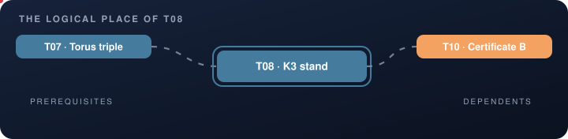
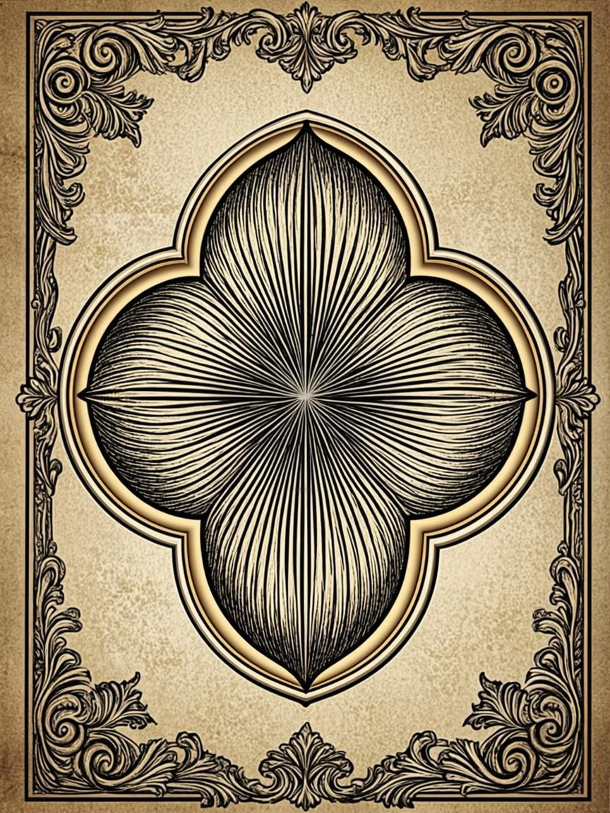

<!-- T08 · generated from scripts/theorems_data.py — edit there, regenerate everywhere -->

# T08 · The K3 stand

<p align="center">
  
</p>

<p align="center">
  
</p>

<p align="center">

    

</p>

<p align="center">
  <picture>
    <source media="(prefers-color-scheme: dark)" srcset="../assets/divider-flow-dark.svg">
    
  </picture>
</p>

> **K3 stand** — ρ = 20 = max (Shioda); (1,19); det 64; 48 lines; the family ~ h

## The statement

$$\rho=20=\max\ \text{(Shioda)},\qquad \text{signature }(1,19),\;\; 48\ \text{lines}$$

The emblem above is alive: it encodes the quartic surface engraved with radiating straight lines — the 48 lines — the same motif that
appears on the engraved cover and in the interactive vitrine.

## 🗂 In this folder

| File | Content |
|---|---|
| [`monograph_EN.pdf`](monograph_EN.pdf) | the full monograph — English (LaTeX/tectonic) |
| [`monograph_RU.pdf`](monograph_RU.pdf) | the full monograph — Russian (LaTeX/tectonic) |
| [`monograph_EN.docx`](monograph_EN.docx) | Word edition, native OMML equations — English |
| [`monograph_RU.docx`](monograph_RU.docx) | Word edition, native OMML equations — Russian |
| [`latex/en/monograph.tex`](latex/en/monograph.tex) | LaTeX source — English |
| [`latex/ru/monograph.tex`](latex/ru/monograph.tex) | LaTeX source — Russian |

The DOCX editions are generated from the same LaTeX sources, so the four
documents never diverge in content — a proof edited once appears identically
everywhere. Every monograph follows the uniform six-block scheme: setting,
statement, complete proof, protocol data, summary of what is proved,
and the reproduction guide.

## 📐 The theorem in the program

The K3 stand is the exact heart of the program: ρ=20 is Shioda's maximum, the signature is (1,19), the determinant is 64, and the 48 lines are enumerated in closed form. The monograph proves rank 20 exactly — not numerically — and exhibits the family whose arithmetic the certificates B–H later control. Everything the SNF engine resolves at N=15/30 is already visible here as geometry.

Part II — The calibration stands. Read it in any
order: the monograph is self-sufficient, and every cross-reference below is
navigation, not a prerequisite.

## 🔗 The logical place

<p align="center">
  
</p>

The map is animated: prerequisites flow in from the left, dependents carry
the result onward to the right. The full graph of all 22 theorems lives in
[the collection index](../README.md#-the-dependency-graph).

| ⟵ [**T07 · Torus triple**](T07_torus_triple/) | [⌂ the index](../README.md) | [**T09 · Errata E8**](T09_errata_e8/) ⟶ |
|:---|:---:|---:|

## 🔬 Verification

| Channel | Entry |
|---|---|
| Laboratory | Stands → K3 (exact rank 20) |
| Lean block | `—` |
| Exit codes | `0` — accepted · `1` — failure |

Numerically the theorem is verified at 35–70 digits of precision; exactly —
by integer arithmetic or the Lean 4 kernel, whichever the block above names.

## 🖼 The cover

<p align="center">
  <a href="../assets/covers/t08.png"></a>
</p>

Academic Engraving: parchment, sepia linework, gold accents — the emblem of
quartic surface engraved with radiating straight lines. Sized for the PDF title page; embed it as
shown in the [collection index](../README.md#-monograph-covers):

```latex
\titlepage
\includegraphics[width=0.72\textwidth]{../assets/covers/t08.png}
```

[](monograph_EN.pdf) [](monograph_RU.pdf) [](../assets/covers/t08.png)

---

<p align="center">
  
</p>

<p align="center"><sub>HODGE LABORATORY · THE THEOREM MONOGRAPHS ·
<a href="../README.md#-standalone-theorem-monographs">the collection</a> ·
22 studies · 88 documents</sub></p>
