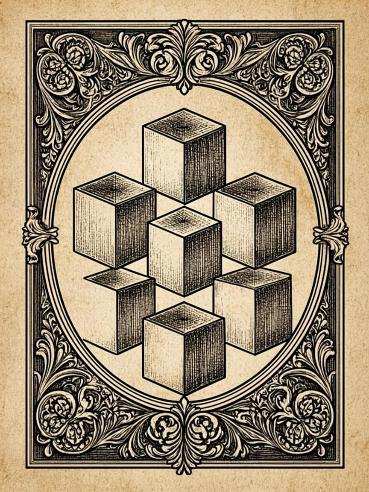

<!-- T18 · generated from scripts/theorems_data.py — edit there, regenerate everywhere -->

# T18 · Certificate J: the Macbeath rung N = 9

<p align="center">
  
</p>

<p align="center">
  
</p>

<p align="center">

    

</p>

<p align="center">
  <picture>
    <source media="(prefers-color-scheme: dark)" srcset="../assets/divider-flow-dark.svg">
    
  </picture>
</p>

> **Macbeath N=9** — census 28 = 1 + 27; x³−3x+1, Vieta (0,−3,−1); Cardano arguments are roots of unity: ∛ω = ζ₉; phase π/9

## The statement

$$x^3-3x+1,\qquad \text{census }28=1+27,\;\; \text{phase }\pi/9$$

The emblem above is alive: it encodes the regular nonagon enclosing a cubic curve — the N = 9 rung — the same motif that
appears on the engraved cover and in the interactive vitrine.

## 🗂 In this folder

| File | Content |
|---|---|
| [`monograph_EN.pdf`](monograph_EN.pdf) | the full monograph — English (LaTeX/tectonic) |
| [`monograph_RU.pdf`](monograph_RU.pdf) | the full monograph — Russian (LaTeX/tectonic) |
| [`monograph_EN.docx`](monograph_EN.docx) | Word edition, native OMML equations — English |
| [`monograph_RU.docx`](monograph_RU.docx) | Word edition, native OMML equations — Russian |
| [`latex/en/monograph.tex`](latex/en/monograph.tex) | LaTeX source — English |
| [`latex/ru/monograph.tex`](latex/ru/monograph.tex) | LaTeX source — Russian |

The DOCX editions are generated from the same LaTeX sources, so the four
documents never diverge in content — a proof edited once appears identically
everywhere. Every monograph follows the uniform six-block scheme: setting,
statement, complete proof, protocol data, summary of what is proved,
and the reproduction guide.

## 📐 The theorem in the program

The Macbeath rung is N=9: census 28=1+27, the cubic x³−3x+1 with Vieta (0,−3,−1), and the Cardano arguments are roots of unity — ∛ω=ζ₉. The monograph proves that the casus irreducibilis resolves exactly over the cyclotomic field, with phase π/9. Where the classical theory surrenders to complex radicals, this rung stays in integers.

Part IV — The cubic rungs. Read it in any
order: the monograph is self-sufficient, and every cross-reference below is
navigation, not a prerequisite.

## 🔗 The logical place

<p align="center">
  
</p>

The map is animated: prerequisites flow in from the left, dependents carry
the result onward to the right. The full graph of all 22 theorems lives in
[the collection index](../README.md#-the-dependency-graph).

| ⟵ [**T17 · Hurwitz N=7**](T17_certificate_i_hurwitz/) | [⌂ the index](../README.md) | [**T19 · Quartic tower**](T19_quartic_tower/) ⟶ |
|:---|:---:|---:|

## 🔬 Verification

| Channel | Entry |
|---|---|
| Laboratory | Certificates → J; Stands → N=9 |
| Lean block | `—` |
| Exit codes | `0` — accepted · `1` — failure |

Numerically the theorem is verified at 35–70 digits of precision; exactly —
by integer arithmetic or the Lean 4 kernel, whichever the block above names.

## 🖼 The cover

<p align="center">
  <a href="../assets/covers/t18.png"></a>
</p>

Academic Engraving: parchment, sepia linework, gold accents — the emblem of
regular nonagon enclosing a cubic curve. Sized for the PDF title page; embed it as
shown in the [collection index](../README.md#-monograph-covers):

```latex
\titlepage
\includegraphics[width=0.72\textwidth]{../assets/covers/t18.png}
```

[](monograph_EN.pdf) [](monograph_RU.pdf) [](../assets/covers/t18.png)

---

<p align="center">
  
</p>

<p align="center"><sub>HODGE LABORATORY · THE THEOREM MONOGRAPHS ·
<a href="../README.md#-standalone-theorem-monographs">the collection</a> ·
22 studies · 88 documents</sub></p>
