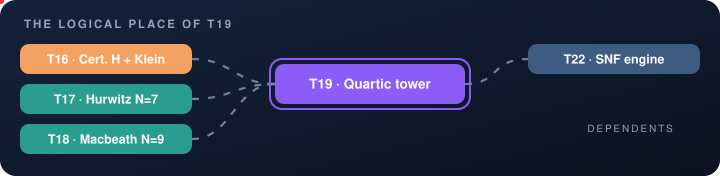
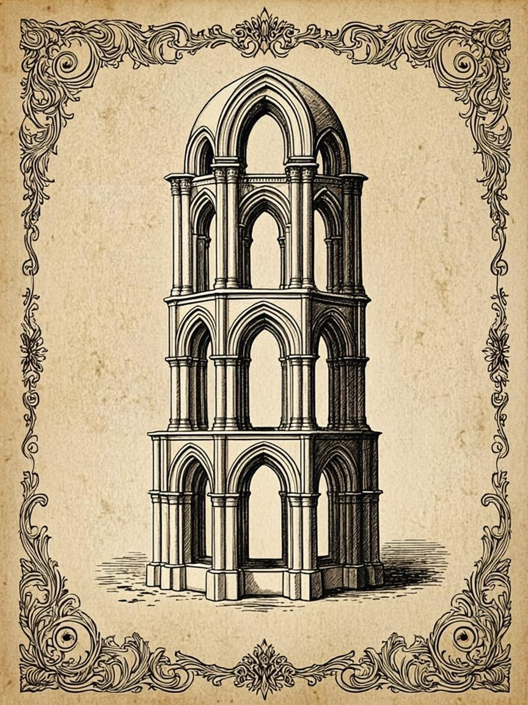

<!-- T19 · generated from scripts/theorems_data.py — edit there, regenerate everywhere -->

# T19 · The quartic tower of N = 15/30

<p align="center">
  
</p>

<p align="center">
  
</p>

<p align="center">

    

</p>

<p align="center">
  <picture>
    <source media="(prefers-color-scheme: dark)" srcset="../assets/divider-flow-dark.svg">
    
  </picture>
</p>

> **Quartic tower** — b_Ch(15) = (7−√5−√(30−6√5))/8, b_Ch(30) = (9−√5−√(30+6√5))/8; minimal quartics with P₃₀(x) = P₁₅(−x); ββ′ = 12√5 — one cyclic field, two rungs; disc = 1125

## The statement

$$b_{\mathrm{Ch}}(30)=\frac{9-\sqrt{5}-\sqrt{30+6\sqrt{5}}}{8}$$

The emblem above is alive: it encodes the tower of stacked quartic arches — two interlocked rungs — the same motif that
appears on the engraved cover and in the interactive vitrine.

## 🗂 In this folder

| File | Content |
|---|---|
| [`monograph_EN.pdf`](monograph_EN.pdf) | the full monograph — English (LaTeX/tectonic) |
| [`monograph_RU.pdf`](monograph_RU.pdf) | the full monograph — Russian (LaTeX/tectonic) |
| [`monograph_EN.docx`](monograph_EN.docx) | Word edition, native OMML equations — English |
| [`monograph_RU.docx`](monograph_RU.docx) | Word edition, native OMML equations — Russian |
| [`latex/en/monograph.tex`](latex/en/monograph.tex) | LaTeX source — English |
| [`latex/ru/monograph.tex`](latex/ru/monograph.tex) | LaTeX source — Russian |

The DOCX editions are generated from the same LaTeX sources, so the four
documents never diverge in content — a proof edited once appears identically
everywhere. Every monograph follows the uniform six-block scheme: setting,
statement, complete proof, protocol data, summary of what is proved,
and the reproduction guide.

## 📐 The theorem in the program

The quartic tower stacks both rungs of one cyclic field: b_Ch(15) and b_Ch(30) are its two radicals, the minimal quartics satisfy P₃₀(x)=P₁₅(−x), and ββ′=12√5. disc=1125 ties the tower to certificate H. The monograph builds the whole ladder from a single field — the structural climax of the exact layer, and the reason 1125 keeps reappearing later.

Part V — The exact layer. Read it in any
order: the monograph is self-sufficient, and every cross-reference below is
navigation, not a prerequisite.

## 🔗 The logical place

<p align="center">
  
</p>

The map is animated: prerequisites flow in from the left, dependents carry
the result onward to the right. The full graph of all 22 theorems lives in
[the collection index](../README.md#-the-dependency-graph).

| ⟵ [**T18 · Macbeath N=9**](T18_certificate_j_macbeath/) | [⌂ the index](../README.md) | [**T20 · Conductor census**](T20_conductor_census/) ⟶ |
|:---|:---:|---:|

## 🔬 Verification

| Channel | Entry |
|---|---|
| Laboratory | Designer item 5; batch bch (N=15/30) |
| Lean block | `bch_radicals` |
| Exit codes | `0` — accepted · `1` — failure |

Numerically the theorem is verified at 35–70 digits of precision; exactly —
by integer arithmetic or the Lean 4 kernel, whichever the block above names.

## 🖼 The cover

<p align="center">
  <a href="../assets/covers/t19.png"></a>
</p>

Academic Engraving: parchment, sepia linework, gold accents — the emblem of
tower of stacked quartic arches. Sized for the PDF title page; embed it as
shown in the [collection index](../README.md#-monograph-covers):

```latex
\titlepage
\includegraphics[width=0.72\textwidth]{../assets/covers/t19.png}
```

[](monograph_EN.pdf) [](monograph_RU.pdf) [](../assets/covers/t19.png)

---

<p align="center">
  
</p>

<p align="center"><sub>HODGE LABORATORY · THE THEOREM MONOGRAPHS ·
<a href="../README.md#-standalone-theorem-monographs">the collection</a> ·
22 studies · 88 documents</sub></p>
