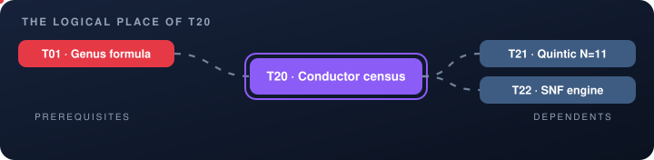
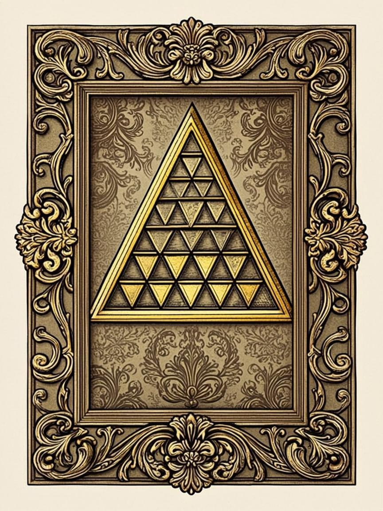

<!-- T20 · generated from scripts/theorems_data.py — edit there, regenerate everywhere -->

# T20 · The conductor census

<p align="center">
  
</p>

<p align="center">
  
</p>

<p align="center">

    

</p>

<p align="center">
  <picture>
    <source media="(prefers-color-scheme: dark)" srcset="../assets/divider-flow-dark.svg">
    
  </picture>
</p>

> **Conductor census** — the triangle c(N) = (N−1)(N−2)/2; lifting lemma + Möbius inversion; self-similarity h_d(N) = h_d(d); 15, 28 = 1+27, 91 = 1+6+84, 406 = 1+6+9+30+84+276 — two schemes, bit-for-bit

## The statement

$$91=1+6+84,\qquad 406=1+6+9+30+84+276$$

The emblem above is alive: it encodes the great triangle census subdivided into counted cells — the same motif that
appears on the engraved cover and in the interactive vitrine.

## 🗂 In this folder

| File | Content |
|---|---|
| [`monograph_EN.pdf`](monograph_EN.pdf) | the full monograph — English (LaTeX/tectonic) |
| [`monograph_RU.pdf`](monograph_RU.pdf) | the full monograph — Russian (LaTeX/tectonic) |
| [`monograph_EN.docx`](monograph_EN.docx) | Word edition, native OMML equations — English |
| [`monograph_RU.docx`](monograph_RU.docx) | Word edition, native OMML equations — Russian |
| [`latex/en/monograph.tex`](latex/en/monograph.tex) | LaTeX source — English |
| [`latex/ru/monograph.tex`](latex/ru/monograph.tex) | LaTeX source — Russian |

The DOCX editions are generated from the same LaTeX sources, so the four
documents never diverge in content — a proof edited once appears identically
everywhere. Every monograph follows the uniform six-block scheme: setting,
statement, complete proof, protocol data, summary of what is proved,
and the reproduction guide.

## 📐 The theorem in the program

The conductor census is the triangle c(N)=(N−1)(N−2)/2 re-derived twice: by a lifting lemma and by Möbius inversion, agreeing bit-for-bit. The self-similarity h_d(N)=h_d(d) explains why the stands recycle their arithmetic, and 91=1+6+84, 406=1+6+9+30+84+276 become structural identities. The monograph is the counting backbone of the whole program.

Part V — The exact layer. Read it in any
order: the monograph is self-sufficient, and every cross-reference below is
navigation, not a prerequisite.

## 🔗 The logical place

<p align="center">
  
</p>

The map is animated: prerequisites flow in from the left, dependents carry
the result onward to the right. The full graph of all 22 theorems lives in
[the collection index](../README.md#-the-dependency-graph).

| ⟵ [**T19 · Quartic tower**](T19_quartic_tower/) | [⌂ the index](../README.md) | [**T21 · Quintic N=11**](T21_certificate_k_quintic/) ⟶ |
|:---|:---:|---:|

## 🔬 Verification

| Channel | Entry |
|---|---|
| Laboratory | Protocol V1; --check-baseline |
| Lean block | `genus_fermat` |
| Exit codes | `0` — accepted · `1` — failure |

Numerically the theorem is verified at 35–70 digits of precision; exactly —
by integer arithmetic or the Lean 4 kernel, whichever the block above names.

## 🖼 The cover

<p align="center">
  <a href="../assets/covers/t20.png"></a>
</p>

Academic Engraving: parchment, sepia linework, gold accents — the emblem of
great triangle census subdivided into counted cells. Sized for the PDF title page; embed it as
shown in the [collection index](../README.md#-monograph-covers):

```latex
\titlepage
\includegraphics[width=0.72\textwidth]{../assets/covers/t20.png}
```

[](monograph_EN.pdf) [](monograph_RU.pdf) [](../assets/covers/t20.png)

---

<p align="center">
  
</p>

<p align="center"><sub>HODGE LABORATORY · THE THEOREM MONOGRAPHS ·
<a href="../README.md#-standalone-theorem-monographs">the collection</a> ·
22 studies · 88 documents</sub></p>
