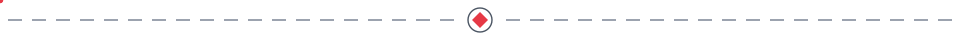
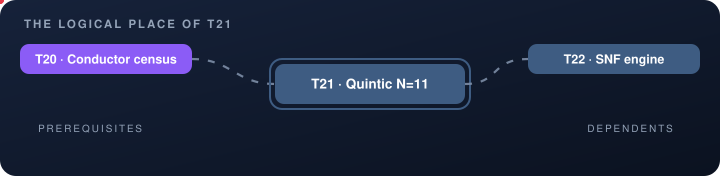
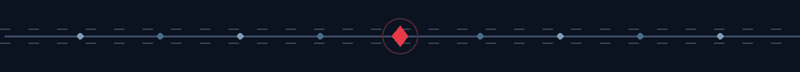

<!-- T21 · generated from scripts/theorems_data.py — edit there, regenerate everywhere -->

# T21 · Certificate K: the cyclic quintic rung N = 11

<p align="center">
  
</p>

<p align="center">
  
</p>

<p align="center">

    

</p>

<p align="center">
  <picture>
    <source media="(prefers-color-scheme: dark)" srcset="../assets/divider-flow-dark.svg">
    
  </picture>
</p>

> **Quintic N=11** — census {11: 45}, g = 45; quintic x⁵+x⁴−4x³−3x²+3x+1, Vieta (−1,−4,3,3,−1), GF(2) irreducible; b_Ch(11): −32y⁵+176y⁴−352y³+308y²−110y+11 (casus irreducibilis quinticus); disc 11⁹ and 11⁴ with SNF (1, 11×9) and (1,11,11,11,11); the C₅-resolvent η ∈ ℤ[ζ₅], branches (2,4,4,1,1) — bit-for-bit with VER-HODGE

## The statement

$$x^5+x^4-4x^3-3x^2+3x+1,\qquad g=45,\;\; \mathrm{disc}=11^9$$

The emblem above is alive: it encodes the five-petal rosette inside an eleven-pointed engraved ring — the same motif that
appears on the engraved cover and in the interactive vitrine.

## 🗂 In this folder

| File | Content |
|---|---|
| [`monograph_EN.pdf`](monograph_EN.pdf) | the full monograph — English (LaTeX/tectonic) |
| [`monograph_RU.pdf`](monograph_RU.pdf) | the full monograph — Russian (LaTeX/tectonic) |
| [`monograph_EN.docx`](monograph_EN.docx) | Word edition, native OMML equations — English |
| [`monograph_RU.docx`](monograph_RU.docx) | Word edition, native OMML equations — Russian |
| [`latex/en/monograph.tex`](latex/en/monograph.tex) | LaTeX source — English |
| [`latex/ru/monograph.tex`](latex/ru/monograph.tex) | LaTeX source — Russian |
| [`stand_t21_n11.py`](stand_t21_n11.py) | the executable verification stand (exit 0 = accepted) |

The DOCX editions are generated from the same LaTeX sources, so the four
documents never diverge in content — a proof edited once appears identically
everywhere. Every monograph follows the uniform six-block scheme: setting,
statement, complete proof, protocol data, summary of what is proved,
and the reproduction guide.

## 📐 The theorem in the program

The quintic rung tops the tower at N=11: census {11:45}, g=45, the quintic x⁵+x⁴−4x³−3x²+3x+1 with a GF(2)-irreducible resolvent, b_Ch(11) as a quintic radical (casus irreducibilis quinticus), disc 11⁹ with SNF (1,11×9), and the C₅-resolvent η∈Z[ζ₅] with branches (2,4,4,1,1). The 17/17 executable stand closes certificate K bit-for-bit with VER-HODGE.

Part VI — The quintic rung and the SNF engine (v1.5/v1.6 slots). Read it in any
order: the monograph is self-sufficient, and every cross-reference below is
navigation, not a prerequisite.

## 🔗 The logical place

<p align="center">
  
</p>

The map is animated: prerequisites flow in from the left, dependents carry
the result onward to the right. The full graph of all 22 theorems lives in
[the collection index](../README.md#-the-dependency-graph).

| ⟵ [**T20 · Conductor census**](T20_conductor_census/) | [⌂ the index](../README.md) | [**T22 · SNF engine**](T22_snf_spectra/) ⟶ |
|:---|:---:|---:|

## 🔬 Verification

| Channel | Entry |
|---|---|
| Laboratory | stand_t21_n11.py (17/17); VER-HODGE cert K |
| Lean block | `— (Lean queue 1)` |
| Exit codes | `0` — accepted · `1` — failure |

Numerically the theorem is verified at 35–70 digits of precision; exactly —
by integer arithmetic or the Lean 4 kernel, whichever the block above names.

## 🖼 The cover

<p align="center">
  <a href="../assets/covers/t21.png"></a>
</p>

Academic Engraving: parchment, sepia linework, gold accents — the emblem of
five-petal rosette inside an eleven-pointed engraved ring. Sized for the PDF title page; embed it as
shown in the [collection index](../README.md#-monograph-covers):

```latex
\titlepage
\includegraphics[width=0.72\textwidth]{../assets/covers/t21.png}
```

[](monograph_EN.pdf) [](monograph_RU.pdf) [](../assets/covers/t21.png)

---

<p align="center">
  
</p>

<p align="center"><sub>HODGE LABORATORY · THE THEOREM MONOGRAPHS ·
<a href="../README.md#-standalone-theorem-monographs">the collection</a> ·
22 studies · 88 documents</sub></p>
