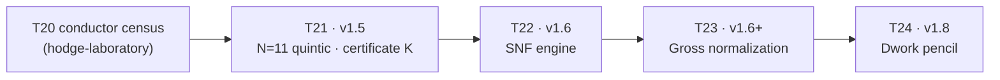

# Monograph slots (T21-T24)

[⬆ VER-HODGE](../README.md) · [⬆ Theorems T01–T20](../../theorems/README.md)

The monograph continues the hodge-laboratory numbering (T01-T20).

| slot | wave | title | status |
|------|------|-------|--------|
| T21 | v1.5 | The N=11 rung: the quintic, the resolvents, certificate K | drafted (this repo, claims C-003) |
| T22 | v1.6 | The SNF engine and the computed polarization types | drafted (C-004, C-005) |
| T23 | v1.6+ | The computed Gross normalization and the sine count | drafted (C-006) |
| T24 | v1.8 | The Dwork pencil: the invariant cohomology and the certified periods | drafted (C-009, C-010, C-011) |
