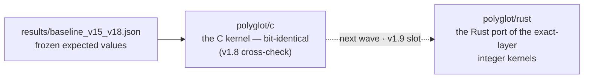

# Rust kernel (polyglot layer)

[⬆ VER-HODGE](../../README.md) · [⬆ polyglot/](../../README.md#layout-mirrors-hodge-laboratory)

The propagation protocol, one picture:

The Rust port of the exact-layer integer kernels (the poly kernels
and the SNF 2x2 repair) is the v1.9 propagation slot: the C kernel
(polyglot/c) carries the bit-identical expected values for v1.8 and
the Rust crate lands with the next wave per the propagation protocol
(docs/ROADMAP.md, §7.6).  The expected values are frozen in
results/baseline_v15_v18.json.
