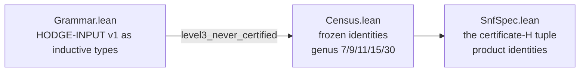

# The Lean 4 layer (WP4)

[⬆ VER-HODGE](../../../README.md) · [⬆ Hodge Laboratory](../../../../README.md) · [⬆ Lean panel of hodge-laboratory](../../../../verification/README.md)

Machine-checked integer facts and the input-grammar specification.
No axioms, no Mathlib (kernel-only `decide`), matching the
hodge-laboratory discipline.

- `Verhodge/Grammar.lean` — the HODGE-INPUT v1 grammar as inductive
  types + the asymmetric contract (level-3 never certified).
- `Verhodge/Census.lean` — the frozen census identities
  (genus 7/9/11/15/30).
- `Verhodge/SnfSpec.lean` — the SNF spec facts (the certificate-H
  tuple, the product identities).

Check: `lake build` (pinned toolchain in `lean-toolchain`).
