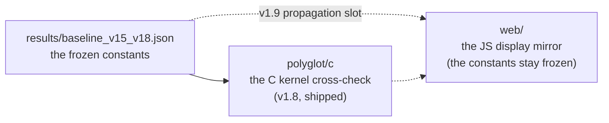

# Web mirror

[⬆ VER-HODGE](../README.md) · [⬆ Hodge Laboratory](../../README.md) · [🧪 Hodge Laboratory Web (live)](https://wild8highlander.github.io/hodge-laboratory-web/) · [♞ Hodge Flow Chess (live)](https://wild8highlander.github.io/hodge-flow-chess/)

The JS display mirror is the v1.9 propagation slot (the constants
are frozen in results/baseline_v15_v18.json).  v1.8 ships the C
kernel cross-check (polyglot/c) per the propagation protocol.

