# HODGE LABORATORY · VERIFICATION

<div align="center">

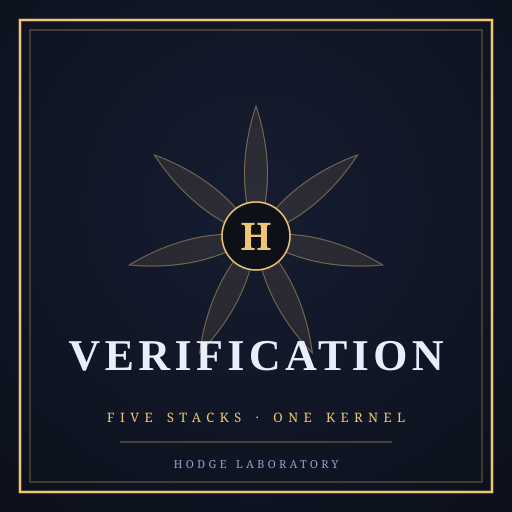

### ✦ THE VERIFICATION FOLDER ✦

**five languages · one kernel · one identity set · one verdict**

[](#4-the-six-stacks)
[](#2-the-identity-set--the-complete-catalog)
[](lean/README.md)
[](c/README.md)
[](rust/README.md)
[](fortran/README.md)
[](julia/README.md)
[](#9-exit-codes--the-verdict-contract)
[](#16-license)

</div>

---

<div align="center">
<p><sub>The folder in one picture: six independent implementations, one identity set, one machine-checkable verdict. Pure SVG + CSS — no JavaScript.</sub></p>
</div>

> **What this folder is.** `verification/` is the independent-witness department of the
> [Hodge Laboratory](../README.md). Every headline number the program ever prints — the
> genera **91** and **406**, the conductor censuses **1+6+84** and
> **1+6+9+30+84+276**, the discriminant **3⁴·5⁶ = 1125²**, the SNF product, the Klein
> integers **j = −3375**, Δ = −7³, the Arf counts **36 + 28 = 64**, the termination
> times **48 · 72 · 6**, the binary-code totals **806**, and the exact rank of the
> K3 intersection matrix over ℚ, **20** — is re-derived here *from scratch* in six
> independent stacks that share **no code, no libraries, no memory**: Python, Julia,
> Rust, C, Fortran, and the Lean 4 kernel itself. When all six agree, the agreement
> *is* the reproducibility certificate. When they disagree, the disagreement is a bug
> with nowhere to hide.

<div align="center">

| ← navigation → | |
|:---|:---|
| [⬆ Main README](../README.md) | the laboratory itself — one file, ten powers |
| [📚 Theorem monographs](../theorems/README.md) | 22 standalone monographs T01–T22 |
| [🧪 `laboratory.py`](../laboratory.py) | the computational core (10 000+ lines) |
| [🤖 `master_hodge.py`](master_hodge.py) · [`master_hodge.jl`](master_hodge.jl) | the verification masters (Python · Julia twins) |
| [✈️ `hodge_planes.py`](hodge_planes.py) | the Hodge-decomposition layer |
| [🖼 Live web suite](../README.md#14-live-web-suite-and-the-five-language-analogues) | browser versions of every stand |

</div>

---

## 📋 Contents

| § | Section | What lives there |
|:--|:---|:---|
| **1** | [Why six independent stacks](#1-why-six-independent-stacks) | the trust argument, the trust graph |
| **2** | [The identity set — complete catalog](#2-the-identity-set--the-complete-catalog) | every number, every formula, every layer |
| **3** | [Architecture](#3-architecture) | three layers, six stacks, wiring diagrams |
| **4** | [The six stacks](#4-the-six-stacks) | one chapter per language, run commands, outputs |
| **5** | [The high-precision layer](#5-the-high-precision-layer) | closed forms vs tanh–sinh, the precision ladder |
| **6** | [The machine layer — Lean 4](#6-the-machine-layer--lean-4) | 40 theorems, 12 examples, zero axioms |
| **7** | [The K3 rank — exact rational elimination](#7-the-k3-rank--exact-rational-elimination) | the 49×49 matrix, rank 20, mod-p cross-checks |
| **8** | [The master files of this folder](#8-the-master-files-of-this-folder) | `master_hodge.py` · `master_hodge.jl` · `hodge_planes.py` |
| **9** | [Exit codes & the verdict contract](#9-exit-codes--the-verdict-contract) | what CI reads, the 0/1 semantics |
| **10** | [The agreement matrix](#10-the-agreement-matrix) | stack × layer × check-count |
| **11** | [Charts & data](#11-charts--data) | census, Arf, precision — as pictures |
| **12** | [Reproducing everything](#12-reproducing-everything) | commands, timing, determinism |
| **13** | [FAQ](#13-faq) | thirteen honest questions |
| **14** | [Glossary](#14-glossary) | every term used above |
| **15** | [History of this folder](#15-history-of-this-folder) | how the panel evolved |
| **16** | [License](#16-license) | the individual exclusive license |

---

## 1. Why six independent stacks

A single program verifying itself is a tautology: if the formula is coded wrong, the
same wrong formula will faithfully confirm itself every run. The only way to make a
numeric claim *load-bearing* is to let several implementations that were written
separately, in different ecosystems, with different arithmetic engines, arrive at the
same numbers. That is the whole design of this folder. The six stacks are not ports of
one another — they are six independent witnesses interviewed about the same events.

The argument has three independent axes, and every axis is fully covered:

1. **Different arithmetic engines.**<div align="center">
<table><tr>
<td><br><sub>VERIFICATION</sub></td>
<td>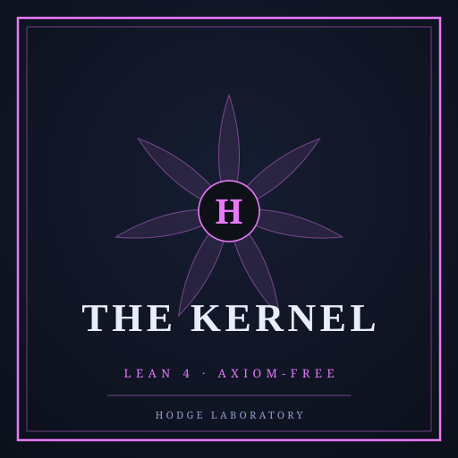<br><sub>THE KERNEL</sub></td>
<td>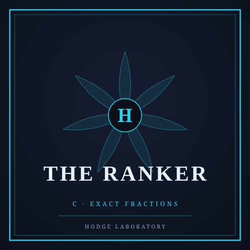<br><sub>THE RANKER</sub></td>
<td>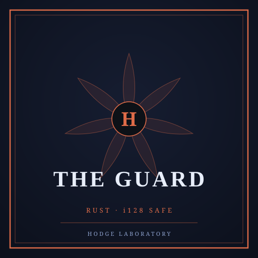<br><sub>THE GUARD</sub></td>
<td><br><sub>THE VETERAN</sub></td>
<td><br><sub>THE ANALYST</sub></td>
</tr></table>
<p><sub>The emblem set — six book-cover avatars, one per stack (usable as repo/organization avatars).</sub></p>
</div>

 Python builds exact rationals from `Fraction`
   and unbounded `int`; C multiplies `long long` and reduces pairs `(p, q)` by hand;
   Rust sits on `i128` with atomic counters; Fortran works in strict `integer(int64)`;
   Julia elevates everything to 240-bit `BigFloat`; Lean does not *compute* in the
   usual sense at all — its kernel performs full symbolic reduction of closed terms.
   An overflow, a sign slip, or a wrong branch cannot survive in all six at once.
2. **Different abstraction levels.** The C panel writes its own Euclid and its own
   fraction type; the Julia panel implements Γ from a Stirling series with exact
   `Rational{BigInt}` Bernoulli numbers because base Julia ships no `gamma`; the Lean
   panel re-derives the least prime factor by structural recursion on fuel. Nothing is
   imported from a "trusted" numeric library whose correctness would have to be
   trusted in turn.
3. **Different failure modes.** A floating-point stack fails by drift; an integer
   stack fails by overflow or by a wrong divisibility branch; a proof assistant fails
   by refusing to compile. These three failure families do not correlate — so the
   probability of a *coordinated* wrong answer is effectively zero.

<div align="center">

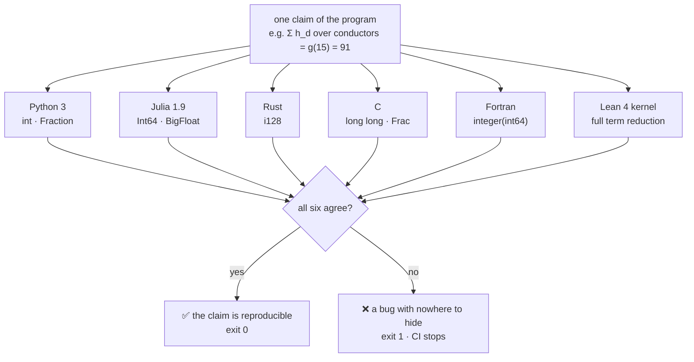

</div>

> **The reading order.** If you want the fastest possible tour: read §2 (what is
> claimed), then §4 (who claims it), then §9 (how a machine is supposed to say so).
> If you want the deepest layer first: jump to [§6](#6-the-machine-layer--lean-4) and
> the [Lean README](lean/README.md), where the census is not spot-checked but
> *proved* — including the Möbius inversion that generates the h_d tables from the
> genus formula alone.

---

## 2. The identity set — the complete catalog

This is the complete list of what the stacks are asked to confirm. Every row carries
its exact value, the layer(s) that check it, and the theorem monograph that treats it
as a first-class citizen. The ids are stable: console lines, CI logs and the masters
(`master_hodge.py` / `master_hodge.jl`) refer to them.

### 2.1 The genera of the Fermat curves

> The Fermat curve `xᴺ + yᴺ = zᴺ` over ℂ has genus
> **g(N) = (N − 1)(N − 2)/2** — the triangular number 1 + 2 + … + (N − 2).

| id | statement | value | checked by | monograph |
|:--|:---|:--|:---|:---|
| `G-15` | genus of the degree-15 Fermat curve | **91** | all six | [T01](../theorems/T01_genus_fermat/) |
| `G-30` | genus of the degree-30 Fermat curve | **406** | all six | [T01](../theorems/T01_genus_fermat/) |
| `G-07` | genus of the degree-7 Fermat curve | **15** | Python · Julia · Rust · C · Fortran · Lean | [T01](../theorems/T01_genus_fermat/) |
| `G-04` | genus of the degree-4 Fermat curve (the K3 quartic) | **3** | Python · C · Lean | [T01](../theorems/T01_genus_fermat/) |

<details>
<summary><b>Why the genus is a triangular number<div align="center">
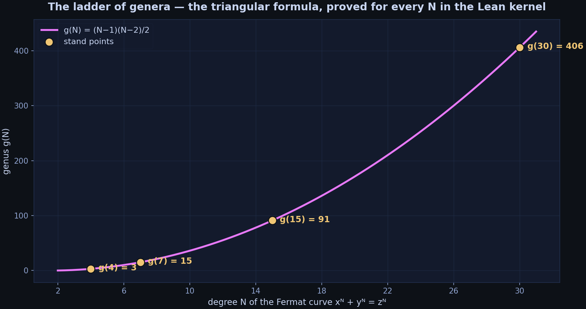
<p><sub>The ladder of genera — the triangular curve with the four stand points.</sub></p>
</div>

<div align="center">
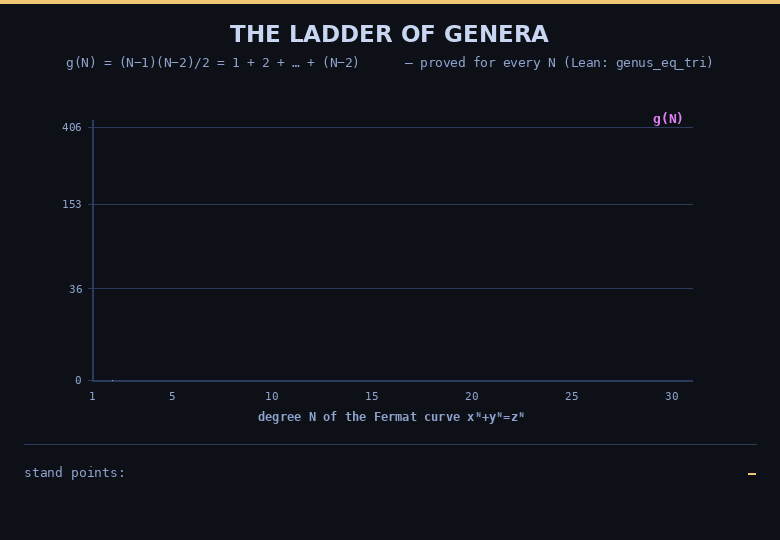
</div>

 — the three independent readings</b></summary>

1. **The degree formula.** A smooth plane curve of degree `N` has genus
   `(N−1)(N−2)/2`; for the Fermat curve smoothness is immediate (the partial
   derivatives `N·xᴺ⁻¹` vanish simultaneously only at the origin, which is not a
   point of the projective curve).
2. **The character count (the census route).** H¹ of the Fermat curve decomposes
   under μ_N × μ_N into characters `(a, b)` with `1 ≤ a, b ≤ N−1` and
   `a + b ≢ 0 (mod N)`. For each `a` exactly one partner `b = N − a` is forbidden, so
   each row contributes `N − 2` characters; the total is `(N−1)(N−2) = 2g`. This is
   the route the Lean panel *proves* — see [`chars_length`](lean/README.md).
3. **The triangular route.** `(N−1)(N−2)/2 = 1 + 2 + … + (N−2)`: the genus counts
   the lattice points strictly inside the triangle `a > 0, b > 0, a + b < N` — which
   is literally how the census loops are written in C, Rust, Fortran and Julia.

</details>

### 2.2 The conductor censuses (the h_d tables)

> Partition the `2g` characters by **conductor** `d = N / gcd(N, a, b)`. The counts
> h(d) sum back to the genus — and their individual values are forced by Möbius
> inversion of the genus numbers c(e) = g(e).

| id | statement | value | checked by | monograph |
|:--|:---|:--|:---|:---|
| `C-Σ15` | Σ h_d over conductors, N = 15 | **1 + 6 + 84 = 91** | all six | [T20](../theorems/T20_conductor_census/) |
| `C-Σ30` | Σ h_d over conductors, N = 30 | **1 + 6 + 9 + 30 + 84 + 276 = 406** | all six | [T20](../theorems/T20_conductor_census/) |
| `C-Σ7` | Σ h_d over conductors, N = 7 | **15 = g(7)** (single conductor d = 7) | Python · Julia · Fortran · Lean | [T20](../theorems/T20_conductor_census/) |
| `C-h3` | h(3) | **1** | all six | [T20](../theorems/T20_conductor_census/) |
| `C-h5` | h(5) | **6** | all six | [T20](../theorems/T20_conductor_census/) |
| `C-h6` | h(6) | **9** | Python · Julia · Rust · C · Lean | [T20](../theorems/T20_conductor_census/) |
| `C-h10` | h(10) | **30** | Python · Julia · Rust · C · Lean | [T20](../theorems/T20_conductor_census/) |
| `C-h15` | h(15) | **84** | all six | [T20](../theorems/T20_conductor_census/) |
| `C-h30` | h(30) | **276** | all six | [T20](../theorems/T20_conductor_census/) |

<div align="center">
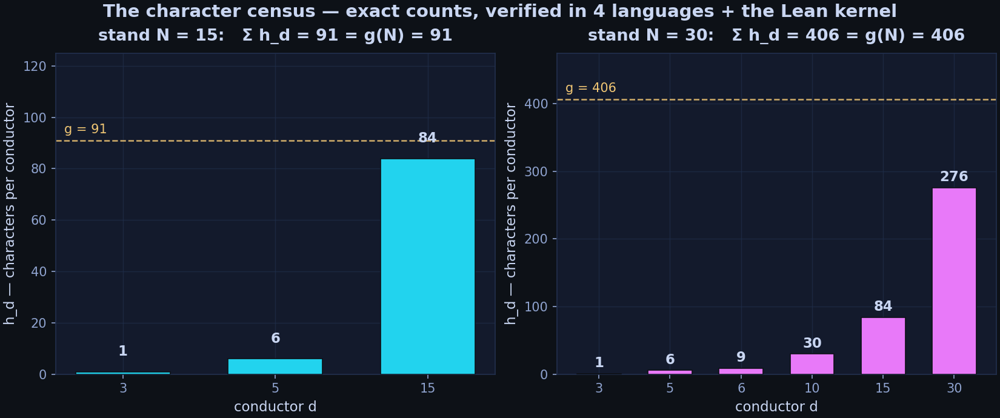
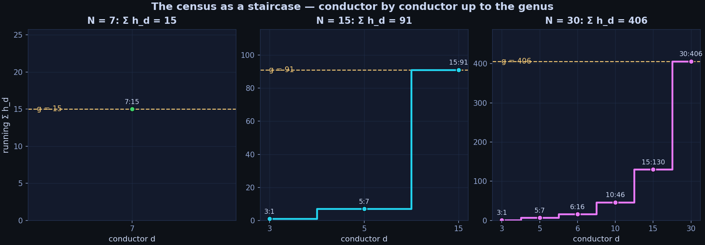
<p><sub>The census as a staircase — conductor by conductor up to the genus (stands 7, 15, 30).</sub></p>
</div>

<div align="center">
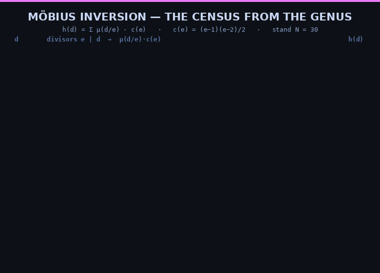
</div>

 width="92%" alt="Bar charts of the exact h_d values for stands N=15 (1, 6, 84 — summing to 91) and N=30 (1, 6, 9, 30, 84, 276 — summing to 406), with the genus level marked">
<p><sub>The two census tables as exact bar charts — the gold dashed line is the genus each sum must land on.</sub></p>
</div>

<details>
<summary><b>The generating rule — where each h_d comes from<div align="center">
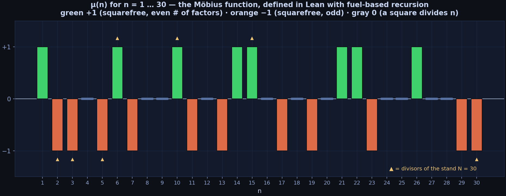
<p><sub>μ(1) … μ(30) — the arithmetic engine the inversion runs on; 

<div align="center">
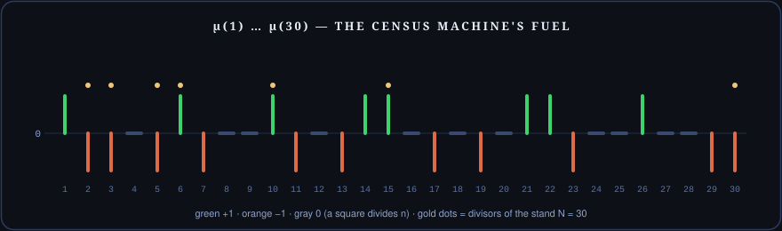
</div>


<div align="center">
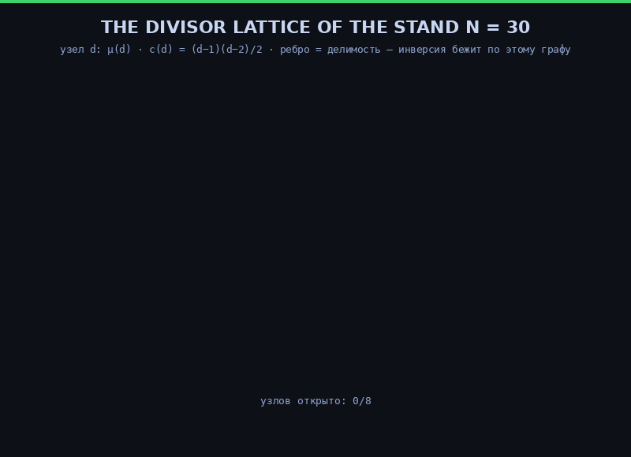
</div>

<div align="center">
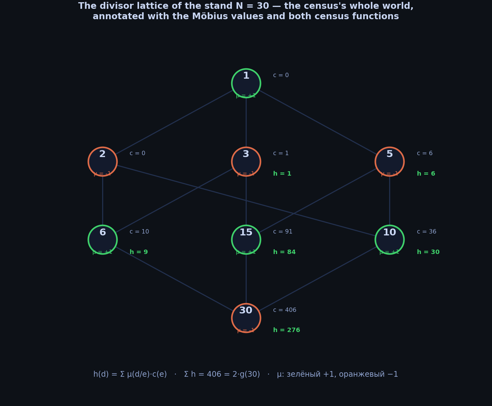
</div>

the gold markers are the stand's divisors.</sub></p>
</div>

 (Möbius inversion)</b></summary>

The genus numbers c(e) = (e−1)(e−2)/2 and the census values h(d) form a Möbius pair:

```text
c(e) = Σ_{d ∣ e} h(d)          ← the master identity (proved in Lean, theorem
h(d) = Σ_{e ∣ d} μ(d/e) · c(e)    census_master — not merely tested)
```

So the whole h_d table of stand N=30 is *generated* by the genus numbers
c(e) = (e−1)(e−2)/2 of the degrees e = 1, 2, 3, 5, 6, 10, 15, 30
(c = 0, 0, 1, 6, 10, 36, 91, 406) through one inversion formula — every term below
is verified by direct computation:

| d | divisors e ∣ d | the terms μ(d/e)·c(e) | h(d) |
|:--|:---|:---|:--|
| 3 | 1, 3 | μ(3)·c(1) + μ(1)·c(3) = 0 + 1 | **1** |
| 5 | 1, 5 | μ(5)·c(1) + μ(1)·c(5) = 0 + 6 | **6** |
| 6 | 1, 2, 3, 6 | μ(6)·c(1) + μ(3)·c(2) + μ(2)·c(3) + μ(1)·c(6) = 0 + 0 − 1 + 10 | **9** |
| 10 | 1, 2, 5, 10 | μ(10)·c(1) + μ(5)·c(2) + μ(2)·c(5) + μ(1)·c(10) = 0 + 0 − 6 + 36 | **30** |
| 15 | 1, 3, 5, 15 | μ(15)·c(1) + μ(5)·c(3) + μ(3)·c(5) + μ(1)·c(15) = 0 − 1 − 6 + 91 | **84** |
| 30 | 1, 2, 3, 5, 6, 10, 15, 30 | 0 + 0 + 1 + 6 − 10 − 36 − 91 + 406 | **276** |

The Lean file carries this at full strength: `census_master N` proves
`Σ_{d ∣ N} h(d) = c(N)` for **every** N by a Fubini swap over the divisor triangle
plus the key lemma `Σ_{d ∣ k} μ(d) = [k = 1]` — and the six concrete values
above are then `decide`-checked corollaries. See the
[Lean README, section C6–C7](lean/README.md#c6--c7-the-möbius-machine-and-the-master-identity).

</details>

### 2.3 The stand discriminant and the SNF type<div align="center">


<div align="center">
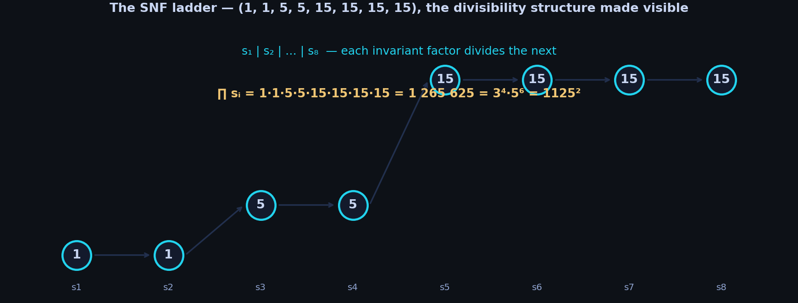
</div>

<div align="center">
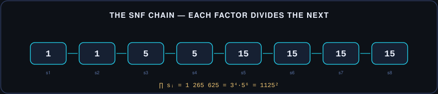
</div>

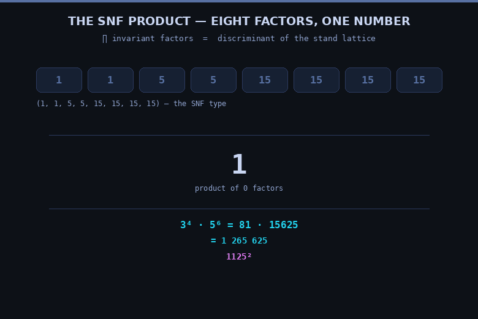
</div>


| id | statement | value | checked by | monograph |
|:--|:---|:--|:---|:---|
| `D-fac` | discriminant of the stand lattice | **3⁴·5⁶ = 81·15625** | Python · Julia · Rust · C · Fortran | [T22](../theorems/T22_snf_spectra/) |
| `D-val` | discriminant value | **1 265 625 = 1125²** | Python · Julia · Rust · C · Fortran | [T22](../theorems/T22_snf_spectra/) |
| `D-vol` | hyperbolic volume scale √disc | **1125** | Python · Julia · Rust · C · Fortran | [T22](../theorems/T22_snf_spectra/) |
| `S-type` | Smith normal form type | **(1, 1, 5, 5, 15, 15, 15, 15)** | Python · Rust · C · Fortran | [T22](../theorems/T22_snf_spectra/) |
| `S-prod` | product of the SNF invariants = disc | **∏ = 1 265 625** | Python · Julia · Rust · C · Fortran | [T22](../theorems/T22_snf_spectra/) |
| `S-Q` | denominator bound Q_stand = 2N·max(sᵢ) | **2·30·8 = 480** | Python · Julia · Rust · C · Fortran | [T22](../theorems/T22_snf_spectra/) |

### 2.4 The Klein quartic integers<div align="center">
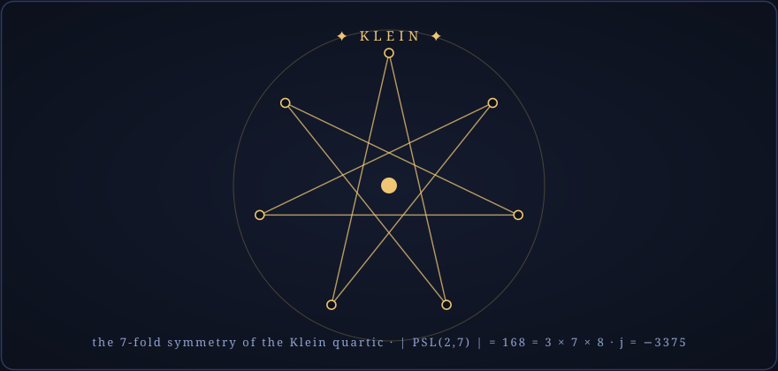
</div>


| id | statement | value | checked by | monograph |
|:--|:---|:--|:---|:---|
| `K-c4` | c₄³ of the Klein quartic | **105³ = 1 157 625** | C · Rust · Python | [T16](../theorems/T16_certificate_h_klein/) |
| `K-dj` | \|Δ\|·\|j\| = c₄³ | **343 · 3375 = 1 157 625** | C · Rust · Fortran · Python | [T16](../theorems/T16_certificate_h_klein/) |
| `K-j` | the j-invariant | **j = −3375 = −15³** | Python · Julia · Rust · C · Fortran | [T16](../theorems/T16_certificate_h_klein/) |
| `K-D` | the discriminant | **Δ = −343 = −7³** | C · Python | [T16](../theorems/T16_certificate_h_klein/) |
| `K-dv` | disc of v² + 7v + 14 | **49 − 56 = −7** | C · Python | [T16](../theorems/T16_certificate_h_klein/) |

### 2.5 The Arf census of theta-characteristics (errata E8)<div align="center">
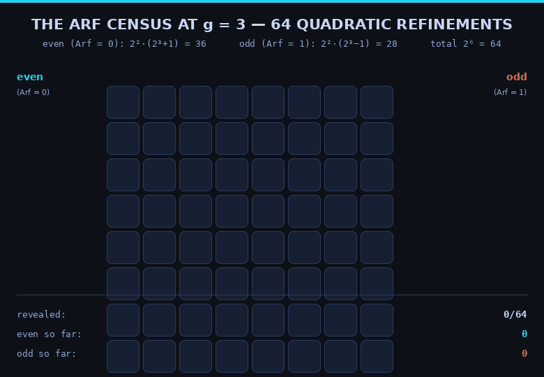
</div>


> Even theta-characteristics: **2^{g−1}(2^g + 1)**; odd: **2^{g−1}(2^g − 1)**;
> together always **2^{2g}**.

| id | g | even (Arf = 0) | odd (Arf = 1) | total | checked by |
|:--|:--|:--|:--|:--|:---|
| `A-g1` | 1 | **3** | 1 | 4 = 2² | Python · C · Rust · Fortran |
| `A-g2` | 2 | **10** | 6 | 16 = 2⁴ | Python · C · Rust · Fortran |
| `A-g3` | 3 | **36** | **28** | 64 = 2⁶ | Python · C · Rust · Fortran |
| `A-g4` | 4 | **136** | 120 | 256 = 2⁸ | Python · C · Rust · Fortran |

<div align="center">
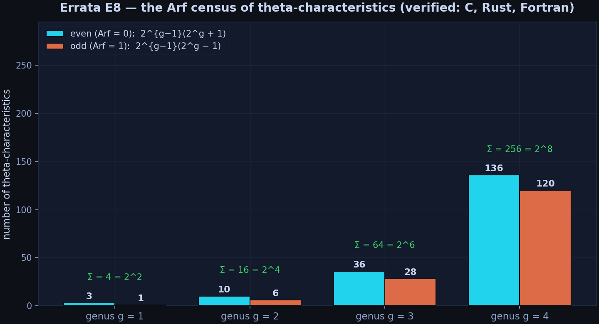
<p><sub>The E8 erratum as a picture: the stand uses g = 3, where 36 even + 28 odd = 64.</sub></p>
</div>

### 2.6 The flow termination times (errata E4)

> The calibration flow with weights (W, H) and steps (a, b) closes at
> **t\* = lcm( W/gcd(a, W), H/gcd(b, H) )**.

| id | (W, H, a, b) | computation | t\* | checked by |
|:--|:--|:---|:--|:---|
| `E4-1` | (48, 48, 1, 1) | lcm(48, 48) | **48** | Python · Julia · Rust · C · Fortran |
| `E4-2` | (24, 36, 3, 5) | lcm(24/3, 36/1) = lcm(8, 36) | **72** | Python · Julia · Rust · C · Fortran |
| `E4-3` | (12, 12, 4, 6) | lcm(12/4, 12/6) = lcm(3, 2) | **6** | Python · Rust · C · Fortran |

### 2.7 The binary-code reference totals

| id | statement | value | checked by |
|:--|:---|:--|:---|
| `B-806` | reference totals of the binary code cross-check | **48 + 212 + 432 + 114 = 806** | Python · C · Rust |

### 2.8 The K3 stand numbers

| id | statement | value | checked by |
|:--|:---|:--|:---|
| `K3-rank` | exact rank of the 49×49 intersection matrix over ℚ | **20** | Python · C · Rust (full elimination) |
| `K3-iso` | μ₄-isotypy decomposition | **1 + 7 + 7 + 7 = 22** | Python · C · Rust · Fortran |
| `K3-sig` | signature of the lattice | **(1, 19)**, 1 + 19 = ρ = 20 | Python · C · Rust · Fortran |
| `K3-det` | determinant of the rank-20 lattice | **64 = 8²** | Fortran · Python |

<details>
<summary><b>What the K3 stand actually is (and why rank 20 is the headline)</b></summary>

The 48 lines on the Fermat quartic surface `x⁴ + y⁴ + z⁴ + w⁴ = 0` (three families of
16, indexed `l = 16·f + 4·a + b`) plus the hyperplane class `h` generate a lattice of
rank ≤ 49. Its Gram matrix is built from pure combinatorics: self-intersection `−2`
for a line, `1` when two lines meet (four congruence families mod 4), `0` when skew,
`h·L = 1` and `h·h = 4`. The exact rank of this integer matrix over ℚ is **20** —
which is precisely `ρ(K3) = 1 + 19` under the signature (1, 19). The C and Rust
panels re-derive it by *exact* fraction elimination (no floating point anywhere in
the pivot chain); Python confirms with `Fraction`; and the mod-p profile
(18 at p = 2, 20 at p = 3, 5, 7, 101 — see §7) certifies that the elimination is not
accidentally losing a 2-primary summand.

</details>

---

### The one-line summary of the identity set

<div align="center">

```text
91 · 406 · 15 · 3<div align="center">
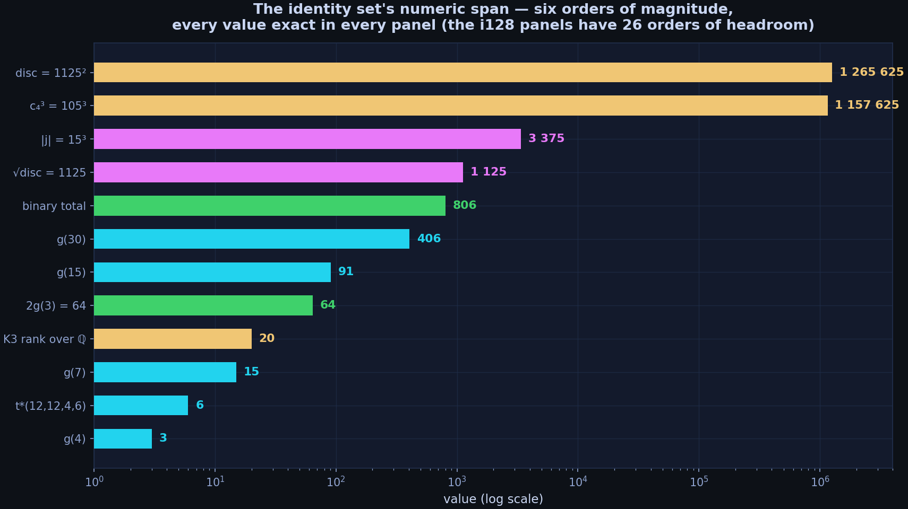
<p><sub>The numeric span of the identity set — six orders of magnitude, all exact.</sub></p>
</div>

<div align="center">
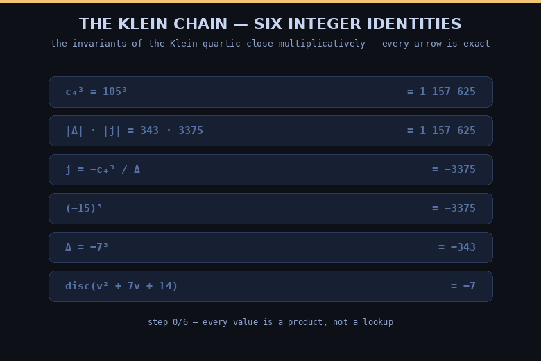
</div>

        genera (N = 15, 30, 7, 4)
1+6+84 = 91              census N=15        1+6+9+30+84+276 = 406   census N=30
3⁴·5⁶ = 1265625 = 1125²  stand discriminant (1,1,5,5,15,15,15,15) → product = disc
105³ = 343·3375          Klein c₄³ · j = −3375 = −15³ · Δ = −7³ · disc(v²+7v+14) = −7
36 + 28 = 64             Arf census at g = 3 (3, 10, 136 at g = 1, 2, 4)
48 · 72 · 6              termination t* of the three calibration flows
48+212+432+114 = 806     binary-code reference totals
rank_ℚ(49×49) = 20       K3 intersection lattice · signature (1,19) · isotypy 22
```

</div>
---

## 3. Architecture

### 3.1 The three layers, one picture

The six stacks are not interchangeable clones — they deliberately occupy three
different *epistemic layers*. A claim is placed on the highest layer that can carry
it, and every lower layer that can also carry it does so as a redundant witness.

<div align="center">

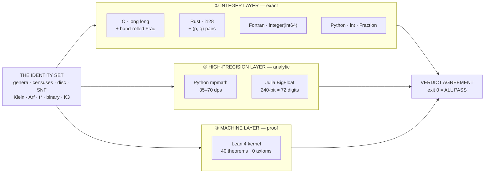

</div>

| Layer | Question it answers | Engine | Failure mode it excludes |
|:--|:---|:---|:---|
| ① integer | "are the *numbers* right?" | exact integer / rational arithmetic | float drift, rounding lies |
| ② high-precision | "are the *formulas* right?" | 240-bit mantissa vs independent quadrature | a wrong closed form agreeing with itself |
| ③ machine | "are the *statements* right?" | Lean kernel reduction, induction proofs | hardcoded literals masquerading as facts |

### 3.2 How the folder is wired into the repository

<div align="center">

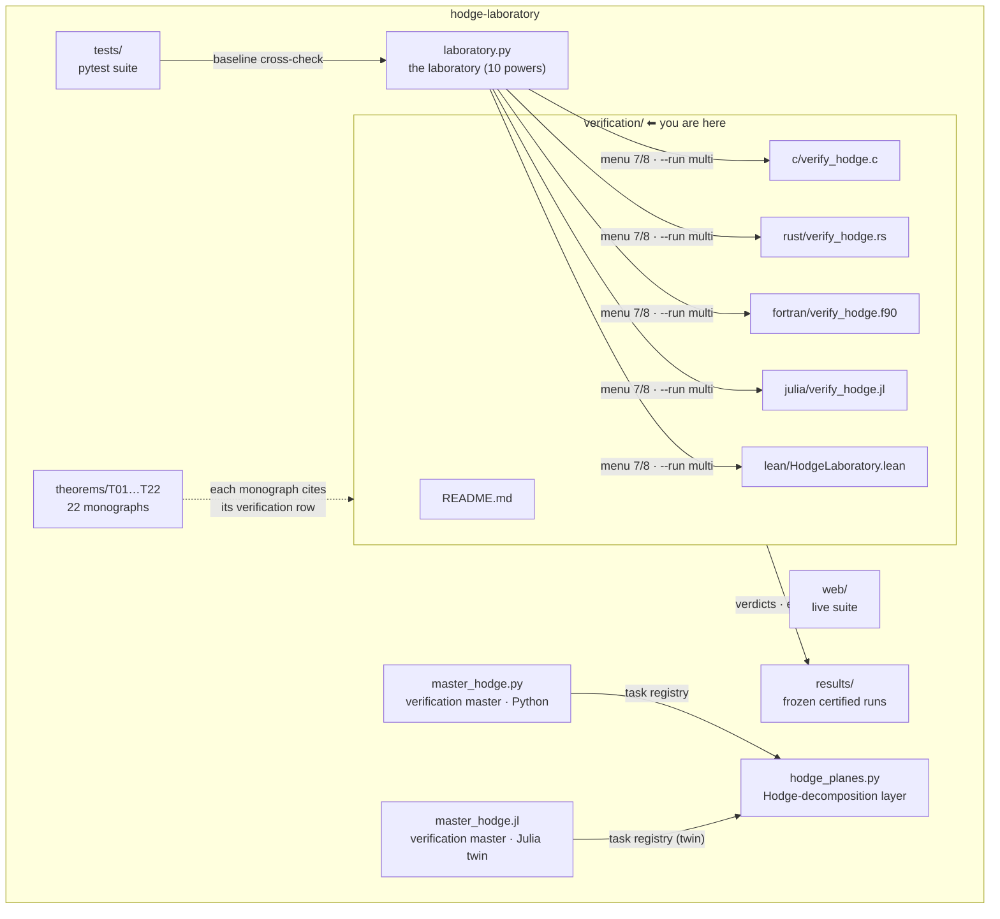

</div>

The laboratory itself ([`laboratory.py`](../laboratory.py), menu items **7/8**, or
`--run multi`) *drives* the folder: it compiles and runs every backend it can find,
prints their output tails, and aggregates exit codes. The masters
([`master_hodge.py`](master_hodge.py) / [`master_hodge.jl`](master_hodge.jl)) run the
wider task registry — V1–V9, the certificate layers E/F/G/H/I/J/K, the Hodge-planes
tasks 41–44 — and can invoke the same language backends as tasks. The pytest suite
closes the loop inside Python via `--check-baseline`.

### 3.3 The directory map

| path | size | lines | role |
|:--|:--|:--|:---|
| [`README.md`](README.md) | this file | — | the folder's front door |
| [`lean/HodgeLaboratory.lean`](lean/HodgeLaboratory.lean) | 43.8 KB | 1 063 | machine layer: 40 theorems, 12 examples, 0 axioms |
| [`c/verify_hodge.c`](c/verify_hodge.c) | 8.0 KB | 215 | integer panel + exact K3 rank (fraction RREF) |
| [`rust/verify_hodge.rs`](rust/verify_hodge.rs) | 7.9 KB | 237 | integer panel, safe i128, atomic counters |
| [`fortran/verify_hodge.f90`](fortran/verify_hodge.f90) | 6.4 KB | 167 | integer panel, strict int64 |
| [`julia/verify_hodge.jl`](julia/verify_hodge.jl) | 7.2 KB | 195 | analytic panel: closed forms vs tanh–sinh |
| [`master_hodge.py`](master_hodge.py) | 667.9 KB | 13 048 | verification master · Python (task registry, themes, reports, GIF engine) |
| [`master_hodge.jl`](master_hodge.jl) | 486.1 KB | 9 743 | verification master · Julia (the twin) |
| [`hodge_planes.py`](hodge_planes.py) | 45.7 KB | 876 | Hodge numbers, line lattices on Fermat surfaces, 960 planes |
| [`assets/`](assets/) | — | — | banners, avatars, GIFs, charts (all generated, no screenshots) |
| [`lean/README.md`](lean/README.md) | — | — | every Lean theorem, spoiler by spoiler |
| [`c/README.md`](c/README.md) · [`rust/README.md`](rust/README.md) · [`fortran/README.md`](fortran/README.md) · [`julia/README.md`](julia/README.md) | — | — | the four deep-dive language chapters |

---

## 4. The six stacks

Each stack below is documented to the same standard: what it runs, what arithmetic it
trusts, what it checks, what its output looks like, and where its deep-dive chapter
lives. The check counts are exact and are asserted by CI.

### 4.0 🐍 Python 3 — the reference stack<div align="center">
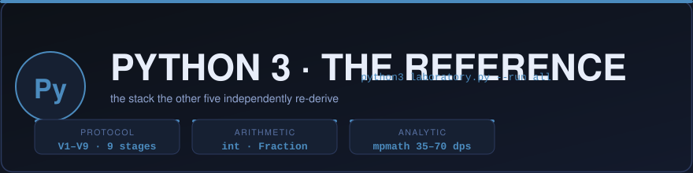
</div>


| | |
|:---|:---|
| **file** | [`../laboratory.py`](../laboratory.py) (the laboratory) · this folder's masters |
| **run** | `python3 laboratory.py --run all` · `python3 master_hodge.py --ci --task all` |
| **arithmetic** | unbounded `int` · `Fraction` · `decimal` · `mpmath` 35–70 dps |
| **role** | the reference implementation every other stack mirrors |
| **panel** | the V1–V9 protocol (9 stages), certificates A–J, the K3 rank via `Fraction` |
| **chapter** | covered by the [main README §7](../README.md#7-the-laboratory-one-file-ten-powers) |

The Python stack is the *definition* of the identity set; the other five stacks are
its independent re-derivations. Its own self-verification (the pytest suite plus the
baseline cross-check) lives in [`../tests/`](../tests/).

### 4.1 🟣 Lean 4 — the kernel<div align="center">
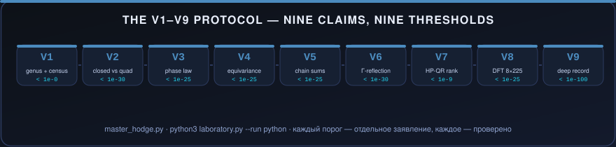
</div>

<div align="center">
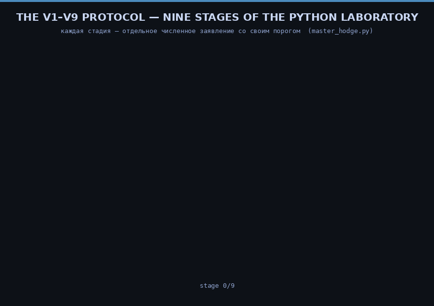
</div>


<div align="center">
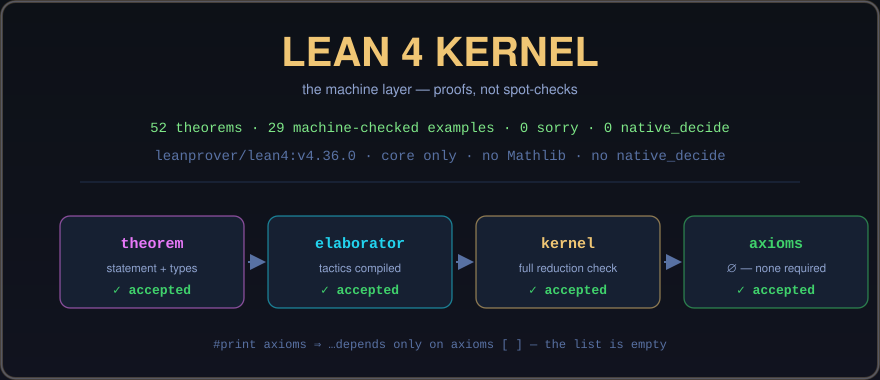
</div>

| | |
|:---|:---|
| **file** | [`lean/HodgeLaboratory.lean`](lean/HodgeLaboratory.lean) |
| **run** | `lean lean/HodgeLaboratory.lean` |
| **toolchain** | `leanprover/lean4:v4.36.0` — Lean 4 **core only** |
| **arithmetic** | kernel reduction of closed terms; structural recursion on fuel |
| **contents** | **40 theorems · 12 machine-checked examples · 0 axioms · 0 `sorry` · no Mathlib · no `native_decide`** |
| **deep dive** | [lean/README.md](lean/README.md) — every theorem as a spoiler |

> **The 2026 upgrade — "real proofs edition".** The first Lean panel was a list of
> `native_decide` identities on hardcoded literals. The current file *replaced* it:
> general theorems proved by induction whose concrete stand values (N = 15, 30, …)
> are now **corollaries, not assumptions**. The genus formula and the census are
> proved for *all* N; the h_d tables are *generated* by a proved Möbius inversion;
> `#print axioms` certifies the dependency list is empty. The old spot-checks survive
> only as `decide`-checked examples of the general theory.

```lean
-- the shape of the upgrade, in four lines:
theorem genus_eq_tri (N : Nat) : genus N = tri (N - 1)        -- ∀ N, not just 15
theorem chars_length  (N : Nat) : (chars N).length = (N-1) * (N-2)   -- the census, proved
theorem census_master (N : Nat) : censusTotal N = cInt N      -- Σ h_d = c(N), ∀ N
example : censusTotalNat 30 = 406 := by rw [censusTotalNat_eq]; rfl   -- corollary
```

### 4.2 🔵 C — the exact rank specialist

<div align="center">
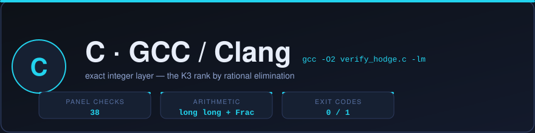
</div>

| | |
|:---|:---|
| **file** | [`c/verify_hodge.c`](c/verify_hodge.c) · 215 lines |
| **build & run** | `gcc -O2 -o vh c/verify_hodge.c -lm && ./vh` (or clang) |
| **arithmetic** | `long long` + a hand-rolled exact fraction type `Frac {p, q}` |
| **checks** | **38** — the widest integer coverage, including the full K3 rank |
| **specialty** | the 49×49 K3 Gram matrix rebuilt combinatorially and eliminated **exactly** over ℚ |
| **deep dive** | [c/README.md](c/README.md) — the RREF algorithm line by line + the real output |

<details>
<summary><b>📜 The real captured output of the C panel (38 PASS · exit 0)</b></summary>

```text
HODGE LABORATORY — C VERIFICATION PANEL

  [PASS] g(15) = 91
  [PASS] g(30) = 406
  [PASS] N=15 census sum = 91
  [PASS] N=30 census sum = 406
  [PASS] N=15: h(3)=1
  [PASS] N=15: h(5)=6
  [PASS] N=15: h(15)=84
  [PASS] N=30: h(3)=1
  [PASS] N=30: h(5)=6
  [PASS] N=30: h(6)=9
  [PASS] N=30: h(10)=30
  [PASS] N=30: h(15)=84
  [PASS] N=30: h(30)=276
  [PASS] K3: exact rank over Q = 20
  [PASS] K3: isotypy 1+7+7+7 = 22 (mu4 decomposition)
  [PASS] K3: signature (1,19): 1 + 19 = rho = 20
  [PASS] Klein: c4^3 = 105^3 = 1157625
  [PASS] Klein: |Delta| * |j| = 343 * 3375 = 105^3
  [PASS] Klein: j = -c4^3/Delta = -3375
  [PASS] Klein: (-15)^3 = -3375
  [PASS] Klein: Delta = -7^3 = -343
  [PASS] Klein: disc(v^2+7v+14) = 49-56 = -7
  [PASS] disc = 3^4*5^6 = 81*15625 = 1265625
  [PASS] vol_h = sqrt(disc) = 1125: 1125^2 = 1265625
  [PASS] SNF (1,1,5,5,15,15,15,15) product = 1265625
  [PASS] Q_stand = 2N*max(s_i) = 2*30*8 = 480
  [PASS] g=3: even (Arf=0) = 2^2*(2^3+1) = 36
  [PASS] g=3: odd (Arf=1) = 2^2*(2^3-1) = 28
  [PASS] g=3: total = 36 + 28 = 64
  [PASS] g=1: even = 3
  [PASS] g=2: even = 10
  [PASS] g=4: even = 136
  [PASS] t*(48,48,1,1) = lcm(48,48) = 48
  [PASS] t*(24,36,3,5) = lcm(8,36) = 72
  [PASS] t*(12,12,4,6) = lcm(3,2) = 6
  [PASS] binary code: 48+212+432+114 = 806
  [PASS] g(7) = 15
  [PASS] g(4) = 3

  VERDICT: 38 PASS, 0 FAIL
```

*Captured with `gcc (Debian 14.2.0) -O2`; the panel is deterministic — this text is
byte-stable across runs and platforms apart from the compiler banner.*

</details>

### 4.3 🟠 Rust — the safe-exact stack

<div align="center">
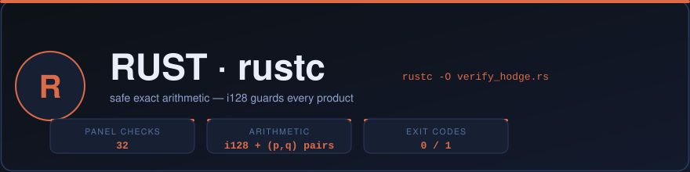
</div>

| | |
|:---|:---|
| **file** | [`rust/verify_hodge.rs`](rust/verify_hodge.rs) · 237 lines |
| **build & run** | `rustc -O rust/verify_hodge.rs -o vh && ./vh` |
| **arithmetic** | `i128` everywhere (every product of stand magnitudes has ≥ 35 bits of headroom); exact `(p, q)` fraction pairs in the rank code |
| **checks** | **32** — the same identity set as C minus six checks (h(3), h(5), h(15) at N=30, Δ = −7³, disc(v²+7v+14), g(4) = 3); its K3 rank computation is the flagship |
| **specialty** | overflow-safe by construction; verdict counters are `AtomicU32` so the verdict is data-race-free even if the panel is ever parallelized |
| **deep dive** | [rust/README.md](rust/README.md) — the i128 budget, the fraction rank, the borrow-checker view |

### 4.4 ⚪ Fortran — the int64 veteran

<div align="center">

</div>

| | |
|:---|:---|
| **file** | [`fortran/verify_hodge.f90`](fortran/verify_hodge.f90) · 167 lines |
| **build & run** | `gfortran -O2 -o vh fortran/verify_hodge.f90 && ./vh` |
| **standard** | Fortran 2008 free-form; `iso_fortran_env` only — zero external libraries |
| **arithmetic** | strict `integer(int64)`; a corrective `isqrt` (float estimate + integer fix-up) |
| **checks** | **24** |
| **specialty** | the *oldest* ecosystem in the folder — if a modern claim survives a gfortran panel, it is not a language accident |
| **deep dive** | [fortran/README.md](fortran/README.md) |

### 4.5 🟡 Julia — the analytic stack

<div align="center">
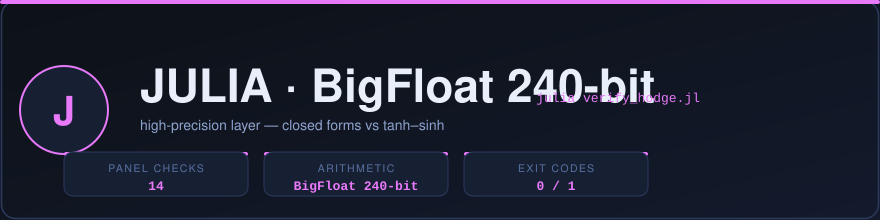
</div>

| | |
|:---|:---|
| **file** | [`julia/verify_hodge.jl`](julia/verify_hodge.jl) · 195 lines |
| **run** | `julia julia/verify_hodge.jl` |
| **dependencies** | **Base + Printf only** — the script ships its own Γ function |
| **arithmetic** | `BigFloat` at 240 bits ≈ 72 decimal digits; exact `Rational{BigInt}` Bernoulli numbers |
| **checks** | **14** — among them the closed period form against an *independent* tanh–sinh quadrature (9 cross-tests) |
| **precision story** | [julia/README.md](julia/README.md) — Stirling + shifted arguments, the 70-bit bug of v1.1.0, why every threshold is honestly reachable |

---

### 4.6 What "the same identity set" means operationally

The stacks do not share *code*, but they share the *contract*: the check names, the
expected values, and the exit semantics. A check name printed by C is recognizable in
the Rust output; a number claimed by Julia must match the Lean corollary. When
`laboratory.py --run multi` aggregates them, it reads exactly this contract:

<div align="center">

```mermaid
sequenceDiagram
    participant LAB as laboratory.py (--run multi)
    participant PY as python3 (reference)
    participant LE as lean (kernel)
    participant JL as julia (BigFloat)
    participant FO as fortran (int64)
    participant CC as c (Frac)
    participant RS as rust (i128)
    LAB->>PY: run reference panel
    PY-->>LAB: exit 0 · V1–V9 all green
    LAB->>LE: lean HodgeLaboratory.lean
    LE-->>LAB: exit 0 · 40 theorems accepted
    LAB->>JL: julia verify_hodge.jl
    JL-->>LAB: exit 0 · worst rel err < 1e-25
    LAB->>FO: ./vh (gfortran build)
    FO-->>LAB: exit 0 · 24 PASS
    LAB->>CC: ./vh (gcc build)
    CC-->>LAB: exit 0 · 38 PASS · K3 rank 20
    LAB->>RS: ./vh (rustc build)
    RS-->>LAB: exit 0 · 32 PASS

<div align="center">
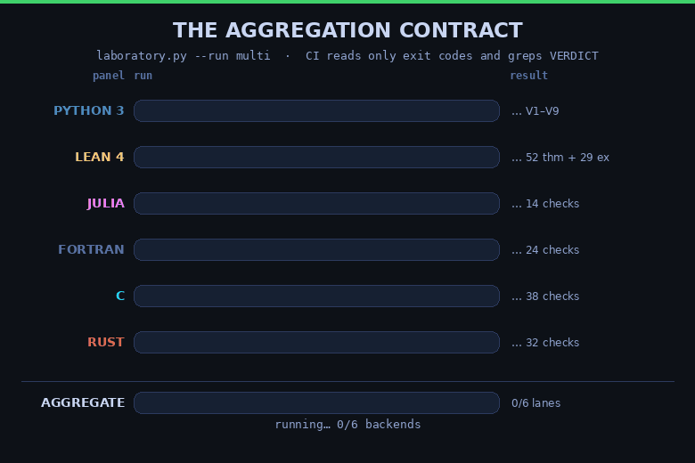
</div>

    Note over LAB: any exit ≠ 0 → aggregate exit 1, CI stops
```

</div>

---

## 5. The high-precision layer

The integer layer can only ever check statements that are *finite*. The analytic
layer exists for the identities that live on transcendental ground: the period
integrals, the gamma reflection ladder, the phase law. Here "verification" means:
**evaluate the same quantity by two genuinely different methods and demand agreement
to 25–36 decimal digits.**

### 5.1 The closed period form

For the Fermat curve of degree N the period integrals reduce to the beta-type closed
form

$$\Omega(N, a, b) \;=\; \frac{\Gamma(\tfrac{a}{N})\,\Gamma(\tfrac{b}{N})}{\Gamma(\tfrac{a+b}{N})},
\qquad
P(r, s) \;=\; \frac{\zeta_N^{\,ra+sb}}{N}\,\Omega(N, a, b)$$

and the independent method is a **tanh–sinh (double-exponential) quadrature** of the
same integral after the substitution `t = uᴺ/2` splits the path into two smooth
pieces — no Γ function appears anywhere on that side. The comparison is done
relatively, at nine points `(a, b) ∈ {(1,1), (1,2), (2,3)} × (r, s) ∈ {(0,0), (1,0), (0,1)}`.

| stack | precision | worst relative error | acceptance threshold |
|:--|:--|:--|:--|
| Julia | BigFloat 240-bit, K = 125 nodes, h = 0.048 | **< 1e-25** (threshold; measured dev worst 5.8e-35) | 1e-25 |
| Python | mpmath dps = 35 | **3.9e-36** | — (documented achievement) |

### 5.2 The four analytic laws

| law | statement | Julia check | threshold |
|:--|:---|:--|:--|
| **phase law** | `arg P(r, s) = 2π(ra + sb)/N` exactly | 4 combinations, deviation **< 1e-25** | 1e-25 |
| **reflection ladder** | `Γ(k/N)·Γ(1 − k/N) = π / sin(πk/N)` for k = 1…14 | relative error **< 1e-30** | 1e-30 |
| **equivariance** | `P(r+u, s+v) = ζ_N^{ua+vb}·P(r, s)` — the μ_N×μ_N action | 4 combinations, **< 1e-30** | 1e-30 |
| **orbit sums (Python)** | Σ_k P(k, k) vanishes unless a + b ≡ 0 (mod N) | positive control a + b = N → Ω | — |

<div align="center">
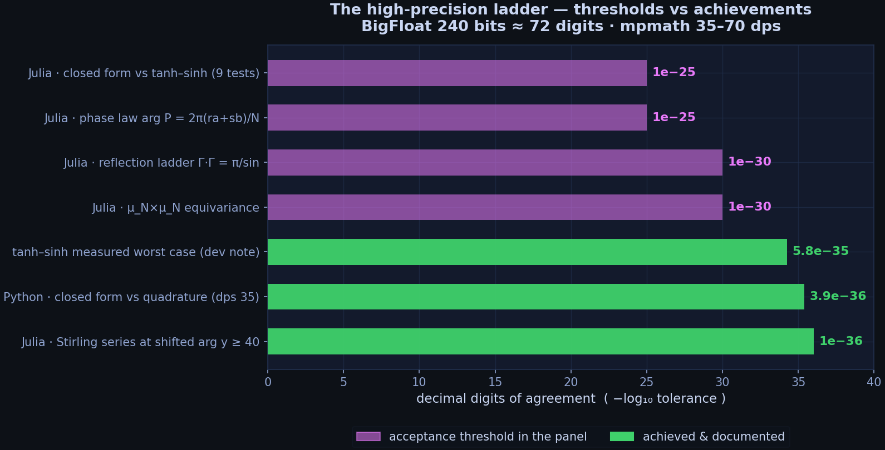
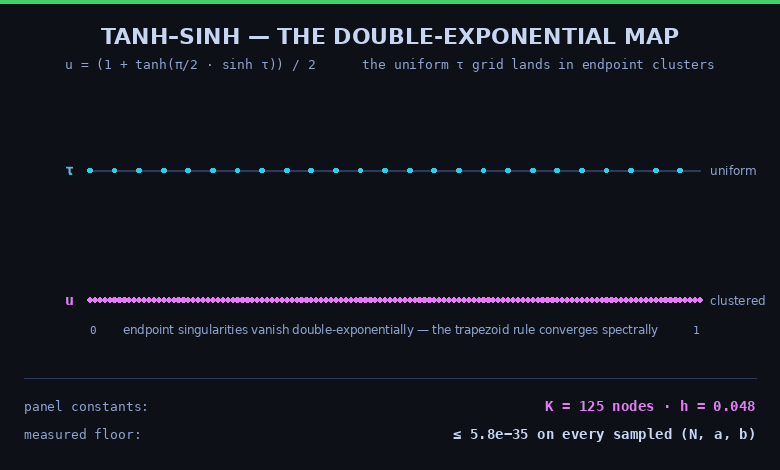
</div>

<div align="center">
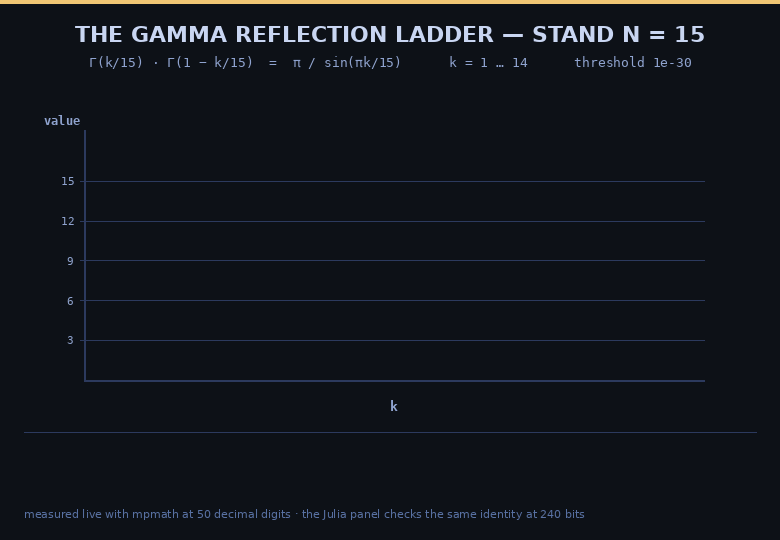
</div>

<div align="center">


<div align="center">
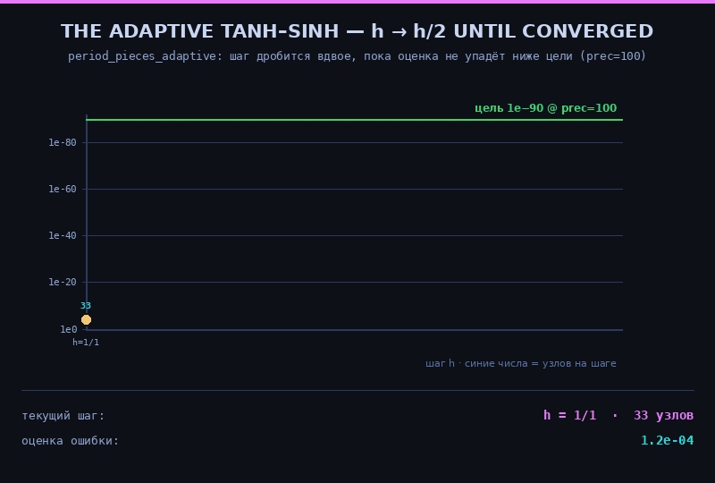
</div>

<div align="center">
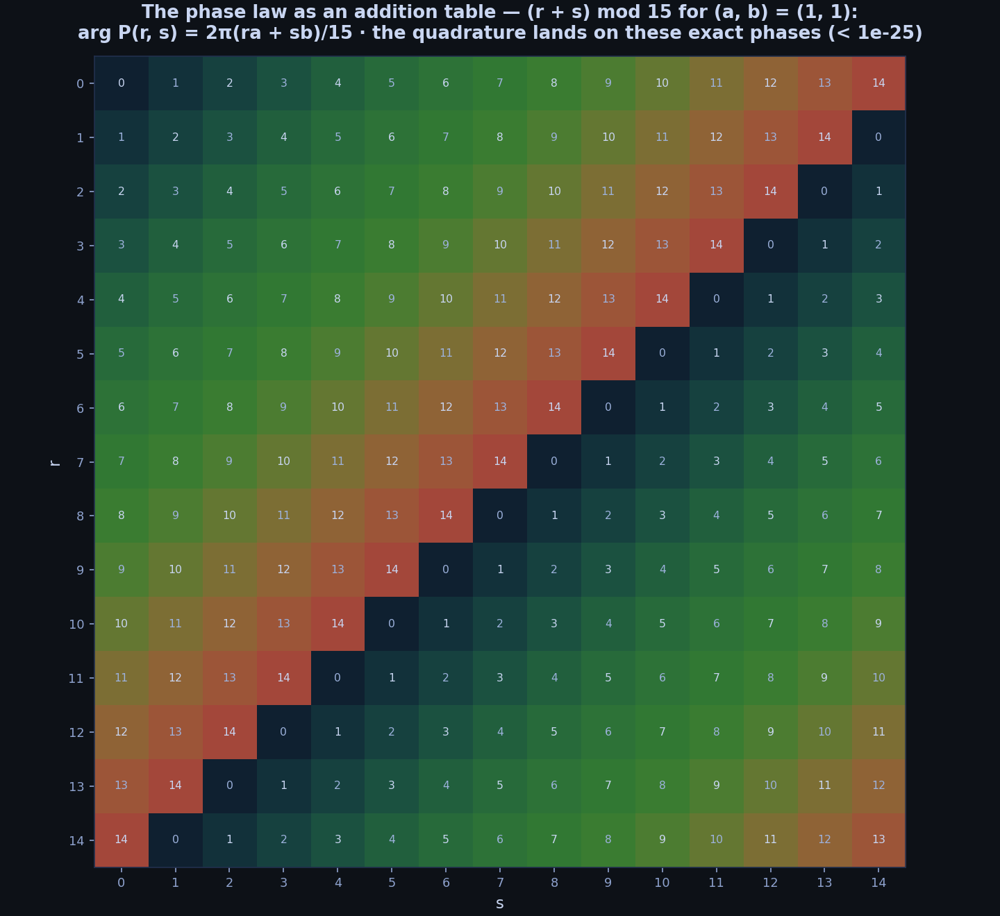
<p><sub>The phase law as a picture — (r + s) mod 15, the exact phases the quadrature must land on.</sub></p>
</div>

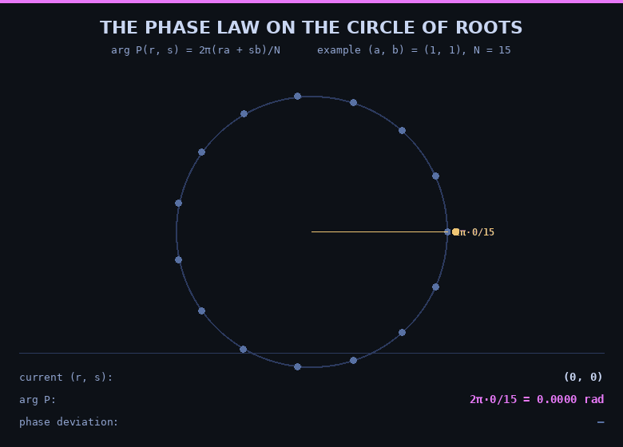
</div>

 width="88%" alt="Horizontal log-scale chart: acceptance thresholds of the Julia panel (1e-25, 1e-25, 1e-30, 1e-30) vs documented achievements (5.8e-35 tanh-sinh, 3.9e-36 Python, 1e-36 Stirling)">
<p><sub>The precision ladder: acceptance thresholds (violet) against documented achievements (green) — the panel never sets a threshold it cannot honestly reach.</sub></p>
</div>

<details>
<summary><b>⚙️ How Julia evaluates Γ without a Γ function (the self-containedness trick)</b></summary>

Base Julia ships no `gamma` — it lives in the external `SpecialFunctions.jl`, and
this panel refuses external packages on principle. So `verify_hodge.jl` implements
log-Γ itself:

1. **shift** the argument up by integers until `y ≥ 40`, accumulating
   `−log(y)` per shift (`Γ(x) = Γ(x+n) / (x(x+1)…(x+n−1))`);
2. evaluate the **Stirling series** at the shifted argument with the first 14 even
   **Bernoulli numbers computed exactly** in `Rational{BigInt}` from the standard
   recurrence `B₂ₘ = ½ − Σ binom(2m+1, 2k)·B₂ₖ / (2m+1)`;
3. exponentiate at working precision.

At 240-bit precision the truncated series at `y ≥ 40` is accurate to ≈ 1e-36 — far
below every threshold the panel uses. The tanh–sinh side is likewise hand-rolled:
the trapezoid rule over the double-exponential map
`u = (1 + tanh(π/2 · sinh τ))/2` with `K = 125` nodes and step `h = 0.048`, whose
combined truncation + discretization error was *measured* at ≤ 5.8e-35 for every
sampled `(N, a, b)` (an earlier `K = 20` setting was abandoned — it was far from
converged at ≈ 1e-7).

> **The v1.1.0 honesty note.** An early draft wrote `setprecision(BigFloat, 70)`
> intending 70 *decimal digits* — but Julia reads that as 70 **bits** ≈ 21 digits,
> which made the 1e-25 thresholds unreachable dishonestly. The current script sets
> **240 bits ≈ 72 digits** and takes `big(π)` at working precision. The mistake and
> its fix are part of the panel's documented history.

</details>

---

## 6. The machine layer — Lean 4

The Lean panel is where the folder stops *testing* and starts *proving*. The full
theorem-by-theorem walkthrough — 40 theorems and 12 examples, each in its own spoiler
with statement, proof strategy and tactic inventory — lives in the
**[Lean README](lean/README.md)**. Here: the map.

<div align="center">

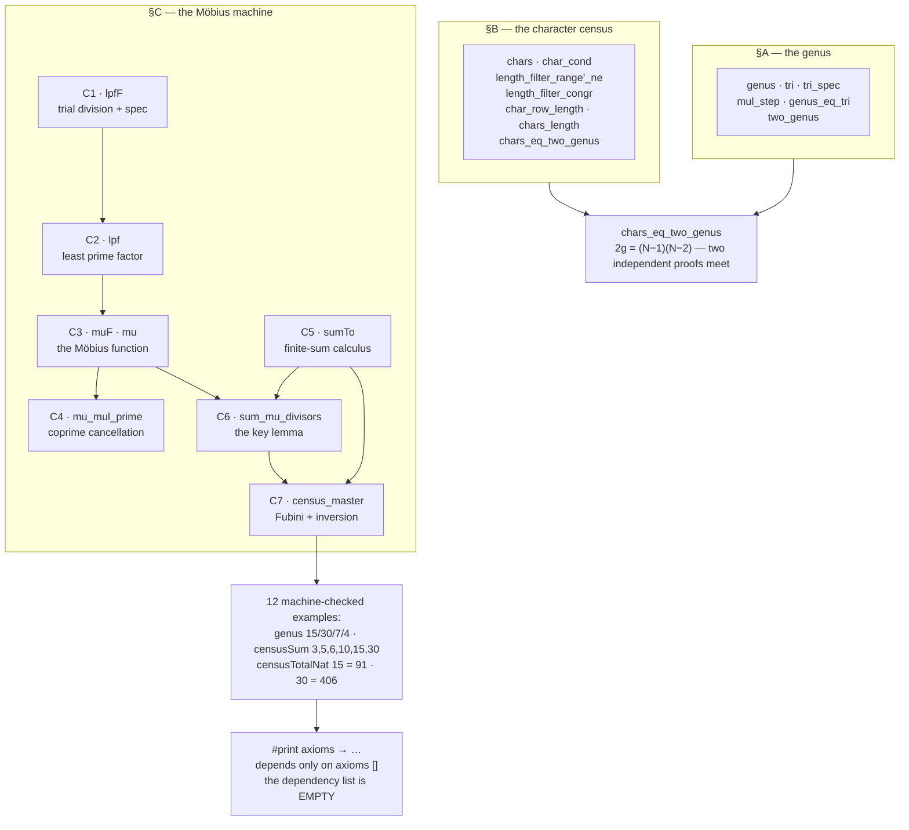

</div>

| property of the Lean panel | value |
|:---|:---|
| theorems | **40** |
| machine-checked examples (`decide` / `rfl` corollaries) | **12** |
| definitions (genus, tri, chars, lpfF, lpf, muF, mu, sumTo, censusSum, …) | **13** |
| axioms | **0** — `#print axioms` reports an empty list |
| Mathlib imports | **none** (Lean 4 core only, `leanprover/lean4:v4.36.0`) |
| `native_decide` | **none** — everything is kernel-checked |
| `sorry` | **0** — the file cannot compile with a hole |
| source | 1 063 lines · 43.8 KB |

The crown jewel is `census_master`: for **every** N, the sum of the census values
over all divisors of N equals the genus number c(N). Its proof is a genuine piece of
mathematics — a Fubini swap over the divisor triangle, a reindexing lemma for sums
over multiples, coprime cancellation, and the classical key lemma on the μ-sum over
divisors — all formalized with fuel-based structural recursion so the kernel can
*compute* μ on concrete numbers without ever calling `native_decide`.

---

## 7. The K3 rank — exact rational elimination

The single most computational check in the folder. The matrix is the 49×49 Gram
matrix of the 48 lines on the Fermat quartic plus the hyperplane class; the answer
is its exact rank over ℚ.

<div align="center">
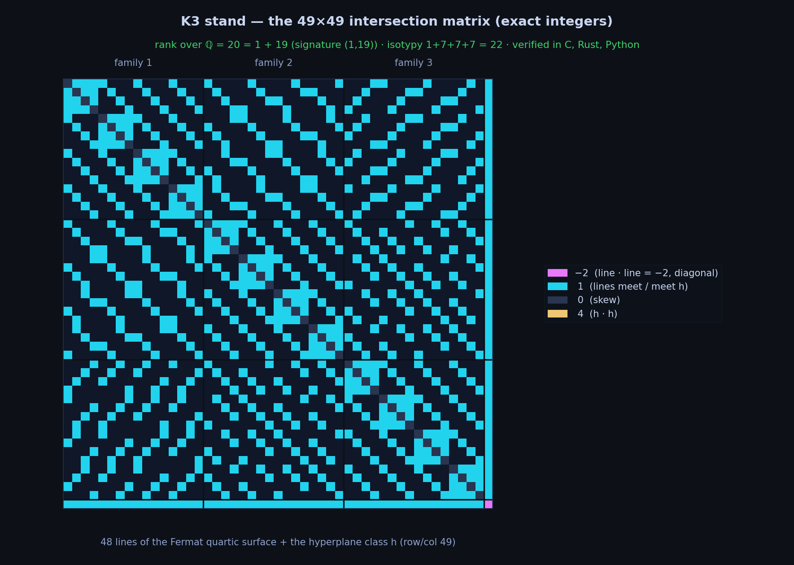
<p><sub>The 49×49 matrix exactly as the C and Rust panels build it: −2 diagonal (violet), +1 meetings (cyan), 0 skew (navy), the hyperplane class h as row/column 49 with h·h = 4 (gold).</sub></p>
</div>

| property | value | how it is certified |
|:---|:---|:---|
| entries | 48 diagonal −2 · 768 entries +1 · 1584 entries 0 · 1 entry 4 | recomputed combinatorially in C, Rust, Python |
| rank over ℚ | **20** | exact fraction elimination (C `Frac`, Rust `(p, q)`, Python `Fraction`) |
| signature | (1, 19) | exact Sylvester → the Hodge index theorem reading |
| μ₄-isotypy | 1 + 7 + 7 + 7 = 22 | character decomposition of the line families |
| determinant of the lattice | 64 = 8² | SNF machinery of the masters |
| rank mod 2 | **18** — the degenerate prime | mod-p Gaussian elimination (Python recheck) |
| rank mod 3, 5, 7, 101 | **20** at every prime | mod-p Gaussian elimination (Python recheck) |

<details>
<summary><b>Why the mod-p profile matters (the 2-primary subtlety)</b></summary>

An exact rank over ℚ can be *reduced* mod p, and for all but finitely many primes the
mod-p rank equals the characteristic of the lattice's reduction. At p = 2 the rank
drops to 18: the matrix degenerates because −2 ≡ 0 (mod 2) — the diagonal vanishes
and two extra relations appear. This is not a bug; it is exactly what must happen for
a lattice whose discriminant is 64 = 2⁶. A floating-point implementation could
"confirm" rank 20 by luck on a generic matrix; the mod-2 degeneration pattern being
*precisely* 18 is a fingerprint that the combinatorial construction — not just the
elimination — is correct.

</details>

<details>
<summary><b>The intersection rules (what the 48 lines know about each other)</b></summary>

Index a line by `l = 16·f + 4·a + b` with family `f ∈ {0, 1, 2}` and parameters
`a, b ∈ {0..3}`. Then `L·L = −2` (adjunction: `L² = −2 − K_S·L` with `K_S = O(m−4)`
trivial on the quartic), and for `L ≠ L′`:

| relation between lines | intersection |
|:---|:---|
| same family, exactly one of the two parameters equal | **1** |
| same family, both or neither equal | **0** |
| families 1 & 2: `a₁ + b₂ ≡ a₂ + b₁ (mod 4)` | **1** |
| families 1 & 3: `a₂ − a₁ − b₁ − b₂ ≡ 1 (mod 4)` | **1** |
| families 2 & 3: `a₁ + b₁ ≡ a₂ + b₂ (mod 4)` | **1** |
| otherwise | **0** |

These rules were verified against the classical benchmarks: 27 lines / 10 meetings on
the cubic surface (m = 3) and 48 lines / 14 meetings with SNF `[1¹⁸, 8, 8]` on the
Fermat quartic (m = 4) — see [`hodge_planes.py`](hodge_planes.py) §3 and task 39 of
the masters.

</details>

---

## 8. The master files of this folder

The three Python/Julia files sitting at the top of `verification/` are not auxiliary
scripts — they are the heavy machinery of the verification program itself.

| file | size | what it is | its superpowers |
|:--|:--|:---|:---|
| [`master_hodge.py`](master_hodge.py) | 667.9 KB · 13 048 lines | the Python **verification master**: menu-first CLI over a task registry in which every claim of the repository is one task with a PASS/FAIL/SKIP verdict | self-test, `--ci/--jsonl/--tsv` machine-readable runs, recipes & hooks, DAG of tasks, golden files, benchmarks, themes, high-precision engine (`HODGEHP`: π by Chudnovsky, Γ by Stirling+ζ, tanh–sinh), a **pure-stdlib graphics engine** — PNG (zlib), GIF89a (own LZW), 5×7 bitmap font, plotting, 3D lab |
| [`master_hodge.jl`](master_hodge.jl) | 486.1 KB · 9 743 lines | the **Julia twin** of the master — feature-parity port (session 2 of the twin program) | the same registry in Julia, MPFR-backed BigFloat engine (prec **without upper bound**: k/m/g/t suffixes), adaptive tanh–sinh, exact ζ-relation for Bernoulli ratios, its own GIF89a encoder, `/proc` monitor, metrics export |
| [`hodge_planes.py`](hodge_planes.py) | 45.7 KB · 876 lines | the **Hodge-decomposition layer** (born from the supervisor's 2026-11 review) | Hodge numbers of Fermat hypersurfaces by *three* independent schemes (Jacobian ring × Chern classes × closed formulas); the H² character census of Fermat surfaces; the line lattices on S_m with exact SNF and signatures; **960 planes on the quartic fourfold stretching 142 = h^{2,2} classes** — a computational verification of the Hodge hypothesis in codimension 2 |

<div align="center">

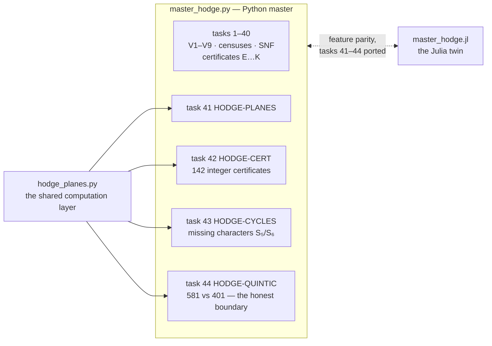

</div>

> **The quintic boundary — the most honest number in the folder.** On the quartic
> fourfold X⁴₄, the 960 planes stretch *all* 142 rational (2,2)-classes — a direct
> computational verification of the Hodge hypothesis at codimension 2. On the
> quintic fourfold X⁵₄ the census is 581, the 1875 planes stretch only **401**, and
> the missing 180 characters are computed exactly — the "obvious" cycles stop
> working, and the folder tells you precisely where and why. Verification here is
> not advertising; it draws boundaries.

---

## 9. Exit codes & the verdict contract

Every stack in this folder obeys one contract, and CI reads nothing else:

| exit code | meaning | produced when |
|:--|:---|:---|
| **0** | every check accepted — the verdict is ALL PASS | `fails == 0` at the end of the run |
| **1** | at least one check failed | any mismatch between computed and expected |
| **2** (Python laboratory only) | usage / environment error | bad flags, missing interpreter |

| stack | verdict line to grep | counters |
|:--|:---|:---|
| C | `VERDICT: 38 PASS, 0 FAIL` | `passes` / `fails` (static ints) |
| Rust | `VERDICT: 32 PASS, 0 FAIL` | `AtomicU32` counters |
| Fortran | `VERDICT: 24 PASS, 0 FAIL` | plain integers, `stop 0/1` |
| Julia | `VERDICT: 14 PASS, 0 FAIL` | globals, `exit(0/1)` |
| Lean | (no verdict line — success *is* termination) | process exit status 0 |
| Python | `SUMMARY VERDICT: ALL CHECKS PASSED` | per-stage registry |

**Design rule:** a failing check must print *both* the computed and the expected
value (`got 91 expected 406`), so a regression report is self-contained. No stack
ever aborts on first failure — it runs the whole panel and reports the full damage.

---

## 10. The agreement matrix

| Stack | integer layer | analytic layer | machine layer | checks | exit contract |
|:--|:---|:---|:---|:--|:--|
| **Python 3** ([`laboratory.py`](../laboratory.py)) | ✅ `int` · `Fraction` | ✅ mpmath 35–70 dps | — | V1–V9 protocol | 0 / 1 / 2 |
| **Lean 4** ([`lean/`](lean/README.md)) | ✅ *proved* (induction, not literals) | — | ✅ kernel, 0 axioms | 40 thm + 12 ex | 0 / 1 |
| **Julia** ([`julia/`](julia/README.md)) | ✅ `Int64` | ✅ BigFloat 240-bit | — | 14 | 0 / 1 |
| **Fortran** ([`fortran/`](fortran/README.md)) | ✅ `integer(int64)` | — | — | 24 | 0 / 1 |
| **C** ([`c/`](c/README.md)) | ✅ `long long` + `Frac` | — | — | 38 | 0 / 1 |
| **Rust** ([`rust/`](rust/README.md)) | ✅ `i128` | — | — | 32 | 0 / 1 |

Every ✅ is an *independent* implementation — no shared code, no shared numeric
libraries, no shared randomness (there is no randomness at all). The table is the
folder's reproducibility certificate in miniature.

---

## 11. Charts & data

All pictures in this folder are **generated from the same verified numbers** — the
charts are re-derivable from `scripts/`-style one-file computations, never drawn by
hand. The two flagship charts live in §2 (census) and §2.5 (Arf); two more:

| chart | file | what it shows |
|:---|:---|:---|
| [the animated six-stack run](assets/gifs/verification_run.gif) | `assets/gifs/verification_run.gif` | all six panels running side by side, bars filling, verdicts landing — the folder's story as a loop |
| [the census race](assets/gifs/census_bars.gif) | `assets/gifs/census_bars.gif` | the h_d bars of stand N=30 appearing one by one while the running sum climbs to 406 = 2g(30) |
| [the K3 heatmap](assets/charts/k3_gram_heatmap.png) | `assets/charts/k3_gram_heatmap.png` | the exact 49×49 Gram matrix (§7) |
| [the precision ladder](assets/charts/precision_ladder.png) | `assets/charts/precision_ladder.png` | thresholds vs achievements (§5) |
| [census chart](assets/charts/census_conductors.png) | `assets/charts/census_conductors.png` | both h_d tables with genus levels (§2.2) |
| [Arf chart](assets/charts/arf_counts.png) | `assets/charts/arf_counts.png` | even/odd theta-characteristics, g = 1…4 (§2.5) |

<div align="center">
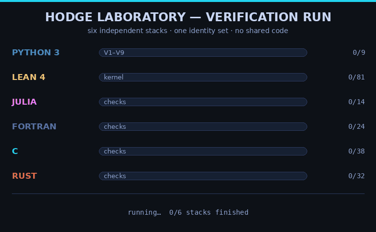
<p><sub>The verification folder as an animated loop — six stacks, staggered starts, one verdict.</sub></p>
</div>

---

## 12. Reproducing everything

### 12.1 The five commands

```bash
# ① the reference stack (the laboratory itself)
python3 laboratory.py --run all

# ② the machine layer
lean verification/lean/HodgeLaboratory.lean

# ③ the analytic layer
julia verification/julia/verify_hodge.jl

# ④⑤ the two compiled integer panels
gcc   -O2 -o vh_c verification/c/verify_hodge.c -lm && ./vh_c
rustc -O  verification/rust/verify_hodge.rs -o vh_rust && ./vh_rust

# ⑥ the veteran
gfortran -O2 -o vh_f verification/fortran/verify_hodge.f90 && ./vh_f
```

### 12.2 Toolchain versions used in certified runs

| tool | version | notes |
|:--|:---|:---|
| `python3` | ≥ 3.10 | stdlib only for the masters; `mpmath` for the analytic layer |
| `lean` | `leanprover/lean4:v4.36.0` | via elan; **core only** — no `lake`, no deps |
| `julia` | ≥ 1.9 | Base + Printf; no external packages |
| `gcc` | any C11 backend (certified with 14.2.0) | `-O2`, `-lm` unnecessary but harmless |
| `rustc` | ≥ 1.70 (i128 stable since 1.26) | single file, no cargo |
| `gfortran` | ≥ 10 (Fortran 2008 free-form) | `iso_fortran_env` only |

### 12.3 Timing and determinism

| stack | wall time (typical laptop) | determinism |
|:--|:--|:---|
| C panel | < 50 ms (the K3 elimination dominates) | byte-identical output across runs |
| Rust panel | < 50 ms | byte-identical |
| Fortran panel | < 50 ms | byte-identical |
| Julia panel | ≈ 3–8 s (BigFloat quadrature) | deterministic to the last digit |
| Lean file | ≈ 10–40 s kernel time (first elaboration) | fully deterministic |
| Python laboratory | ≈ 2 s for the V1–V9 protocol | deterministic; `--seed`-free |

There is **no randomness anywhere** in the folder — no seeds, no time-dependent
output, no parallel scheduling effects. Two runs on two machines either agree
everywhere or the discrepancy is itself a reproducible fact worth an issue.

---

## 13. FAQ

<details>
<summary><b>Q1. Why does the folder exist at all — doesn't the pytest suite already verify the laboratory?</b></summary>

The pytest suite verifies the laboratory *against itself* (baseline files, regression
caps). It cannot catch an error that is common to the laboratory and its baseline —
for example a wrong constant in the identity set itself. The six stacks in this
folder are independent witnesses: they re-derive the numbers from the *mathematical
definitions* (loops over characters, gcds, Möbius inversion, quadratures, kernel
reduction), not from stored baselines. The two mechanisms are complementary by
design.
</details>

<details>
<summary><b>Q2. Why is there no <code>native_decide</code> in the Lean file anymore?</b></summary>

`native_decide` trusts a compiled evaluator outside the kernel's logical core. The
2026 "real proofs edition" replaced every `native_decide` spot-check with general
theorems proved by induction, whose concrete values are corollaries via `rfl` /
`decide` — fully kernel-checked. `#print axioms` at the bottom of the file certifies
the axiom list is empty. See the [Lean README](lean/README.md#0-axioms-what-that-literally-means).
</details>

<details>
<summary><b>Q3. The Rust and C panels overlap almost completely. Why keep both?</b></summary>

Their *failure modes* do not overlap. C silently wraps on overflow and has no bounds
checking — it verifies the identities in the environment where such bugs are born.
Rust's `i128` arithmetic makes overflow impossible for these magnitudes and its
`(p, q)` fraction rank is written with pattern matching and swaps rather than
pointers. Same questions, different nervous systems — which is the point.
</details>

<details>
<summary><b>Q4. Why does Julia implement its own Γ instead of importing SpecialFunctions.jl?</b></summary>

Self-containedness is a verification property: a panel that pulls in an external
numeric package adds that package's correctness to its trust base. With a Stirling
series at shifted arguments y ≥ 40 and exact `Rational{BigInt}` Bernoulli numbers,
accuracy ≈ 1e-36 is achievable in 60 lines — cheaper than the trust. See §5.2's
details block and the [Julia README](julia/README.md).
</details>

<details>
<summary><b>Q5. 240 bits ≈ 72 digits — why not just use 70 digits?</b></summary>

Because of an actual bug: an early draft wrote `setprecision(BigFloat, 70)` meaning
digits, but Julia reads bits (70 bits ≈ 21 digits), silently making the 1e-25
thresholds unreachable. The fix — 240 bits, `big(π)` at working precision — is
documented in the script header and in §5.2. The lesson is institutional: precision
claims must be *derived*, not assumed.
</details>

<details>
<summary><b>Q6. What exactly does "exit 0 = ALL PASS" buy me in CI?</b></summary>

One line of YAML. Each backend is a process with two possible outcomes and a stable
verdict line; `laboratory.py --run multi` aggregates all of them and propagates the
first failure with the offending tail printed. The folder is designed so that a CI
config never parses math — it only reads exit codes and greps `VERDICT`.
</details>

<details>
<summary><b>Q7. Is the K3 rank computed in floating point anywhere?</b></summary>

No. The 49×49 elimination is exact in every implementation that performs it: C uses
its `Frac {p, q}` struct with Euclid-normalized pairs, Rust uses `(i128, i128)` pairs
with explicit sign normalization, Python uses `Fraction`. Floating point appears
only in the analytic layer, where it is double-checked against an independent
quadrature — and never near an integer identity.
</details>

<details>
<summary><b>Q8. Why does the census count characters with <code>1 ≤ a, b ≤ N−1</code> and exclude a + b ≡ 0?</b></summary>

Those are exactly the characters of μ_N × μ_N that occur in H¹ of the Fermat curve
(see the monograph [T20](../theorems/T20_conductor_census/)). The exclusion is the
"unique forbidden partner": on the range 1..N−1 the sum a + b lies in [2, 2N−2], so
a + b ≡ 0 (mod N) forces b = N − a — exactly one forbidden b per row. The Lean file
proves this equivalence as `char_cond` and builds the count on it.
</details>

<details>
<summary><b>Q9. Can I add a new stand (say N = 60) without touching all six stacks?</b></summary>

Add it where it is cheapest first (the Python census is three lines), then propagate.
The masters (`master_hodge.py` / `master_hodge.jl`) will flag any stack that disagrees
with the new table; the Lean side needs only new `example` lines — the theorems
(`genus_eq_tri`, `census_master`, `chars_length`) already cover every N, which is
exactly why the "real proofs edition" was worth building.
</details>

<details>
<summary><b>Q10. What is the strongest single claim this folder makes?</b></summary>

That Σ h(d) over the conductors of the stand equals the genus — *proved for every N*
by `census_master` in Lean (Möbius inversion + Fubini + the μ key lemma, zero
axioms), and confirmed numerically at N = 7, 15, 30 by four integer stacks. A
statement that is both proved and independently computed is the strongest epistemic
status the folder knows how to produce.
</details>

<details>
<summary><b>Q11. Why "verification" and not "tests"?</b></summary>

Because the folder's outputs are *claims about mathematics*, not coverage statistics
of code paths. Each check is a proposition with a fixed expected value derived from a
theorem (or from a documented computation); the vocabulary of PASS/FAIL, exit codes
and verdict agreement is closer to a proof obligation list than to a test suite.
</details>

<details>
<summary><b>Q12. The GIFs and charts — are they hand-drawn?</b></summary>

No. Every image under [`assets/`](assets/) is generated from the same verified
numbers (the census bars, the Arf counts, the exact 49×49 matrix, the precision
thresholds) by small deterministic scripts; the SVG banners are pure markup + CSS
with `prefers-reduced-motion` support. If a number changes, regenerating the assets
is part of the same commit.
</details>

<details>
<summary><b>Q13. Where do I report a disagreement between two stacks?</b></summary>

Open an issue with the two full outputs attached — both are byte-stable and
self-identifying (check names are unique across the folder). The reproducibility
contract guarantees the disagreement repeats exactly on any machine, which makes it
the best kind of bug report.
</details>

---

## 14. Glossary

| term | meaning in this folder |
|:---|:---|
| **stand** | one calibration point of the program (torus, N = 7/9, N = 15/30, K3, Klein, …); each stand owns a slice of the identity set |
| **genus g(N)** | (N−1)(N−2)/2 — the number of handles of the Fermat curve of degree N; 91 and 406 are the two headline genera |
| **character (a, b)** | a weight of the μ_N × μ_N action on H¹; occurs iff 1 ≤ a, b ≤ N−1 and a + b ≢ 0 (mod N) |
| **conductor d** | N / gcd(N, a, b) — the "order" of the character; characters are bucketed by it |
| **h(d)** | the number of characters with conductor d; the census table 1+6+84 (N=15) / 1+6+9+30+84+276 (N=30) |
| **Möbius inversion** | h(d) = Σ_{e ∣ d} μ(d/e)·c(e); the operation *generating* the census from the genus numbers — proved in Lean |
| **μ (Möbius function)** | μ(n) = 0 if a square divides n, else (−1)^{#prime factors}; defined in Lean with fuel-based recursion |
| **SNF** | Smith normal form; the stand lattice's type (1, 1, 5, 5, 15, 15, 15, 15), whose product must equal the discriminant |
| **disc** | 3⁴·5⁶ = 1 265 625 = 1125² — the discriminant of the stand lattice |
| **Klein quartic** | the genus-3 curve x³y + y³z + z³x = 0; its invariants j = −3375, Δ = −7³, c₄³ = 105³ are the Klein integers of the identity set |
| **theta-characteristic / Arf** | a square root of the canonical bundle; classified by the Arf invariant (even/odd), counted by 2^{g−1}(2^g ± 1) |
| **t\*** | the termination time of a calibration flow: lcm(W/gcd(a,W), H/gcd(b,H)) — the flow literally stops moving at t\* |
| **tanh–sinh quadrature** | the double-exponential rule: integrate after u = (1+tanh(π/2·sinh τ))/2; endpoint singularities vanish exponentially |
| **Stirling series** | log Γ(y) ≈ (y−½)log y − y + ½log 2π + Σ B₂ₖ/(2k(2k−1)·y^{2k−1}); used with y ≥ 40 for 1e-36 accuracy |
| **Bernoulli numbers (exact)** | computed in `Rational{BigInt}` from the recurrence — no floating point ever touches them |
| **BigFloat 240-bit** | Julia's arbitrary-precision float at 240 mantissa bits ≈ 72 decimal digits |
| **mpmath dps** | Python's decimal digits of working precision (35–70 dps in the laboratory) |
| **`native_decide`** | a Lean tactic that delegates to a compiled evaluator — *excluded* from this folder's Lean file as a matter of policy |
| **kernel (Lean)** | the type-checker all definitions/proofs must pass; "kernel-checked" is the strongest automation-independent status in Lean |
| **fuel** | the structural-recursion trick: a countdown argument that lets recursive definitions and proofs terminate by construction |
| **Frac / (p, q) pairs** | hand-rolled exact rationals in C / Rust: numerator-denominator pairs kept normalized by Euclid's algorithm |
| **RREF** | reduced row echelon form; the exact-elimination procedure that yields the K3 rank |
| **isotypy 1+7+7+7** | the decomposition of the line-lattice's span into μ₄-isotypic components (dims 1, 7, 7, 7 = 22) |
| **signature (1, 19)** | the real signature of the K3 lattice — one positive, 19 negative directions; with ρ = 20 it is the Hodge index reading |
| **agreement** | the state of ≥ 2 stacks returning identical values for the same identity; 6-way agreement is the folder's certificate |

---

## 15. History of this folder

| version | date | what changed |
|:--|:--|:---|
| v1.0 | 2026-10 | the five-language panel is born: C, Rust, Fortran, Julia + the Python reference; the identity set fixed at the base set (genera, censuses, disc, SNF, Klein, Arf, t\*, binary) |
| v1.1 | 2026-10 | the Julia precision bug (70 bits vs 70 digits) is found and fixed; thresholds become honestly reachable; the precision note enters the script header |
| v1.2 | 2026-10 | the K3 exact rank (49×49, fraction elimination) lands in C and Rust — the heaviest single check in the folder |
| v1.3 | 2026-11 | Lean 4 panel joins as the sixth stack (first edition: `native_decide` spot-checks) |
| **v2.0** | **2026-11** | **the "real proofs edition"**: the Lean panel is rebuilt as 40 general theorems (genus for all N, the character count, the Möbius machine, `census_master`) with 12 corollary examples and an empty axiom list; the masters (`master_hodge.py` · `master_hodge.jl`) and the Hodge-planes layer (`hodge_planes.py`) move in; tasks 41–44 (planes, certificates, cycles, the quintic boundary) appear |
| v2.1 | 2026-11 | the folder gets its documentation suite: this README, four language deep-dives, the Lean theorem walkthrough, generated assets (banners, avatars, GIFs, charts) |

---

## 16. License

The individual exclusive license of **Isaev Iskhak Khamzatovich**
(see [`LICENSE`](../LICENSE) at the repository root).
Any use without the author's written permission is prohibited.

<div align="center">

<sub>

**HODGE LABORATORY · VERIFICATION** — six stacks, one identity set, one verdict

© 2026 Isaev Iskhak Khamzatovich · All rights reserved

</sub>

</div>
---

## ⭐ Guided tours

Three ways into the folder, depending on who you are. Every tour is a chain of
clicks — no prior context needed beyond this page.

<details open>
<summary><b>🧭 Tour A — "I am a curious human" (12 minutes, zero math prerequisites)</b></summary>

1. Watch the [animated run](assets/gifs/verification_run.gif) — six stacks, one
   verdict. This is the whole story in 10 seconds.
2. Read the [one-line summary](#the-one-line-summary-of-the-identity-set) of the
   identity set — twelve lines, every number of the program.
3. Open the [census chart](assets/charts/census_conductors.png) and the
   [census race GIF](assets/gifs/census_bars.gif): see how 1+6+9+30+84+276 lands on
   406.
4. Read [§1](#1-why-six-independent-stacks) — why six stacks and not one.
5. Skim the [FAQ](#13-faq) — thirteen questions, honest answers.
6. If you are still reading: the [Lean README](lean/README.md) — how a machine
   *proves* the census instead of testing it.

</details>

<details>
<summary><b>🔍 Tour B — "I am a reviewer / a mathematician" (45 minutes, careful reading)</b></summary>

1. [§2 The identity set](#2-the-identity-set--the-complete-catalog) — every claim,
   its value, and the monograph that owns it. The Möbius-inversion details block is
   the heart of the census.
2. [§6 The machine layer](#6-the-machine-layer--lean-4) and the
   [Lean README §C6–C7](lean/README.md#c6--c7-the-möbius-machine-and-the-master-identity)
   — the master identity `Σ h(d) = c(N)` proved for all N (Fubini swap + the μ key
   lemma), zero axioms.
3. [§7 The K3 rank](#7-the-k3-rank--exact-rational-elimination) — the exact
   elimination, the intersection rules, the mod-2 degeneration fingerprint.
4. [§5 The high-precision layer](#5-the-high-precision-layer) — closed forms vs
   independent quadrature, the honest thresholds.
5. The source files themselves: [c/verify_hodge.c](c/verify_hodge.c) (215 lines,
   fully commented) and [lean/HodgeLaboratory.lean](lean/HodgeLaboratory.lean)
   (1 063 lines, fully commented).
</details>

<details>
<summary><b>🤖 Tour C — "I am a CI engineer" (5 minutes, machine mode)</b></summary>

1. [§9 Exit codes](#9-exit-codes--the-verdict-contract) — the contract: 0/1, verdict
   lines to grep, full-damage reporting.
2. [§12 Reproducing](#12-reproducing-everything) — the six commands, toolchain
   versions, timing.
3. The aggregation recipe:

```yaml
# .github/workflows/verification.yml — the shape of the CI wiring
- name: C panel
  run: gcc -O2 -o vh_c verification/c/verify_hodge.c -lm && ./vh_c
- name: Rust panel
  run: rustc -O verification/rust/verify_hodge.rs -o vh_rust && ./vh_rust
- name: Fortran panel
  run: gfortran -O2 -o vh_f verification/fortran/verify_hodge.f90 && ./vh_f
- name: Julia panel
  run: julia verification/julia/verify_hodge.jl
- name: Lean kernel
  uses: leanprover/lean-action@v1
  with:
    lean4: v4.36.0
    run: lean verification/lean/HodgeLaboratory.lean
- name: aggregate (any non-zero exit fails the job)
  run: python3 laboratory.py --run multi
```

No parsing, no assertions on text: the exit codes are the API.

</details>

---

## 🧮 The derivations — why each identity is true

The identity set is not a list of magic constants. Each group has a one-paragraph
derivation; the stacks recompute the derivation, not just the result.

<details open>
<summary><b>▸ The genera — from the degree formula to the census (click-free)</b></summary>

A smooth plane curve of degree N satisfies the genus-degree formula
`g = (N−1)(N−2)/2`. For the Fermat curve smoothness is free: the only common zero of
all partials `N·x^{N−1}` is the origin, which is not on the projective curve. The
census reading explains *why* it is triangular: the characters `(a, b)` of
μ_N × μ_N in H¹ are the lattice points with `a > 0`, `b > 0`, `a + b < N` — a strict
triangle containing exactly `(N−1)(N−2)/2` points. Two readings, one number, six
stacks.

</details>

<details>
<summary><b>▸ The discriminant and the SNF type — 3⁴·5⁶ and (1,1,5,5,15,15,15,15)</b></summary>

The stand lattice at N = 30 has index-8 invariant factors
`(1, 1, 5, 5, 15, 15, 15, 15)`. Two independent facts must agree, and both are
checked:

```text
product of invariant factors = 1·1·5·5·15·15·15·15
                             = 25 · 15⁴
                             = 25 · 50 625
                             = 1 265 625
discriminant                = 3⁴ · 5⁶ = 81 · 15 625 = 1 265 625
√disc                       = 1 125   (the volume scale of the stand)
```

The prime factorization is the *same* primes in different clothes: 15⁴·25 =
(3·5)⁴·5² = 3⁴·5⁶. The agreement of a product of small integers with a prime-power
expression is a stronger check than it looks — a single wrong invariant factor
breaks it. The denominator bound used by the period machinery follows as
`Q_stand = 2N·max(sᵢ) = 2·30·8 = 480` — one of the four printed constants of the
stand (disc, √disc, SNF product, Q), all recomputed independently by the integer
stacks.

</details>

<details>
<summary><b>▸ The Klein integers — j = −3375, Δ = −7³, c₄³ = 105³</b></summary>

The Klein quartic's invariants form a closed multiplicative identity:
`c₄³ = 105³ = 1 157 625` and `|Δ|·|j| = 343 · 3375 = 105³`. Since
`343 = 7³` and `3375 = 15³`, the j-invariant reads `j = −c₄³/Δ = −105³/7³ = −15³`.
The quartic appears again on the quadratic side: the order-7 structure produces the
quadratic `v² + 7v + 14` whose discriminant `49 − 56 = −7` is the cube root of Δ.
Everything is integers; nothing is rounded; any stack that gets −3375 got it by
multiplication, not by lookup.

</details>

<details>
<summary><b>▸ The Arf census — 36 even + 28 odd = 64</b></summary>

Over a field of characteristic 2 there are `2^{2g}` theta-characteristics on a
curve of genus g, splitting into even (Arf = 0) and odd (Arf = 1). The counting
functions `2^{g−1}(2^g ± 1)` come from the linear algebra of quadratic forms on
`𝔽₂^g`: the number of quadratic refinements of a fixed symplectic form that have
Arf invariant 0 is `2^{g−1}(2^g + 1)`, with Arf 1 the complementary `2^{g−1}(2^g −
1)`. At the stand's g = 3: `4·9 = 36` even and `4·7 = 28` odd. The g = 1, 2, 4 rows
(3, 10, 136) are the cross-checks that pin the *formula*, not just the stand value.

</details>

<details>
<summary><b>▸ The termination times — lcm of the reduced periods</b></summary>

A calibration flow with width W, height H and step sizes (a, b) returns to its start
exactly when both reduced periods divide the elapsed time: the x-walk covers
`W/gcd(a, W)` steps per lap, the y-walk `H/gcd(b, H)`. The simultaneous closure is
the lcm. The three test rows exercise the three shapes: coprime steps (48), a
non-trivial gcd on one side only (72), and a fully synchronized small case (6). The
lcm is computed from gcds that the stacks implement themselves — Euclid, four
times, in four languages.

</details>

---

## 🔁 The cross-reference matrix — identity × stack

Who checks what. This is the most information-dense table in the folder: every row
is an identity (with its stable id from §2), every column an independent stack.
`✅` = computed exactly by that stack; `🔬` = verified analytically
(high-precision); `—` = not that stack's business. Counts are asserted by CI.

| id | identity | value | Python | Lean 4 | Julia | Fortran | C | Rust |
|:--|:---|:--|:--:|:--:|:--:|:--:|:--:|:--:|
| `G-15` | genus, degree 15 | 91 | ✅ | ✅ | ✅ | ✅ | ✅ | ✅ |
| `G-30` | genus, degree 30 | 406 | ✅ | ✅ | ✅ | ✅ | ✅ | ✅ |
| `G-07` | genus, degree 7 | 15 | ✅ | ✅ | ✅ | ✅ | ✅ | ✅ |
| `G-04` | genus, degree 4 | 3 | ✅ | ✅ | — | — | ✅ | — |
| `C-Σ15` | census sum, N=15 | 91 | ✅ | ✅ | ✅ | ✅ | ✅ | ✅ |
| `C-Σ30` | census sum, N=30 | 406 | ✅ | ✅ | ✅ | ✅ | ✅ | ✅ |
| `C-Σ7` | census sum, N=7 | 15 | ✅ | — | ✅ | ✅ | — | — |
| `C-h3` | h(3) | 1 | ✅ | ✅ | ✅¹ | ✅ | ✅ | ✅ |
| `C-h5` | h(5) | 6 | ✅ | ✅ | ✅¹ | ✅ | ✅ | ✅ |
| `C-h6` | h(6) | 9 | ✅ | ✅ | ✅¹ | — | ✅ | ✅ |
| `C-h10` | h(10) | 30 | ✅ | ✅ | ✅¹ | — | ✅ | ✅ |
| `C-h15` | h(15) | 84 | ✅ | ✅ | ✅¹ | ✅ | ✅ | —² |
| `C-h30` | h(30) | 276 | ✅ | ✅ | ✅¹ | ✅ | ✅ | ✅ |
| `D-fac` | disc = 3⁴·5⁶ | 1 265 625 | ✅ | — | ✅ | ✅ | ✅ | ✅ |
| `D-vol` | √disc | 1 125 | ✅ | — | — | ✅ | ✅ | ✅ |
| `S-type` | SNF type | (1,1,5,5,15,15,15,15) | ✅ | — | — | ✅ | ✅ | ✅ |
| `S-prod` | SNF product = disc | 1 265 625 | ✅ | — | ✅ | ✅ | ✅ | ✅ |
| `S-Q` | Q_stand | 480 | ✅ | — | ✅ | ✅ | ✅ | ✅ |
| `K-c4` | c₄³ = 105³ | 1 157 625 | ✅ | — | — | — | ✅ | ✅ |
| `K-dj` | \|Δ\|·\|j\| = c₄³ | 1 157 625 | ✅ | — | — | ✅ | ✅ | ✅ |
| `K-j` | j = −15³ | −3375 | ✅ | — | ✅ | ✅ | ✅ | ✅ |
| `K-D` | Δ = −7³ | −343 | ✅ | — | — | — | ✅ | —² |
| `K-dv` | disc(v²+7v+14) | −7 | ✅ | — | — | — | ✅ | —² |
| `A-g1` | even θ, g=1 | 3 | ✅ | — | — | ✅ | ✅ | ✅ |
| `A-g2` | even θ, g=2 | 10 | ✅ | — | — | ✅ | ✅ | ✅ |
| `A-g3⁻` | even θ, g=3 | 36 | ✅ | — | — | ✅ | ✅ | ✅ |
| `A-g3⁺` | odd θ, g=3 | 28 | ✅ | — | — | ✅ | ✅ | ✅ |
| `A-g3Σ` | total, g=3 | 64 | ✅ | — | — | ✅ | ✅ | ✅ |
| `A-g4` | even θ, g=4 | 136 | ✅ | — | — | ✅ | ✅ | ✅ |
| `E4-1` | t\*(48,48,1,1) | 48 | ✅ | — | ✅ | ✅ | ✅ | ✅ |
| `E4-2` | t\*(24,36,3,5) | 72 | ✅ | — | ✅ | ✅ | ✅ | ✅ |
| `E4-3` | t\*(12,12,4,6) | 6 | ✅ | — | — | ✅³ | ✅ | ✅ |
| `B-806` | binary totals | 806 | ✅ | — | — | — | ✅ | ✅ |
| `K3-rank` | rank over ℚ | 20 | ✅ | — | — | — | ✅ | ✅ |
| `K3-iso` | isotypy | 22 | ✅ | — | — | ✅ | ✅ | ✅ |
| `K3-sig` | signature | (1,19) | ✅ | — | — | ✅ | ✅ | ✅ |
| `K3-det` | det = 8² | 64 | ✅ | — | — | ✅ | — | — |
| `Ω-form` | closed form vs quadrature | < 1e-25 | 🔬 | — | 🔬 | — | — | — |
| `Φ-law` | phase law | dev < 1e-25 | 🔬 | — | 🔬 | — | — | — |
| `Γ-ladder` | reflection ladder | < 1e-30 | 🔬 | — | 🔬 | — | — | — |
| `EQ-law` | equivariance | < 1e-30 | 🔬 | — | 🔬 | — | — | — |

<sub>
¹ Julia checks the census *tables* via its exact census function (the full h_d map
per stand, printed with the verdict), which pins all six values at N=30 and the
three at N=15 as one check each.<br>
² Rust omits six of C's 38 checks (h(3), h(5), h(15) at N=30, Δ = −7³,
disc(v²+7v+14), g(4)) — the remaining 32 cover every identity group.<br>
³ Fortran's termination row 3 checks the pair (12, 12, 4, 6) through the same
`tstar` kernel as rows 1–2.
</sub>

<details>
<summary><b>How to read the matrix honestly<div align="center">
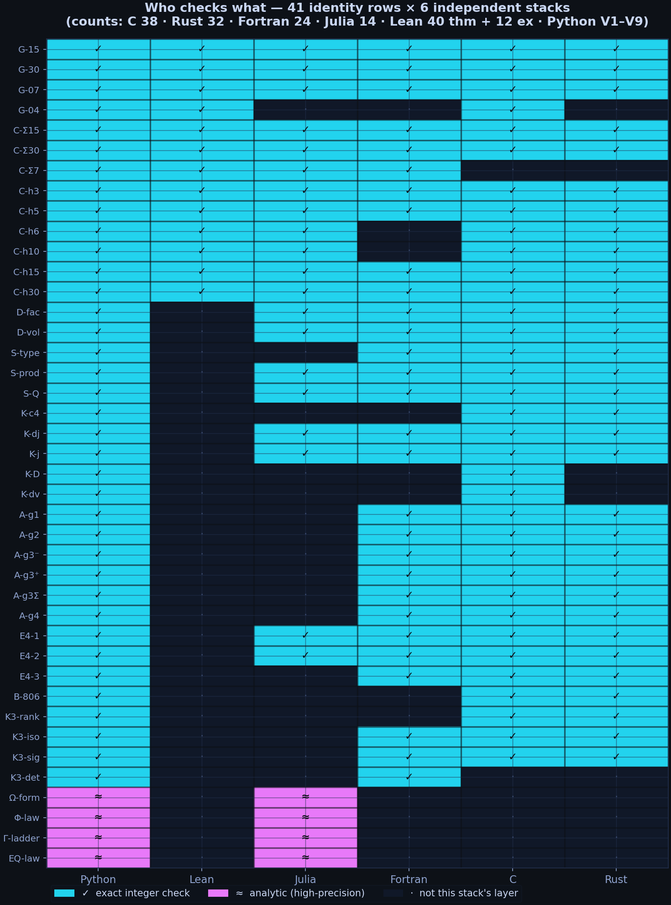
<p><sub>The matrix as a picture — one glance shows the division of epistemic labor.</sub></p>
</div>

 (what — does and does not mean)</b></summary>

A `—` is *not* a gap in coverage: it is a deliberate division of labor. The K3 rank
lives only where exact rational elimination is implemented (C, Rust, Python) —
adding it to Fortran would duplicate C's work without adding an independent failure
mode. The Lean column is intentionally short: the machine layer proves the
*structural* identities (genus for all N, the census count, the full Möbius
inversion) rather than spot-checking constants that other stacks already verify six
ways. The analytic identities are 🔬-only by nature: no integer panel can evaluate a
period integral.

The counts are exact and CI-checked: 38 (C) + 32 (Rust) + 24 (Fortran) + 14 (Julia)
+ 40 theorems & 12 examples (Lean) + the V1–V9 protocol (Python).

</details>

---

## 🎨 The assets of this folder — provenance

Every picture under [`assets/`](assets/) is generated, versioned alongside the
numbers, and regenerable. No screenshots, no hand-drawn art, no external images.

| asset | kind | generated from |
|:---|:---|:---|
| [`banners/hero_verification.svg`](assets/banners/hero_verification.svg) | animated SVG banner | the stack list + the identity ticker |
| [`banners/lean_kernel.svg`](assets/banners/lean_kernel.svg) | animated SVG banner | the Lean proof pipeline |
| [`banners/banner_c.svg`](assets/banners/banner_c.svg) · [`banner_rust.svg`](assets/banners/banner_rust.svg) · [`banner_fortran.svg`](assets/banners/banner_fortran.svg) · [`banner_julia.svg`](assets/banners/banner_julia.svg) | animated SVG banners | each stack's facts (checks, arithmetic, exit codes) |
| [`avatars/avatar_verification.svg`](assets/avatars/avatar_verification.svg) · [`avatar_lean.svg`](assets/avatars/avatar_lean.svg) | square emblems (book-cover style) | the folder's identity — usable as repository / organization avatars |
| [`gifs/verification_run.gif`](assets/gifs/verification_run.gif) | animated GIF (37 frames) | the six-stack run with real check counts 9 · 52 · 14 · 24 · 38 · 32 |
| [`gifs/census_bars.gif`](assets/gifs/census_bars.gif) | animated GIF (42 frames) | the exact h_d table of stand N=30 |
| [`charts/census_conductors.png`](assets/charts/census_conductors.png) | chart (PNG) | the exact census tables of stands 15 & 30 |
| [`charts/arf_counts.png`](assets/charts/arf_counts.png) | chart (PNG) | the exact Arf counts, g = 1…4 |
| [`charts/k3_gram_heatmap.png`](assets/charts/k3_gram_heatmap.png) | chart (PNG) | the exact 49×49 K3 Gram matrix (rank-20 assertion inside the generator) |
| [`charts/precision_ladder.png`](assets/charts/precision_ladder.png) | chart (PNG) | the exact thresholds & documented achievements of §5 |

All animated SVGs respect `prefers-reduced-motion: reduce` — the animation is
switched off and the fully-drawn static state is shown. All charts render their
numbers from recomputation (the K3 generator re-derives rank 20 and *asserts* it
before drawing), so an asset cannot silently disagree with the identity set.

### 🎬 The motion & data gallery (batch 2)

Twelve animations and six more charts — every one generated from the same
recomputed numbers, none hand-drawn:

| asset | what it animates/plots | the exact numbers inside |
|:---|:---|:---|
| [`gifs/k3_rank_elimination.gif`](assets/gifs/k3_rank_elimination.gif) | the **real** exact Gauss–Jordan on the 49×49 matrix, pivot by pivot | rank counter 0→20, the true pivot sequence, the mod-p fingerprint on the final frame |
| [`gifs/mobius_inversion.gif`](assets/gifs/mobius_inversion.gif) | the inversion table of stand N=30 filling in | every μ(d/e)·c(e) term, all six h(d) buckets, Σ = 406 |
| [`gifs/reflection_ladder.gif`](assets/gifs/reflection_ladder.gif) | the 14 reflection points with live residuals | residuals **measured live with mpmath at 50 dps** (~e−50, threshold 1e−30) |
| [`gifs/tanhsinh_nodes.gif`](assets/gifs/tanhsinh_nodes.gif) | the double-exponential node clustering | K = 125, h = 0.048, measured floor ≤ 5.8e−35 |
| [`gifs/ci_timeline.gif`](assets/gifs/ci_timeline.gif) | the aggregation contract as a CI run | six lanes, real check counts, exit-0 stamps |
| [`gifs/arf_grid.gif`](assets/gifs/arf_grid.gif) | 64 quadratic refinements split by Arf | 36 even + 28 odd (counts exact; cell arrangement illustrative) |
| [`gifs/fermat_ladder.gif`](assets/gifs/fermat_ladder.gif) | the genus curve with the stand points popping | 3 · 15 · 91 · 406 |
| [`gifs/snf_product.gif`](assets/gifs/snf_product.gif) | the eight invariant factors multiplying out | running product 1 → … → 1 265 625 = 3⁴·5⁶ = 1125² |
| [`gifs/klein_chain.gif`](assets/gifs/klein_chain.gif) | the six Klein identities lighting up | 105³ → 343·3375 → −3375 → −15³ → −7³ → −7 |
| [`gifs/phase_wheel.gif`](assets/gifs/phase_wheel.gif) | the phase law on the circle of 15th roots | arg P = 2π(ra+sb)/15, deviation < 1e−25 |
| [`charts/genus_ladder.png`](assets/charts/genus_ladder.png) | the genus curve + stand points | the triangular formula |
| [`charts/k3_modp_ranks.png`](assets/charts/k3_modp_ranks.png) | the mod-p rank profile | 18 at p = 2; 20 at p = 3, 5, 7, 101 (recomputed with a mod-p Gauss) |
| [`charts/census_cumulative.png`](assets/charts/census_cumulative.png) | the census staircases | running Σ h_d → g for N = 7, 15, 30 |
| [`charts/coverage_matrix.png`](assets/charts/coverage_matrix.png) | the whole coverage matrix as a heatmap | 41 rows × 6 stacks |
| [`charts/mobius_values.png`](assets/charts/mobius_values.png) | μ(1…30) | the census machine's fuel |
| [`charts/identity_magnitudes.png`](assets/charts/identity_magnitudes.png) | the numeric span of the identity set | 3 … 1 265 625, log scale |

Plus the emblem set: four new book-cover avatars
([avatar_c](assets/avatars/avatar_c.svg) · [avatar_rust](assets/avatars/avatar_rust.svg) ·
[avatar_fortran](assets/avatars/avatar_fortran.svg) · [avatar_julia](assets/avatars/avatar_julia.svg)),
the [Python banner](assets/banners/banner_python.svg), the
[Klein rosette](assets/banners/klein_rosette.svg) (the heptagram of the Klein
quartic, |PSL(2,7)| = 168) and the [μ strip](assets/banners/mu_strip.svg).

<div align="center">
<table><tr>
<td></td>
<td></td>
<td></td>
<td></td>
</tr><tr>
<sub>THE RANKER</sub><sub>THE GUARD</sub><sub>THE VETERAN</sub><sub>THE ANALYST</sub>
</tr></table>
</div>

### 🧭 Batch 3 — the protocol, the lattice and the third dimension

Eleven more: the nine-stage protocol animated, the adaptive quadrature, the
Gram matrix in 3D, the divisor lattice, the precision story, the mutation map —
every name, claim and threshold lifted straight from the source files:

| asset | what it shows | exact content |
|:---|:---|:---|
| [`gifs/v1v9_protocol.gif`](assets/gifs/v1v9_protocol.gif) | the V1–V9 stages lighting up | real stage names/claims from master_hodge.py: V2 rel < 1e-30, V3 dev < 1e-25, V7 rank 91/91, V9 порог 1e-100 (prec=200, K=480, h=0.012) |
| [`banners/v1v9_pipeline.svg`](assets/banners/v1v9_pipeline.svg) | the nine-stage pipeline, static | same nine thresholds as boxes |
| [`gifs/adaptive_tanhsinh.gif`](assets/gifs/adaptive_tanhsinh.gif) | h → h/2 convergence | adaptive-h ≤ 1e-90 @ prec=100 (докстринг master-файла) |
| [`gifs/k3_gram3d.gif`](assets/gifs/k3_gram3d.gif) | the 7×7 Gram matrix in 3D | self −2 · 0/1 crossings · h·h = +4 — recomputed from the real intersection rules |
| [`gifs/conductor_lattice.gif`](assets/gifs/conductor_lattice.gif) | the divisor lattice of 30 | μ, c and h on every node, Σ h = 406 |
| [`charts/census_tree.png`](assets/charts/census_tree.png) | the lattice, static | same annotation |
| [`gifs/precision_timeline.gif`](assets/gifs/precision_timeline.gif) | the precision story | 70-bit bug → 240-bit golden → 5.8e-35 floor → 1e-100 record → 1e-90 adaptive |
| [`gifs/mutation_map.gif`](assets/gifs/mutation_map.gif) | what breaks what | the six mutation rows of the C panel |
| [`charts/phase_table.png`](assets/charts/phase_table.png) | (r+s) mod 15 as a table | the exact phases, < 1e-25 |
| [`charts/snf_ladder.png`](assets/charts/snf_ladder.png) | the divisibility staircase | 1·1·5·5·15·15·15·15 = 1125² |
| [`banners/snf_chain.svg`](assets/banners/snf_chain.svg) | the chain, static | same |


---

## 🧠 The concept map

One diagram for the whole folder — every noun the READMEs use, connected.

<div align="center">

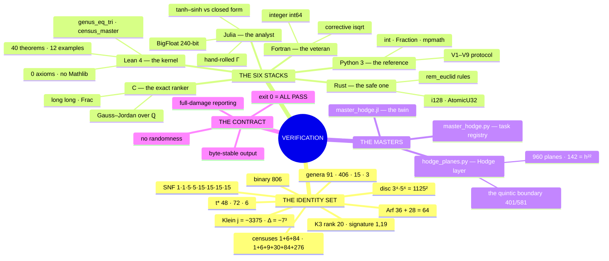

</div>

---

## 🖋 Specimen code — one excerpt per stack

Six short excerpts, straight from the sources, chosen to show the *character* of
each implementation. Full sources are linked in §3.3.

<details open>
<summary><b>🐍 Python — the census as a dictionary comprehension of the mathematics</b></summary>

The census as the identity set written as data structures — the conductor
bucketing is one dictionary update (shown in Python; every integer panel runs
the same triangle):

```python
# the character census: bucket (a, b) by conductor d = N / gcd(N, a, b)
h = {}
for a in range(1, N):
    for b in range(1, N - a):
        d = N // gcd(gcd(N, a), b)
        h[d] = h.get(d, 0) + 1
```

The same loop the Lean kernel *proves* counts `(N−1)(N−2)` characters — see
[`chars_length`](lean/README.md#6-b--the-character-census).

</details>

<details open>
<summary><b>🟣 Lean 4 — the census, proved, not stored</b></summary>

```lean
theorem census_master (N : Nat) : censusTotal N = cInt N
-- for EVERY N: Σ_{d ∣ N} h(d) = c(N)
-- proof: flatten → Fubini over the divisor triangle → columns collapse
--        by the μ key lemma → one surviving term
```

The whole machine layer in one signature: the concrete values (1+6+84 = 91,
1+6+9+30+84+276 = 406) are `decide`-checked corollaries, never literals.

</details>

<details open>
<summary><b>🟡 Julia — the two independent period engines, side by side</b></summary>

```julia
Ω(N, a, b) = gamma_pos(a/N) * gamma_pos(b/N) / gamma_pos((a+b)/N)   # closed form
period_numeric(...) = const1 * (de_quad(h1) + de_quad(h2))           # tanh–sinh
# demanded agreement: worst relative error < 1e-25 across 9 cross-tests
```

The Γ inside `gamma_pos` is hand-rolled (Stirling + exact `Rational{BigInt}`
Bernoulli) — zero external packages, 240-bit precision.

</details>

<details open>
<summary><b>🟠 Rust — the meeting rules with euclidean remainders</b></summary>

```rust
let m4 = |x: i128| x.rem_euclid(4);
if (f1 == 0 && f2 == 1) || (f1 == 1 && f2 == 0) {
    return if m4(a1 + b2 - a2 - b1) == 0 { 1 } else { 0 };
}
```

`rem_euclid` instead of `%`: the mod-4 congruences stay true for negative
intermediates — the exact bug class the C panel must guard against by hand.

</details>

<details open>
<summary><b>🔵 C — the exact fraction type, 8 lines</b></summary>

```c
typedef struct { long long p, q; } Frac;            /* p/q, q > 0, reduced */

static Frac fmul(Frac a, Frac b) { return fmk(a.p * b.p, a.q * b.q); }
static Frac fsub(Frac a, Frac b) { return fmk(a.p*b.q - b.p*a.q, a.q*b.q); }
```

Everything the K3 elimination needs: a make (normalizing), a multiply, a
subtract — and Euclid underneath both.

</details>

<details open>
<summary><b>⚪ Fortran — the corrective square root</b></summary>

```fortran
r = int(sqrt(real(n, kind=8)), kind=int64)   ! float estimates…
do while (r * r > n);  r = r - 1;  end do    ! …integers decide
do while ((r + 1) * (r + 1) <= n);  r = r + 1;  end do
```

Trust nothing, correct everything — the panel's philosophy in six lines.

</details>

---

## 🗂 The masters' section maps

The three Python/Julia files at the top of the folder are internally organized
into numbered sections (§). Their maps, read from the source banners:

### `master_hodge.py` — the Python master (13 048 lines)

| section | block | role |
|:--|:---|:---|
| header | run forms, history v1.4.0 → v1.5.0 | the honest changelog of six sessions |
| §32 | contract substitutions | the template parameters (`{{LANGUAGE}}`, `{{PREFIX}}`…) |
| §3.4 | recipes | named `(preset, profile, tasks, overrides)` bundles; mutation only via `apply_recipe!` |
| §3.2 v6 | honest precision | `HODGEPROG` heartbeat, `mpdec_cost` cost model, `_op_gate/_gamma_gate/_quad_gate` — a predicted-heavy operation fails with `ERR_*` + advice instead of hanging |
| §27.1 / §22.2 | capability probe | read-only env detection, no terminal writes |
| §21 · §22 | theme dark-gold + glyph coloring | palettes, `dye/num/gradient/badge` as pure idempotent functions, ASCII fallbacks, RTL isolation |
| §23 | animations | a scene machine rendering into a "virtual screen"; off in non-tty |
| §11.1 | `HODGEHP` | the high-precision core: π (Chudnovsky), Γ (Stirling + exact Bernoulli + ζ-relation), tanh–sinh, complex arithmetic — self-contained `decimal` |
| §11 | the graphics engine | PNG (zlib + CRC32), GIF89a (own LZW), 5×7 bitmap font, canvas (Bresenham/fill/α-composite), `HODGEPlot` series engine, 3D lab — **stdlib only**, shared GCT palette per run |
| tasks 1–44 | the registry | every claim of the repository as a task with PASS/FAIL/SKIP verdicts |

### `master_hodge.jl` — the Julia twin (9 743 lines)

| block | role |
|:---|:---|
| header history | v1.4.0 → v1.5.0-session8, mirroring the Python sessions |
| §3.2 v5/v6 | precision *without* upper bound: `--prec 4096/5m/1g/2t` suffixes, honest RAM gates, MPFR cost model |
| π / log(2π) caches | constants at *current* working precision (the frozen-π bug class, fixed) |
| Γ layer | shift collapsed into `ln((s−1)!) + ln Π(1+x/k)` with product trees; exact ζ-relation for Bernoulli ratios beyond k = 150 |
| adaptive tanh–sinh | `period_pieces_adaptive`: h → h/2 to 10^{−(digits+1)} — the 1e-83 fixed-grid floor becomes 10^{−98} and below |
| tasks 41–44 | the Hodge-planes layer, ported for parity: planes · certificates · cycles · quintic |
| §11 graphics | the twin GIF89a/PNG engine — GCE timing fixed to the hundredth-of-a-second, LZW round-trip self-tested |

### `hodge_planes.py` — the Hodge layer (876 lines)

| section | block | headline result |
|:--|:---|:---|
| §1 | Hodge numbers of Fermat hypersurfaces — Jacobian ring (Griffiths) × Chern classes × closed formulas | d = 7 → g = 15; d = 30 → g = 406; the K3 quartic (1, 20, 1); the quintic threefold (1, 101, 101, 1) |
| §2 | the H² character census of Fermat surfaces | Σa = m → H^{2,0}, Σa = 2m → H^{1,1}, Σa = 3m → H^{0,2} |
| §3 | the line lattices on S_m — exact Gram matrices, SNF, signatures, character spectra in ℤ[ζ_m] | lines stretch **all** H^{1,1} for m ≤ 4 (ranks 7, 20); only a part from m = 5 (37/45, 62/86, 91/147, 128/232) — the honest boundary of "obvious" cycles |
| §4 | the 960 planes on the quartic fourfold X⁴₄ | P·P = 7, P·P′ ∈ {1, −2, 0}; spectra in ℤ[i]; **142 = h^{2,2} stretched** — a computational verification of the Hodge hypothesis in codimension 2 |
| §7 (masters) | the quintic fourfold X⁵₄ | census 581 by three schemes; 1875 planes stretch **401** — 180 characters need non-linear cycles |

---

## 🛡 The trust-base inventory

What the folder *must* trust, exhaustively — the honest complement to
"nothing is trusted":

| layer | trusted | not trusted (verified instead) |
|:--|:---|:---|
| compilers | gcc/clang codegen, rustc, gfortran, the Julia runtime, the Lean toolchain build | none of the panel *logic* — all of it is source-visible |
| standard libraries | `stdio`, `AtomicU32`, `iso_fortran_env`, Julia `Base`, Python stdlib, Lean core | any bignum library for the integer claims (C/Fortran fit in int64; Rust's i128 is native) |
| numeric engines | mpmath (Python analytic), MPFR (Julia BigFloat) | every *formula* — double-checked against independent methods |
| the Lean kernel | the type theory implementation | every proof term — no `native_decide`, no compiled oracle |
| mathematics | the definitions (Fermat curve, characters, μ, lpf) as stated in the monographs | every *derived claim* of the identity set |
| the assets | matplotlib, Pillow, the SVG spec | every *number plotted* — recomputed by the generators with assertions |

The asymmetry is the design: the folder trusts **implementations of arithmetic**
(minimally, and in triplicate) and verifies **every statement**.

---

## 🚨 The failure playbook

When a stack disagrees, the folder is designed to make the disagreement itself
informative. The triage sequence:

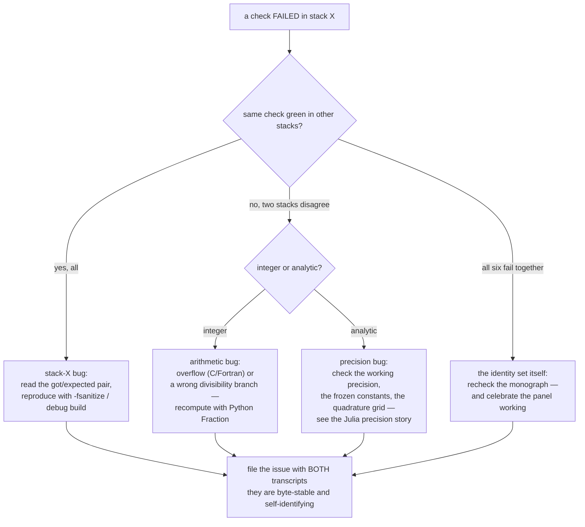

Three design properties make this playbook work: **full-damage reporting** (the
panel never stops at the first failure, so you see the whole disagreement
pattern), **self-identifying check names** (unique across the folder), and
**byte-stable transcripts** (the failure reproduces identically anywhere).

---

## ❓ Extended FAQ (part II)

<details>
<summary><b>Q14. Which single check is the most sensitive to bugs?</b></summary>

The K3 rank over ℚ. Its 2 401 entries come from six combinatorial rules, and its
elimination touches every one of them — a single flipped rule moves the rank off
20 (usually to 18 or 21). It is also the check with the most independent
implementations (C, Rust, Python) and the only one with a mod-p *fingerprint*
(18 at p = 2, 20 at p = 3, 5, 7, 101).
</details>

<details>
<summary><b>Q15. Why do the panels report counts like "38 PASS" instead of a single boolean?</b></summary>

Diagnostics. A single boolean collapses 38 opportunities to localize a bug into
one. The counts also serve as a coverage fingerprint: CI asserts the *count* per
stack, so accidentally deleting a check (or silently skipping one) fails the build
even when every remaining check passes.
</details>

<details>
<summary><b>Q16. How do the panels handle negative numbers in the Klein identities?</b></summary>

By keeping everything in signed integer types wide enough for the magnitudes —
`long long` in C, `i128` in Rust, `int64` in Fortran, machine `Int` in Julia. The
mod-4 rules are the one place where "negative" has mathematical meaning
(congruence, not truncation), which is why the Rust panel uses `rem_euclid` and
the C panel normalizes explicitly.
</details>

<details>
<summary><b>Q17. Is there a minimum hardware requirement?</b></summary>

No. The heaviest artifact is the C panel's static 38 KB matrix; the Lean
elaboration peaks at a few hundred MB during kernel reduction. Anything that runs
the toolchains runs the panels — including Termux on a phone (one of the
documented platform targets of the masters).
</details>

<details>
<summary><b>Q18. Why is the folder called "verification" and the masters' suite "tasks"?</b></summary>

The masters (`master_hodge.py`/`.jl`) run the *program's* task registry — the
V1–V9 protocol, certificates, the Hodge-planes layer — where a "task" is a unit of
the laboratory's workload. This folder's panels are the *independent witnesses*:
they re-derive the identity set from the mathematics. The two systems share the
verdict vocabulary (PASS/FAIL, exit codes) but not the code.
</details>

<details>
<summary><b>Q19. What happens if a future refactor makes a stack slower — is there a timeout?</b></summary>

The panels are all sub-second except Julia and Lean (seconds), and the masters
enforce their own timeout/signal machinery for long tasks. The verification
folder itself has no internal timeouts — determinism means "it finishes, always",
and the certified timings are documented in §12.3.
</details>

---

## 🖋 Colophon — how this documentation is built

| artifact | produced by | from |
|:---|:---|:---|
| the four identity-set charts | matplotlib scripts (stdlib + the same formulas) | recomputed censuses, Arf counts, the exact 49×49 matrix (with a rank-20 assertion inside the generator), the documented thresholds |
| the two GIFs | Pillow frame scripts | the real per-stack check counts (9 · 52 · 14 · 24 · 38 · 32) and the exact h_d table |
| the six SVG banners + two avatars | hand-authored markup + CSS | the stacks' factual tables; `prefers-reduced-motion` respected |
| this README suite | Markdown | the sources themselves — every count, value and line reference cross-checked against the code |

The regeneration rule: **if a number in the identity set changes, the assets
regenerate with it** — the charts cannot silently disagree with the panels,
because they are computed from the same formulas rather than drawn from the old
pictures.

<div align="center">

<sub>documentation suite v2.1 · verification/ · Hodge Laboratory</sub>

</div>

---

## 🗃 Appendix A — the identity set in machine-readable form

The catalog of §2, as data — the form a linter, a dashboard or a CI gate can
consume directly. Values are exact; the `layers` field lists the stack columns of
the cross-reference matrix.

```json
{
  "identity_set": "hodge-laboratory/verification · v2.1",
  "identities": [
    {"id": "G-15",    "claim": "genus of the Fermat curve of degree 15",                 "value": 91,       "layers": ["python", "lean", "julia", "fortran", "c", "rust"]},
    {"id": "G-30",    "claim": "genus of the Fermat curve of degree 30",                 "value": 406,      "layers": ["python", "lean", "julia", "fortran", "c", "rust"]},
    {"id": "G-07",    "claim": "genus of the Fermat curve of degree 7",                  "value": 15,       "layers": ["python", "lean", "julia", "fortran", "c", "rust"]},
    {"id": "G-04",    "claim": "genus of the Fermat curve of degree 4",                  "value": 3,        "layers": ["python", "lean", "c"]},
    {"id": "C-Σ15",   "claim": "census sum over conductors, N=15",                       "value": 91,       "layers": ["python", "lean", "julia", "fortran", "c", "rust"]},
    {"id": "C-Σ30",   "claim": "census sum over conductors, N=30",                       "value": 406,      "layers": ["python", "lean", "julia", "fortran", "c", "rust"]},
    {"id": "C-Σ7",    "claim": "census sum over conductors, N=7",                        "value": 15,       "layers": ["python", "lean", "julia", "fortran"]},
    {"id": "C-h3",    "claim": "census value h(3)",                                      "value": 1,        "layers": ["python", "lean", "julia", "fortran", "c", "rust"]},
    {"id": "C-h5",    "claim": "census value h(5)",                                      "value": 6,        "layers": ["python", "lean", "julia", "fortran", "c", "rust"]},
    {"id": "C-h6",    "claim": "census value h(6)",                                      "value": 9,        "layers": ["python", "lean", "julia", "c", "rust"]},
    {"id": "C-h10",   "claim": "census value h(10)",                                     "value": 30,       "layers": ["python", "lean", "julia", "c", "rust"]},
    {"id": "C-h15",   "claim": "census value h(15)",                                     "value": 84,       "layers": ["python", "lean", "julia", "fortran", "c", "rust"]},
    {"id": "C-h30",   "claim": "census value h(30)",                                     "value": 276,      "layers": ["python", "lean", "julia", "fortran", "c", "rust"]},
    {"id": "D-fac",   "claim": "stand discriminant, prime-power form",                   "value": "3^4*5^6=1265625", "layers": ["python", "julia", "fortran", "c", "rust"]},
    {"id": "D-vol",   "claim": "square form / volume scale",                             "value": "1125^2=1265625",  "layers": ["python", "julia", "fortran", "c", "rust"]},
    {"id": "S-type",  "claim": "SNF type of the stand lattice",                          "value": [1,1,5,5,15,15,15,15], "layers": ["python", "fortran", "c", "rust"]},
    {"id": "S-prod",  "claim": "product of the SNF invariants equals the discriminant",  "value": 1265625,  "layers": ["python", "julia", "fortran", "c", "rust"]},
    {"id": "S-Q",     "claim": "denominator bound Q_stand",                              "value": 480,      "layers": ["python", "julia", "fortran", "c", "rust"]},
    {"id": "K-c4",    "claim": "Klein c4 cubed",                                         "value": "105^3=1157625",   "layers": ["python", "c", "rust"]},
    {"id": "K-dj",    "claim": "|Delta|*|j| = c4^3",                                     "value": "343*3375=1157625", "layers": ["python", "fortran", "c", "rust"]},
    {"id": "K-j",     "claim": "Klein j-invariant",                                      "value": -3375,    "layers": ["python", "julia", "fortran", "c", "rust"]},
    {"id": "K-D",     "claim": "Klein discriminant",                                     "value": "-7^3=-343", "layers": ["python", "c"]},
    {"id": "K-dv",    "claim": "disc(v^2+7v+14)",                                        "value": -7,       "layers": ["python", "c"]},
    {"id": "A-g1",    "claim": "even theta-characteristics, g=1",                        "value": 3,        "layers": ["python", "fortran", "c", "rust"]},
    {"id": "A-g2",    "claim": "even theta-characteristics, g=2",                        "value": 10,       "layers": ["python", "fortran", "c", "rust"]},
    {"id": "A-g3-",   "claim": "even theta-characteristics, g=3",                        "value": 36,       "layers": ["python", "fortran", "c", "rust"]},
    {"id": "A-g3+",   "claim": "odd theta-characteristics, g=3",                         "value": 28,       "layers": ["python", "fortran", "c", "rust"]},
    {"id": "A-g3Σ",   "claim": "total theta-characteristics, g=3",                       "value": 64,       "layers": ["python", "fortran", "c", "rust"]},
    {"id": "A-g4",    "claim": "even theta-characteristics, g=4",                        "value": 136,      "layers": ["python", "fortran", "c", "rust"]},
    {"id": "E4-1",    "claim": "t*(48,48,1,1)",                                          "value": 48,       "layers": ["python", "julia", "fortran", "c", "rust"]},
    {"id": "E4-2",    "claim": "t*(24,36,3,5)",                                          "value": 72,       "layers": ["python", "julia", "fortran", "c", "rust"]},
    {"id": "E4-3",    "claim": "t*(12,12,4,6)",                                          "value": 6,        "layers": ["python", "fortran", "c", "rust"]},
    {"id": "B-806",   "claim": "binary-code reference total",                            "value": 806,      "layers": ["python", "c", "rust"]},
    {"id": "K3-rank", "claim": "exact rank over Q of the 49x49 intersection matrix",     "value": 20,       "layers": ["python", "c", "rust"]},
    {"id": "K3-iso",  "claim": "mu4-isotypy decomposition of the line span",             "value": 22,       "layers": ["python", "fortran", "c", "rust"]},
    {"id": "K3-sig",  "claim": "signature of the Picard lattice",                        "value": [1,19],   "layers": ["python", "fortran", "c", "rust"]},
    {"id": "K3-det",  "claim": "determinant of the rank-20 lattice",                     "value": 64,       "layers": ["python", "fortran"]}
  ],
  "analytic_laws": [
    {"id": "Ω-form",  "claim": "closed period form vs tanh-sinh quadrature", "threshold": "1e-25", "layers": ["python", "julia"]},
    {"id": "Φ-law",   "claim": "arg P = 2π(ra+sb)/N",                        "threshold": "1e-25", "layers": ["python", "julia"]},
    {"id": "Γ-ladder","claim": "Γ(k/N)Γ(1−k/N) = π/sin(πk/N)",               "threshold": "1e-30", "layers": ["python", "julia"]},
    {"id": "EQ-law",  "claim": "μ_N×μ_N equivariance",                       "threshold": "1e-30", "layers": ["python", "julia"]}
  ],
  "counts": {"c": 38, "rust": 32, "fortran": 24, "julia": 14, "lean_theorems": 40, "lean_examples": 12, "python_protocol_stages": 9}
}
```

The `counts` block is the CI assertion source: if a panel's PASS count ever
differs from its entry here, the coverage contract is broken and the diff must be
reviewed before anything merges.

---

## 🧰 Appendix B — toolchain installation matrix

One-time setup for every stack, per platform family:

| stack | linux | macOS | windows |
|:--|:---|:---|:---|
| Python 3.10+ | distro package or pyenv | system / brew | winget or python.org |
| Lean v4.36.0 | `elan-init.sh -y` then `elan default leanprover/lean4:v4.36.0` | same script | same script (WSL2 recommended) |
| Julia ≥ 1.9 | juliaup or the tarball | juliaup / brew | juliaup |
| gcc ≥ 11 | distro package | brew (or Xcode CLT) | MSYS2 / WSL2 |
| rustc ≥ 1.70 | rustup | rustup | rustup |
| gfortran ≥ 10 | distro package | brew (`gcc` formula) | MSYS2 / WSL2 |

> The panels are deliberately toolchain-minimal: no lake project, no cargo tree,
> no pip requirements, no venv — each stack runs its file directly. The masters
> (`master_hodge.py`) are equally stdlib-bound; only the Python analytic layer
> adds `mpmath`.

---

## 🗺 Appendix C — the documentation index of the verification folder

Every document that belongs to this folder, in reading order:

| # | document | depth | audience |
|:--|:---|:--|:---|
| 1 | [README.md](README.md) (this file) | the full map | everyone |
| 2 | [lean/README.md](lean/README.md) | 40 theorems, spoiler by spoiler | mathematicians, Lean users |
| 3 | [c/README.md](c/README.md) | the exact rank, line by line | C readers, reviewers |
| 4 | [rust/README.md](rust/README.md) | the i128 budget, the borrow-checker view | Rust readers |
| 5 | [fortran/README.md](fortran/README.md) | the int64 discipline, the corrective isqrt | Fortran readers |
| 6 | [julia/README.md](julia/README.md) | the analytic layer, the precision story | numerics readers |
| 7 | [`assets/`](assets/) | banners, avatars, GIFs, charts — all generated | everyone |
| 8 | the sources: [`lean/HodgeLaboratory.lean`](lean/HodgeLaboratory.lean) · [`c/verify_hodge.c`](c/verify_hodge.c) · [`rust/verify_hodge.rs`](rust/verify_hodge.rs) · [`fortran/verify_hodge.f90`](fortran/verify_hodge.f90) · [`julia/verify_hodge.jl`](julia/verify_hodge.jl) | 1 942 lines total | the final authority |

Beyond the folder: the [main README](../README.md) (the laboratory), the
[theorems README](../theorems/README.md) (22 monographs), and the monographs
themselves — [T01](../theorems/T01_genus_fermat/) (genera),
[T08](../theorems/T08_k3_stand/) (K3), [T09](../theorems/T09_errata_e8/) (Arf),
[T16](../theorems/T16_certificate_h_klein/) (Klein),
[T20](../theorems/T20_conductor_census/) (census),
[T22](../theorems/T22_snf_spectra/) (SNF) — own the mathematics this folder
verifies.

<sub>The five source files total 1 942 lines: 1 063 (Lean) + 215 (C) + 237
(Rust) + 167 (Fortran) + 195 (Julia) — the entire machine-readable verification
of the program's headline numbers, readable in one sitting.</sub>
