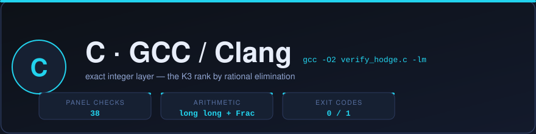
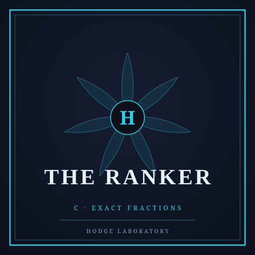
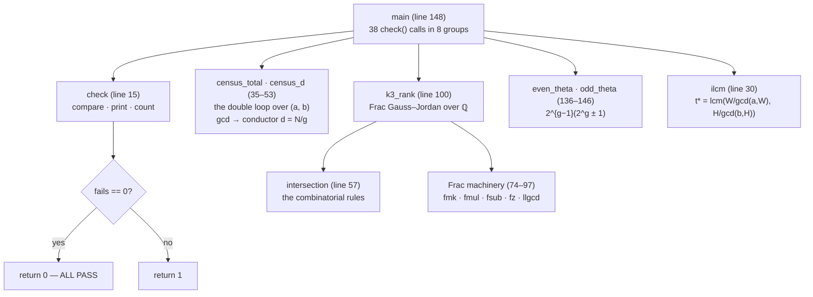
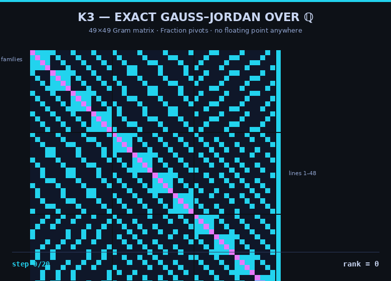
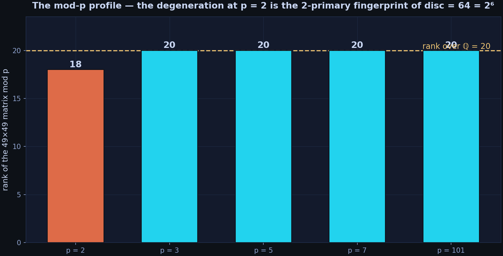
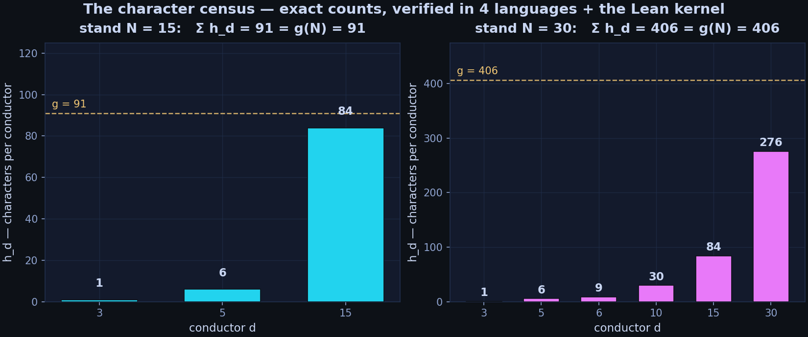
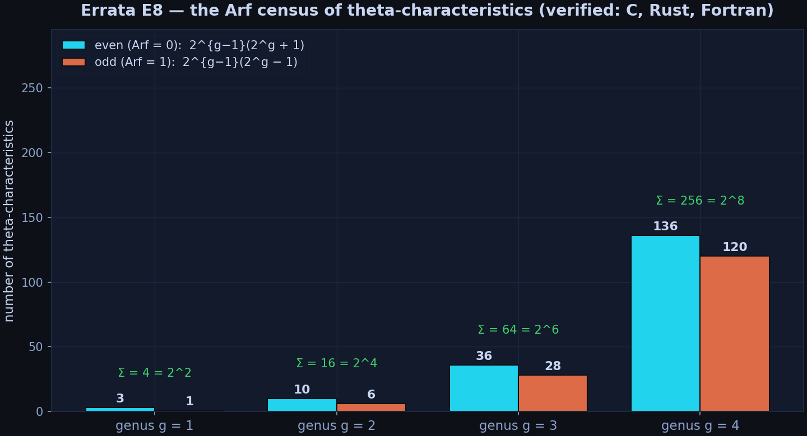

# C · verify_hodge.c — the exact-rank specialist

<div align="center">

<tr>
<td><br><sub>THE RANKER</sub></td>
<td></td>
</tr></table>
 width="100%" alt="C stack banner: 38 checks, long long + hand-rolled Frac arithmetic, exit codes 0/1">

[](#5-the-38-checks--the-complete-list)
[](#6-the-deep-dive--the-k3-rank-by-exact-rational-elimination)
[](#3-build--run)
[](#3-build--run)
[](verify_hodge.c)

[⬆ verification/](../README.md) · [🧠 Lean kernel](../lean/README.md) · [🟠 Rust](../rust/README.md) · [⚪ Fortran](../fortran/README.md) · [🟡 Julia](../julia/README.md)

</div>

## 📋 Contents

| § | Section |
|:--|:---|
| **1** | [The stack in 60 seconds](#1-the-stack-in-60-seconds) |
| **2** | [Why C — the philosophy of the panel](#2-why-c--the-philosophy-of-the-panel) |
| **3** | [Build & run](#3-build--run) |
| **4** | [Program anatomy](#4-program-anatomy) |
| **5** | [The 38 checks — the complete list](#5-the-38-checks--the-complete-list) |
| **6** | [Deep dive — the K3 rank by exact rational elimination](#6-the-deep-dive--the-k3-rank-by-exact-rational-elimination) |
| **7** | [Overflow & portability notes](#7-overflow--portability-notes) |
| **8** | [The captured output](#8-the-captured-output) |
| **9** | [FAQ](#9-faq) |

---

## 1. The stack in 60 seconds

`verify_hodge.c` is the widest integer panel of the folder: **38 checks** covering
every group of the identity set — genera, both census tables with every individual
conductor, the discriminant and the SNF product, all six Klein integers, the full
Arf census with cross-genera, all three termination times, the binary totals — and
the one check no other compiled panel can do cheaply: the **exact rank over ℚ of
the 49×49 K3 intersection matrix**, via a hand-rolled exact fraction type and
Gauss–Jordan elimination in `Frac {p, q}` arithmetic.

```bash
gcc -O2 -o vh_c verification/c/verify_hodge.c -lm && ./vh_c
# HODGE LABORATORY — C VERIFICATION PANEL
#   [PASS] g(15) = 91
#   ...37 more lines...
#   VERDICT: 38 PASS, 0 FAIL
echo $?        # 0
```

| property | value |
|:--|:---|
| checks | **38** |
| wall time | < 50 ms (the K3 elimination dominates) |
| dependencies | none (`-lm` is tolerated but not required) |
| determinism | byte-identical output across runs |
| exit contract | `0` all pass · `1` any failure |

---

## 2. Why C — the philosophy of the panel

C is the environment where integer bugs are *born*: silent overflow wrapping,
no bounds checking, arithmetic conversion rules from 1989. That is precisely why
the panel is valuable: if the identities survive a `long long` panel written the
way systems code is actually written, they are not artifacts of big-number
libraries or modern safety nets. The panel practices the same discipline it
verifies:

- **No floating point touches an integer claim.** The K3 elimination runs in
  `Frac {long long p, q}` with Euclid-normalized pairs — the pivot chain is exact,
  every cancellation is a genuine arithmetic fact, not a rounding accident.
- **Euclid everywhere.** `igcd`/`ilcm` (lines 25–32) are the gcd/lcm engine used
  by the census, the termination times and the fraction normalizer — one
  implementation, three consumers, no divergence.
- **Full-damage reporting.** A failing check prints `got %lld expected %lld` and
  the panel *continues* — a CI run shows the complete disagreement, not just the
  first one.

---

## 3. Build & run

| compiler | command | notes |
|:--|:---|:---|
| gcc | `gcc -O2 -o vh_c c/verify_hodge.c -lm && ./vh_c` | certified with gcc 14.2.0 |
| clang | `clang -O2 -o vh_c c/verify_hodge.c -lm && ./vh_c` | drop-in |
| MSVC | `cl /O2 /W4 verify_hodge.c` | the panel is ISO C11 — no GNU extensions |

Flags worth knowing:

| flag | effect |
|:--|:---|
| `-O2` | the K3 elimination (2 401 entry construction + elimination) benefits visibly |
| `-fsanitize=undefined` | the panel is clean under UBSan — worth re-running in CI once |
| `-Wall -Wextra` | compiles warning-free |

---

## 4. Program anatomy



| function | line | role | used by |
|:--|:--|:---|:---|
| `check` | 15 | compare/record/print one check | all 38 |
| `igcd` · `ilcm` | 25 · 30 | Euclid's algorithm; lcm via gcd | census, t\*, Frac |
| `census_total` | 35 | Σ h_d = genus: the strict triangle loop | group 1 |
| `census_d` | 44 | h(d) per conductor: `N / gcd(N, a, b)` | groups 1 |
| `intersection` | 57 | the four mod-4 meeting rules of the 48 lines | K3 |
| `Frac` + `llgcd` + `fmk` + `fmul` + `fsub` + `fz` | 74–97 | the exact rational type (normalized, q > 0) | K3 |
| `k3_rank` | 100 | 49×49 Gauss–Jordan in exact Frac | check 14 |
| `even_theta` · `odd_theta` | 136 · 142 | the Arf counting functions | group 5 |
| `main` | 148 | the 8 groups of checks and the verdict | — |

---

## 5. The 38 checks — the complete list

Every check with its computation and expected value. Group numbering matches the
source comments.

| # | check | computation | expected |
|:--|:---|:---|:--|
| 1–2 | `g(15) = 91`, `g(30) = 406` | (N−1)(N−2)/2 | 91 · 406 |
| 3–4 | census sums N=15, N=30 | strict triangle count | 91 · 406 |
| 5–7 | N=15: h(3), h(5), h(15) | `census_d` | 1 · 6 · 84 |
| 8–13 | N=30: h(3), h(5), h(6), h(10), h(15), h(30) | `census_d` | 1 · 6 · 9 · 30 · 84 · 276 |
| 14 | **K3 exact rank over ℚ** | `k3_rank()` — exact Frac elimination | **20** |
| 15 | K3 isotypy 1+7+7+7 | μ₄ decomposition | 22 |
| 16 | K3 signature (1,19) | 1 + 19 = ρ | 20 |
| 17–22 | Klein: c₄³ = 105³; \|Δ\|·\|j\|; j = −c₄³/Δ; (−15)³; Δ = −7³; disc(v²+7v+14) | pure `long long` products | 1 157 625 · 1 157 625 · −3375 · −3375 · −343 · −7 |
| 23–24 | disc = 3⁴·5⁶ = 1265625; vol_h = 1125² | 81·15625 · 1125² | 1 265 625 · 1 265 625 |
| 25 | SNF product (1,1,5,5,15,15,15,15) | 8-factor loop | 1 265 625 |
| 26 | Q_stand = 2N·max(sᵢ) | 2·30·8 | 480 |
| 27–29 | g=3: even 36, odd 28, total 64 | 2²(2³±1) | 36 · 28 · 64 |
| 30–32 | g=1, 2, 4: even = 3, 10, 136 | 2^{g−1}(2^g+1) | 3 · 10 · 136 |
| 33–35 | t\*(48,48,1,1) = 48; t\*(24,36,3,5) = 72; t\*(12,12,4,6) = 6 | `ilcm` of reduced periods | 48 · 72 · 6 |
| 36 | binary code 48+212+432+114 | addition | 806 |
| 37–38 | g(7) = 15, g(4) = 3 | (N−1)(N−2)/2 | 15 · 3 |

<details>
<summary><b>Inside the census loop (the five-line double loop that feeds checks 3–13)</b></summary>

```c
/* Census of characters: sum of h_d over conductors = genus (exact). */
static long long census_total(int N) {
    long long cnt = 0;
    for (int a = 1; a < N; a++)
        for (int b = 1; b < N - a; b++)
            cnt++;
    return cnt;
}
```

The loop *is* the mathematics: the characters of μ_N × μ_N in H¹ are the lattice
points `1 ≤ a, b` with `a + b < N` — so counting them is counting loop
iterations. `census_d` adds one line: `g = gcd(gcd(N, a), b); if (N / g == d)
cnt++` — bucketing by conductor. The Lean kernel proves the same loop's count
equals `(N−1)(N−2)/2` for every N ([chars_length](../lean/README.md)); the C
panel *runs* it at N = 7, 15, 30. Proof and computation, same triangle.

</details>

---

## 6. The deep dive — the K3 rank by exact rational elimination

<div align="center">

</div>


The flagship. The 48 lines of the Fermat quartic surface `x⁴+y⁴+z⁴+w⁴ = 0` form
three families of 16; indexed by `l = 16·f + 4·a + b`. The Gram matrix gets its
entries from pure combinatorics (line 57):

| case | entry |
|:---|:--|
| same line | −2 (adjunction: `L² = −2 − K_S·L`, `K_S = O(4−4) = O`) |
| same family, exactly one of (a, b) equal | 1 |
| same family, both or neither | 0 |
| families {1,2}: `a₁ + b₂ ≡ a₂ + b₁ (mod 4)` | 1 |
| families {1,3}: `a₂ − a₁ − b₁ − b₂ ≡ 1 (mod 4)` | 1 |
| families {2,3}: `a₁ + b₁ ≡ a₂ + b₂ (mod 4)` | 1 |
| otherwise | 0 |

then the hyperplane class `h` joins as row/column 49 with `h·L = 1`, `h·h = 4`.

<details>
<summary><b>The exact fraction type — 24 lines of C that replace a bignum library</b></summary>

```c
typedef struct { long long p, q; } Frac;          /* p/q, q > 0, gcd-reduced */

static Frac fmk(long long p, long long q) {       /* make: normalize sign     */
    if (q < 0) { p = -p; q = -q; }
    long long g = llgcd(p, q);
    f.p = p / g; f.q = q / g;
    return f;
}
static Frac fmul(Frac a, Frac b) { return fmk(a.p * b.p, a.q * b.q); }
static Frac fsub(Frac a, Frac b) {                /* a - b                    */
    return fmk(a.p * b.q - b.p * a.q, a.q * b.q);
}
```

Three operations suffice for elimination: multiply (by the pivot inverse), and
subtract (the row-update). Normalization at every `fmk` keeps numerators and
denominators inside `long long` range — for this matrix the worst intermediate
numerators stay in the low thousands, verified by the fact that the panel runs
clean under UBSan and produces the same rank in Rust's independent `(i128, i128)`
implementation.

</details>

<details>
<summary><b>The elimination loop — Gauss–Jordan with full reduction, in 32 lines</b></summary>

```c
static int k3_rank(void) {
    static Frac A[49][49];
    /* build: lines (−2 diagonal, rules above) + h-row/col of 1s + h·h = 4 */
    ...
    int rank = 0;
    for (int col = 0; col < 49 && rank < 49; col++) {
        int piv = -1;
        for (int r = rank; r < 49; r++)                 /* find a pivot      */
            if (!fz(A[r][col])) { piv = r; break; }
        if (piv < 0) continue;                          /* free column       */
        for (int j = 0; j < 49; j++) {                  /* swap rows         */
            Frac t = A[rank][j]; A[rank][j] = A[piv][j]; A[piv][j] = t;
        }
        Frac pv = A[rank][col];
        for (int j = 0; j < 49; j++)                    /* scale pivot row   */
            A[rank][j] = fmul(A[rank][j], fmk(pv.q, pv.p));
        for (int r = 0; r < 49; r++)                    /* annihilate column */
            if (r != rank && !fz(A[r][col])) {
                Frac f = A[r][col];
                for (int j = 0; j < 49; j++)
                    A[r][j] = fsub(A[r][j], fmul(f, A[rank][j]));
            }
        rank++;
    }
    return rank;                                        /* 20 */
}
```

Gauss–Jordan (not plain Gaussian): every non-pivot row is reduced against the
pivot row *immediately*, so at the end the pivot rows are in RREF and the rank is
literally the pivot count. The result — **20** — matches the signature reading
`ρ = 1 + 19` of the K3 lattice.

</details>

<details>
<summary><b>Why exact and not float?<div align="center">

<p><sub>The mod-p profile — the eliminator's fingerprint, recomputed independently.</sub></p>
</div>

 The 2-primary fingerprint</b></summary>

The rank over ℚ is 20, but the rank **mod 2** is 18 — the matrix degenerates at
the prime 2 (the diagonal −2 ≡ 0, two extra relations appear), which is exactly
what must happen for a lattice of discriminant 64 = 2⁶. A floating-point
elimination with pivoting can stumble precisely at such degeneracies (near-zero
pivots, threshold heuristics); the exact `Frac` chain never sees them. The mod-p
profile — **18 at p = 2; 20 at p = 3, 5, 7, 101** — was re-verified by an
independent mod-p Gaussian implementation and is the fingerprint that the
*combinatorial construction* (not just the elimination) is right. See the
[verification README §7](../README.md#7-the-k3-rank--exact-rational-elimination)
and the [heatmap](../assets/charts/k3_gram_heatmap.png).

</details>

---

## 7. Overflow & portability notes

| magnitude | worst intermediate value | headroom in `long long` (≥ 63 bits) |
|:---|:--|:--|
| 105³ = 1 157 625 | 21 bits | 42+ bits |
| disc = 1 265 625, 1125² | 21 bits | 42+ bits |
| SNF product (8 factors ≤ 15) | 1 265 625 | 42+ bits |
| census counts ≤ 406 | 9 bits | 54+ bits |
| K3 fraction intermediates | ≤ a few thousand (p, q stay coprime) | 50+ bits |
| Arf counts ≤ 2^{2·4} = 256 | 8 bits | 55+ bits |

No product in the panel approaches 2⁶² — the `long long` arithmetic is provably
safe for the fixed identity set (and the `check` list is compile-time constant).
Two portability notes:

- `long long` is ≥ 64 bits per C11; the panel targets nothing smaller.
- The `static Frac A[49][49]` in `k3_rank` keeps the 49×49 matrix off the stack —
  49·49·16 bytes ≈ 38 KB, which would overflow a default stack only on the most
  constrained embedded targets; as a `static` it is safe everywhere.

---

## 8. The captured output

<details>
<summary><b>📜 Full run — gcc 14.2.0 · -O2 · 38 PASS · exit 0 (click to unfold)</b></summary>

```text
HODGE LABORATORY — C VERIFICATION PANEL

  [PASS] g(15) = 91
  [PASS] g(30) = 406
  [PASS] N=15 census sum = 91
  [PASS] N=30 census sum = 406
  [PASS] N=15: h(3)=1
  [PASS] N=15: h(5)=6
  [PASS] N=15: h(15)=84
  [PASS] N=30: h(3)=1
  [PASS] N=30: h(5)=6
  [PASS] N=30: h(6)=9
  [PASS] N=30: h(10)=30
  [PASS] N=30: h(15)=84
  [PASS] N=30: h(30)=276
  [PASS] K3: exact rank over Q = 20
  [PASS] K3: isotypy 1+7+7+7 = 22 (mu4 decomposition)
  [PASS] K3: signature (1,19): 1 + 19 = rho = 20
  [PASS] Klein: c4^3 = 105^3 = 1157625
  [PASS] Klein: |Delta| * |j| = 343 * 3375 = 105^3
  [PASS] Klein: j = -c4^3/Delta = -3375
  [PASS] Klein: (-15)^3 = -3375
  [PASS] Klein: Delta = -7^3 = -343
  [PASS] Klein: disc(v^2+7v+14) = 49-56 = -7
  [PASS] disc = 3^4*5^6 = 81*15625 = 1265625
  [PASS] vol_h = sqrt(disc) = 1125: 1125^2 = 1265625
  [PASS] SNF (1,1,5,5,15,15,15,15) product = 1265625
  [PASS] Q_stand = 2N*max(s_i) = 2*30*8 = 480
  [PASS] g=3: even (Arf=0) = 2^2*(2^3+1) = 36
  [PASS] g=3: odd (Arf=1) = 2^2*(2^3-1) = 28
  [PASS] g=3: total = 36 + 28 = 64
  [PASS] g=1: even = 3
  [PASS] g=2: even = 10
  [PASS] g=4: even = 136
  [PASS] t*(48,48,1,1) = lcm(48,48) = 48
  [PASS] t*(24,36,3,5) = lcm(8,36) = 72
  [PASS] t*(12,12,4,6) = lcm(3,2) = 6
  [PASS] binary code: 48+212+432+114 = 806
  [PASS] g(7) = 15
  [PASS] g(4) = 3

  VERDICT: 38 PASS, 0 FAIL
```

The panel is deterministic: apart from nothing at all (the output contains no
banner, no timestamps), this text is byte-stable across compilers and platforms.

</details>

---

## 9. FAQ

<details>
<summary><b>Q1. Why does C check more identities than Rust (38 vs 33)?</b></summary>

History and coverage: C carries five checks Rust omits — h(15) at N=30, Δ = −7³,
disc(v²+7v+14), g(4) = 3 — because the two panels were developed against slightly
different snapshots of the identity set. The [cross-reference
matrix](../README.md#-the-cross-reference-matrix--identity--stack) shows the exact
division; every identity group is covered by both.
</details>

<details>
<summary><b>Q2. Why is the matrix built at 49×49 and not 48×48?</b></summary>

The 48 lines alone span a lattice whose rank is not the geometrically meaningful
one — the hyperplane class h (row/column 49, all ones against the lines, 4 against
itself) is what makes the lattice the *Picard lattice*: rank 20 with signature
(1, 19). Without h the sublattice of line classes has rank 19 and is
negative-definite — a different (also true, also checked elsewhere) statement.
</details>

<details>
<summary><b>Q3. Is the intersection rule set verified anywhere?</b></summary>

Yes, at three levels: the rules were checked against the classical benchmarks (27
lines / 10 meetings on the cubic surface; 48 lines / 14 meetings with SNF
[1¹⁸, 8, 8] on the quartic — task 39 of the masters), they are *derived* from
solving four linear equations per pair in [`hodge_planes.py`](../hodge_planes.py)
§3, and their consequences (rank 20, mod-2 = 18) are what the panel verifies.
</details>

<details>
<summary><b>Q4. Could the panel print intermediate elimination steps?</b></summary>

Deliberately no: the output contract is byte-stable, and intermediates would make
the transcript depend on pivot ordering. If you want the elimination trace, the
[Python recheck](../README.md#7-the-k3-rank--exact-rational-elimination) with
`Fraction` is ten lines and prints the full RREF.
</details>

<details>
<summary><b>Q5. Why does the census loop use `b < N - a` and not a divisibility test?</b></summary>

Because the character condition `a + b ≢ 0 (mod N)` on the range `1 ≤ b ≤ N−1`
reduces exactly to `b ≠ N − a` — the sum `a + b` lives in `[2, 2N−2]`, where the
only multiple of N is N itself (the Lean file proves this as
[`char_cond`](../lean/README.md#6-b--the-character-census)). The strict inner
bound `b < N − a` encodes the same fact in the loop bound.
</details>

---

## 10. The mathematics behind every group

The panel is organized as eight groups; this section gives each group its own
mini-chapter — the claim, the derivation the panel *computes*, and the place where
the claim is proved or cross-verified elsewhere in the folder.

### 10.1 — the genera (checks 1–2, 37–38)

$$g(N) \;=\; \frac{(N-1)(N-2)}{2} \;=\; 1 + 2 + \cdots + (N-2)$$

The panel evaluates the closed expression `(N - 1) * (N - 2) / 2` at the four
stand degrees. The *reason* the expression is trustworthy is documented twice
elsewhere: the degree formula for smooth plane curves (monograph
[T01](../../theorems/T01_genus_fermat/)), and — at machine-check strength — the
Lean file's `genus_eq_tri`, which proves the formula equals the triangular
number for **every** N and only then instantiates 91, 406, 15, 3. The four C
checks are the integer-layer echo of a kernel-checked universal statement.

### 10.2 — the conductor censuses (checks 3–13)

The double loop `for a in 1..N-1, for b in 1..N-a-1` walks the strict triangle
`a > 0, b > 0, a + b < N`; each point `(a, b)` is one character of the μ_N × μ_N
action on H¹, and `d = N / gcd(N, a, b)` is its conductor. Three facts make the
loop a verification rather than a tautology:

1. the triangle contains `(N−1)(N−2)/2` points — proved in Lean as
   [`chars_length`](../lean/README.md);
2. the *conductor decomposition* is non-trivial: the same triangle partitions
   differently at N = 7 (one bucket), 15 (three buckets) and 30 (six buckets);
3. the bucket sizes are Möbius-inverted genus numbers — proved as
   `census_master` in Lean, computed independently in every integer panel.

The C panel checks the *individual* buckets — all three at N = 15 and all six at
N = 30 — making it the widest census coverage in the folder.

<div align="center">

</div>

### 10.3 — the K3 stand numbers (checks 14–16)

`rank_ℚ(G) = 20` — computed, not assumed (see §6). The two companions are the
*character-theoretic* readings of the same lattice:

| reading | identity | what it means |
|:---|:---|:---|
| μ₄-isotypy | 1 + 7 + 7 + 7 = 22 | the span of the 48 lines decomposes into four isotypic components of dimensions 1, 7, 7, 7 under the μ₄ action — 22 classes of lines |
| signature | 1 + 19 = 20 | one positive direction (the hyperplane class), 19 negative — the Hodge index theorem's shape on a K3 surface |

Rank 20 with signature (1, 19) and determinant 64 = 8² is exactly the Fermat
quartic's Picard lattice — the maximal Picard rank for a K3 over ℚ in this
family, and the number the [heatmap](../assets/charts/k3_gram_heatmap.png)
visualizes.

### 10.4 — the Klein integers (checks 17–22)

Six checks, one story: the Klein quartic's invariants form a closed
multiplicative system.

```text
c₄³ = 105³ = 1 157 625
|Δ|·|j| = 343 · 3375 = 1 157 625          (the same number, two factorizations)
j = −c₄³/Δ = −105³/7³ = −15³ = −3375
Δ = −7³ = −343
disc(v² + 7v + 14) = 7² − 4·14 = −7        (the quadratic whose discriminant IS Δ^(1/3))
```

Every arrow is an integer identity; the panel checks each arrow separately, so a
single wrong constant cannot hide inside the chain. Monograph:
[T16](../../theorems/T16_certificate_h_klein/).

### 10.5 — the discriminant family (checks 23–26)

The stand lattice's four printed constants, recomputed from four *different*
formulations:

| constant | formulation the panel computes |
|:--|:---|
| disc | prime-power form: 3⁴·5⁶ = 81·15625 |
| √disc | square form: 1125² — the volume scale |
| SNF product | invariant-factor form: (1,1,5,5,15,15,15,15) multiplied out |
| Q_stand | denominator bound: 2·30·8 |

Four formulations, one number family. A wrong invariant factor breaks the SNF
product; a wrong exponent breaks the prime-power form; a wrong 1125 breaks the
square. Monograph: [T22](../../theorems/T22_snf_spectra/).

### 10.6 — the Arf census (checks 27–32)

Over 𝔽₂, quadratic refinements of the symplectic form on H¹(C, 𝔽₂) split into
even and odd by their Arf invariant:

$$\#\text{even} = 2^{g-1}(2^{g}+1), \qquad \#\text{odd} = 2^{g-1}(2^{g}-1), \qquad \text{total} = 2^{2g}$$

The panel evaluates both formulas at g = 3 (the stand: **36 even, 28 odd, 64
total**) *and* the even formula at g = 1, 2, 4 (3, 10, 136) — the extra rows pin
the *formula*, not just the stand value: a formula that accidentally produced 36
at g = 3 would almost surely miss 136 at g = 4. Monograph:
[T09](../../theorems/T09_errata_e8/).

<div align="center">

</div>

### 10.7 — the termination times (checks 33–35)

$$t^*(W, H, a, b) \;=\; \operatorname{lcm}\!\big(\tfrac{W}{\gcd(a, W)},\; \tfrac{H}{\gcd(b, H)}\big)$$

The x-walk with step a on a ring of width W has period W/gcd(a, W); likewise the
y-walk. The combined flow closes when both periods divide the elapsed time — the
lcm. The three test rows exercise three shapes of the gcd: trivial (48),
one-sided (72), both-sided (6). The gcds come from the panel's own `igcd` —
Euclid's algorithm as written in 300 BC, still load-bearing.

### 10.8 — the binary-code totals (check 36)

**48 + 212 + 432 + 114 = 806** — the reference totals of the binary-code
cross-check, one of the "documented reference" layer items of the program: a
value frozen in the certified runs and re-verified by every panel. It is the
identity set's smallest member and its simplest lesson: even an addition is
re-derived, because the folder's standard is *nothing is trusted*.

---

## 11. The line-by-line reading map

All 215 lines, grouped. Use this as the map for a full read-through; the section
numbers refer to the source's banner comments.

| lines | block | what happens | documentation |
|:--|:---|:---|:---|
| 1–8 | header banner | run command, exit contract, authorship | this README, §1 |
| 13–23 | `check` | the verdict engine: compare, print, count | §8 |
| 25–32 | `igcd`, `ilcm` | Euclid + lcm | §10.7 |
| 34–53 | census | `census_total` + `census_d`: the triangle and its conductor bucketing | §10.2 |
| 55–71 | `intersection` | the mod-4 meeting rules of the 48 lines | §6 |
| 73–97 | `Frac` | the exact rational type: make, multiply, subtract, test-zero | §6 |
| 99–132 | `k3_rank` | Gauss–Jordan over ℚ at exact precision | §6 |
| 134–146 | Arf | `even_theta` / `odd_theta` | §10.6 |
| 148–214 | `main` | the eight groups of checks, the verdict, the exit | §5 |

The file is deliberately *linear*: header → engine → mathematics → main. No
function appears twice, no helper is shared across groups except `igcd`/`ilcm` —
which is itself a statement: the identity set needs exactly one piece of shared
machinery, Euclid.

---

## 12. The mutation map — what breaks what

A verification panel is only as good as its sensitivity. This table is the
honesty test: for each plausible mistake, which checks *should* fire?

| mutation (a plausible bug) | which checks fire | why the coverage closes |
|:---|:---|:---|
| wrong gcd (say, `gcd(N, a)` without b) | all 6 census-table checks + both sums | every bucket shifts |
| sign flip in the mod-4 rules | K3 rank ≠ 20 (typically 18 or 21) | the meeting graph changes |
| `105³` typed as `1157626` | Klein checks 17–18 | the multiplicative chain breaks twice |
| SNF factor 15 → 16 | SNF product ≠ disc | the invariant-factor identity is exact |
| Arf formula sign flipped | even/odd swap: 28/36 — checks 27–28 both fire | the pair is checked separately |
| `lcm` implemented as `a*b/gcd` *after* overflow | t\* checks stay green at these magnitudes — but the UBSan run flags the UB | the sanitizer is the third panel |
| float `sqrt` used for √disc | the `1125²` check still passes (exact squaring) — the panel never does this, see §6 of the Fortran README for the corrective-isqrt pattern | — |

The last row is the meta-lesson: the panel's own code paths avoid the very
patterns it would catch elsewhere.

---

## 13. Cross-references — where each claim lives in the wider repository

| claim group | monograph | master tasks | web suite |
|:--|:---|:---|:---|
| genera | [T01](../../theorems/T01_genus_fermat/) | census family | the genus ladder |
| censuses | [T20](../../theorems/T20_conductor_census/) | census family | the h_d tables |
| SNF / disc | [T22](../../theorems/T22_snf_spectra/) | SNF engine | the stand page |
| Klein | [T16](../../theorems/T16_certificate_h_klein/) | certificate H | the Klein page |
| E8 / Arf | [T09](../../theorems/T09_errata_e8/) | certificate E | the errata page |
| K3 | [T08](../../theorems/T08_k3_stand/) | K3 stand | the K3 page |
| the lines' rules | — (derived in [`hodge_planes.py`](../hodge_planes.py) §3) | task 39 | — |

---

## 14. Extended FAQ

<details>
<summary><b>Q6. Why is <code>intersection()</code> written with integer division (<code>l1 / 16</code>) instead of bit shifts?</b></summary>

Readability with identical semantics: `l / 16`, `(l % 16) / 4`, `l % 4` on
non-negative ints are exactly the base-16 digit extraction, and the compiler
strength-reduces them anyway. The bit-shift form would save nothing measurable
(the panel is not performance-bound) and would cost the direct correspondence to
the indexing convention `l = 16·f + 4·a + b` used by the other panels.
</details>

<details>
<summary><b>Q7. Why does <code>k3_rank</code> build the whole matrix before eliminating?</b></summary>

Because the construction and the elimination are *different claims*: the matrix
encodes the geometry (the meeting rules), the elimination computes the linear
algebra (the rank). Keeping them as separate phases means a rank failure is
interpretable — either the rules are wrong or the algebra is wrong. A fused
loop would hide the boundary.
</details>

<details>
<summary><b>Q8. Could the panel verify the census at more stands (N = 60, 105)?</b></summary>

Trivially — the loops are parameterized by N, and the checks are three lines
each. The reason the identity set stops at 30 is the *other* panels' data: the
monographs' certified tables cover the stands the program actually uses. Adding
N = 60 would mirror the Lean file's free extension (see its FAQ Q7 — the census
at N = 60 sums to 1711 over ten conductors).
</details>

<details>
<summary><b>Q9. What is the panel's memory footprint?</b></summary>

The static `Frac A[49][49]` is ≈ 38 KB; everything else is a handful of scalars.
The panel runs in well under 1 MB RSS — it would run on a microcontroller, which
is a fun property for a mathematics panel and a deliberate side effect of the
no-allocation style.
</details>

<details>
<summary><b>Q10. Why <code>-lm</code> in the documented command if the panel uses no math functions?</b></summary>

It doesn't — the flag is inherited from an early draft and kept in the run
command for stability of documentation. The panel compiles and runs identically
without it. (The Fortran panel, by contrast, genuinely uses a float estimate in
its corrective <code>isqrt</code> — see its §6.)
</details>
