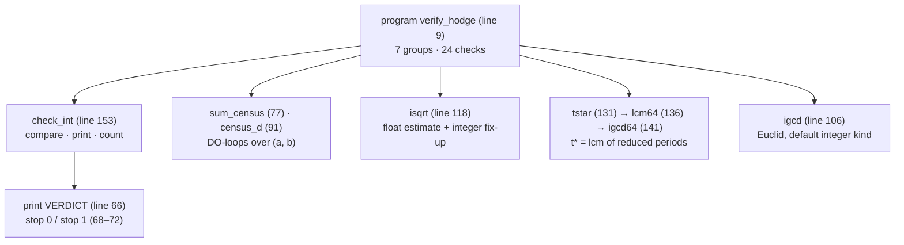

# FORTRAN · verify_hodge.f90 — the int64 veteran

<div align="center">


[](#5-the-24-checks--the-complete-list)
[](#3-build--run)
[](#3-build--run)
[_strict-8FA3CF?style=flat-square)](#7-overflow--portability-notes)
[](verify_hodge.f90)

[⬆ verification/](../README.md) · [🔵 C](../c/README.md) · [🟠 Rust](../rust/README.md) · [🧠 Lean kernel](../lean/README.md) · [🟡 Julia](../julia/README.md)

</div>

## 📋 Contents

| § | Section |
|:--|:---|
| **1** | [The stack in 60 seconds](#1-the-stack-in-60-seconds) |
| **2** | [Why Fortran — sixty years of numerical memory](#2-why-fortran--sixty-years-of-numerical-memory) |
| **3** | [Build & run](#3-build--run) |
| **4** | [Program anatomy](#4-program-anatomy) |
| **5** | [The 24 checks — the complete list](#5-the-24-checks--the-complete-list) |
| **6** | [Deep dive — the contained-program style](#6-the-deep-dive--the-contained-program-style) |
| **7** | [Overflow & portability notes](#7-overflow--portability-notes) |
| **8** | [FAQ](#8-faq) |

---

## 1. The stack in 60 seconds

`verify_hodge.f90` is the folder's witness from the oldest living numerical
ecosystem. In **167 lines of strict Fortran 2008** it re-derives **24 checks** of
the identity set — both census tables, the discriminant family, the SNF product,
the Klein integers, the E8 Arf trio, all three termination times, and the K3 stand
numbers — with every integer strictly `integer(int64)`.

```bash
gfortran -O2 -o vh_f verification/fortran/verify_hodge.f90 && ./vh_f
#
#   VERDICT: 24 PASS, 0 FAIL
echo $?        # 0   (the panel terminates via `stop 0` / `stop 1`)
```

| property | value |
|:--|:---|
| checks | **24** |
| wall time | < 50 ms |
| dependencies | `iso_fortran_env` only — part of the standard library |
| determinism | byte-identical output |
| exit contract | `0` all pass · `1` any failure — via `stop 0` / `stop 1` |

---

## 2. Why Fortran — sixty years of numerical memory

Every identity this panel checks was first computed in the 1950s–70s style: nested
DO-loops over lattice points, integer gcds, no dynamic allocation, no
abstraction. Keeping a Fortran panel in the folder is not nostalgia — it is a
*decoding argument*: the identity set is written down in a language whose semantics
have been stable since FORTRAN 66, so a modern claim that survives the gfortran
panel is not an artifact of any modern abstraction. The panel also contributes one
specialist the other panels lack: a **corrective integer square root** (§6), used
to certify `√disc = 1125` without ever trusting a floating-point `sqrt`.

---

## 3. Build & run

| compiler | command | notes |
|:--|:---|:---|
| gfortran | `gfortran -O2 -o vh_f fortran/verify_hodge.f90 && ./vh_f` | certified route |
| ifort / ifx | `ifx -O2 verify_hodge.f90 -o vh_f && ./vh_f` | drop-in |
| flags | `-std=f2008 -Wall` | compiles clean against the Fortran 2008 standard |

The file is free-form (`!` comments, `contains` section) and uses **no module
other than** `iso_fortran_env` — for the portable `int64` kind parameter.

---

## 4. Program anatomy



| item | line | role |
|:--|:--|:---|
| `snf_type` | 16 | the array `(1, 1, 5, 5, 15, 15, 15, 15)` as `int64` data |
| `sum_census` | 77 | Σ h_d: the strict triangle `b = 1, N−a−1` |
| `census_d` | 91 | h(d) per conductor via `igcd(igcd(N, a), b)` |
| `igcd` | 106 | Euclid on default integers (loop bounds are small) |
| `isqrt` | 118 | the corrective integer square root |
| `tstar` / `lcm64` / `igcd64` | 131 / 136 / 141 | the termination machinery at int64 |
| `check_int` | 153 | the shared verdict routine |
| `stop 0 / stop 1` | 68–72 | the exit-code contract |

<details>
<summary><b>Two kinds of integers — and why both are correct (click to unfold)</b></summary>

The panel runs its gcds at the *default integer kind* (`igcd`, line 106) and its
products at `int64` (`lcm64`, `igcd64`, the SNF loop). This is not
inconsistency — it is kind discipline: `igcd` is only ever called on loop bounds
and small arguments (`N ≤ 30`, `a, b < N`), where the default kind (≥ 32 bits
everywhere gfortran runs) is unconditionally safe; every value that could grow
(`prod`, census counts, t\* products) is declared `integer(int64)` explicitly.
The panel documents the boundary by naming: `igcd` vs `igcd64`.

</details>

---

## 5. The 24 checks — the complete list

| group | checks | computation | expected |
|:--|:---|:---|:---|
| census sums | N=15 · N=30 · N=7 | `sum_census` triangle loops | 91 · 406 · 15 |
| census table | h(3), h(5), h(15) at N=15; h(30) at N=30 | `census_d` | 1 · 6 · 84 · 276 |
| Klein | j = −105³/343 = −15³; \|Δ\|·\|j\| = 343·3375 = 105³ | int64 products | −3375 · 1 157 625 |
| discriminant | disc = 3⁴·5⁶; √disc via `isqrt` | 81·15625; corrective isqrt | 1 265 625 · 1125 |
| SNF | product of (1,1,5,5,15,15,15,15) | 8-factor DO-loop | 1 265 625 |
| ladder | Q_stand = 2·30·8 | arithmetic | 480 |
| E8 | even 36 · odd 28 · total 64 at g=3 | 2²(2³ ± 1) | 36 · 28 · 64 |
| E4 | t\*(48,48,1,1) · t\*(24,36,3,5) · t\*(12,12,4,6) | `tstar` → lcm | 48 · 72 · 6 |
| K3 | isotypy 1+7+7+7 · det = 8² · rank 1+19 | stand numbers | 22 · 64 · 20 |
| genera | g(15) · g(30) | (N−1)(N−2)/2 | 91 · 406 |

The Fortran panel is one of only two panels that check the N = 7 census (the
other is Julia) — the degenerate stand whose entire census is a single
conductor, `h(7) = 15 = g(7)`: the smallest possible witness that the census
machinery does not secretly assume a rich divisor structure.

---

## 6. The deep dive — the contained-program style

The whole file is a single `program` with a `contains` section — the modern
Fortran idiom that needs no external module, no interface block, no linking
ceremony.

<details>
<summary><b>The corrective isqrt — how to take an integer square root without trusting floating point</b></summary>

```fortran
integer(int64) function isqrt(n)
    integer(int64), intent(in) :: n
    integer(int64) :: r
    r = int(sqrt(real(n, kind=8)), kind=int64)   ! floating-point estimate
    do while (r * r > n)                        ! fix downward …
        r = r - 1
    end do
    do while ((r + 1) * (r + 1) <= n)           ! … and upward
        r = r + 1
    end do
    isqrt = r
end function
```

The float `sqrt` is only an *estimate*; two correction loops walk the answer to
the true ⌊√n⌋. Why keep the float at all? Because it guarantees the correction
loops run **O(1)** iterations (the estimate is within ±1 of the truth for
n ≤ 2⁵²), so the panel never walks from 10¹² down to 1125 one step at a time —
but also never *trusts* the float: if the estimate were off by a million, the
loops would still land exactly on ⌊√n⌋. Trust nothing, correct everything.

</details>

<details>
<summary><b>The verdict routine — Fortran's version of full-damage reporting</b></summary>

```fortran
subroutine check_int(name, actual, expected, passes, fails)
    character(len=*), intent(in) :: name
    integer(int64), intent(in) :: actual, expected
    integer, intent(inout) :: passes, fails
    if (actual == expected) then
        passes = passes + 1
        print '(a, a, a)', '  [PASS] ', name, ''
    else
        fails = fails + 1
        print '(a, a, a, i0, a, i0)', '  [FAIL] ', name, &
            '  got ', actual, ' expected ', expected
    end if
end subroutine
```

The list-directed format prints the computed *and* expected values on failure —
the same contract as the C and Rust panels. The counters are passed as
`intent(inout)` rather than hidden in a module variable: everything the panel
mutates is visible in the call sites, in keeping with the file's style of putting
all state where the reader can see it.

</details>

---

## 7. Overflow & portability notes

| computation | worst value | int64 headroom |
|:---|:--|:--|
| 3⁴·5⁶ = 1 265 625 | 21 bits | 42+ bits |
| 105³ / 343·3375 | 1 157 625 | 42+ bits |
| SNF product | 1 265 625 | 42+ bits |
| t\* products | ≤ 48·36 | 50+ bits |
| census counts | ≤ 406 | 54+ bits |

Every product is at least 42 bits below the int64 ceiling — no `huge()` guards
are needed, and the fixed check list makes the bound structural. Two portability
notes:

- `iso_fortran_env` is standard since Fortran 2008; any conforming compiler has
  `int64`.
- `stop 0` / `stop 1` set the process exit status on every mainstream compiler
  (the `stop-code` feature is standard Fortran 90+).

---

## 8. FAQ

<details>
<summary><b>Q1. Why does the panel check only 4 of the 6 census table values?</b></summary>

Coverage choice: the Fortran panel samples the census tables (h(3), h(5), h(15)
at N=15; h(30) at N=30) — the endpoints and the extremes. The full six-value
table at N=30 lives in the C and Rust panels and in the Julia printout; the
cross-reference matrix in the [verification README](../README.md#-the-cross-reference-matrix--identity--stack)
shows the exact division.
</details>

<details>
<summary><b>Q2. Why does the panel have two gcd functions?</b></summary>

Kind discipline: `igcd` works at the default integer kind (loop bounds, small
arguments), `igcd64` at int64 (lcm products). Fortran has no generic kind-polymorphic
Euclid without a module and an interface — two 10-line functions are the honest
alternative, and their naming makes the boundary explicit.
</details>

<details>
<summary><b>Q3. What does Fortran contribute that C does not?</b></summary>

An independent *ecosystem* rather than an independent file: different standard
semantics (DO-loop bounds, integer kinds, array slicing), a different optimizer
 lineage, and sixty years of numerical culture. Also, concretely: the corrective
`isqrt` (§6) — unique to this panel — and a shared specialty with Julia, the
N = 7 census check.
</details>

<details>
<summary><b>Q4. Is the panel fixed-form or free-form?</b></summary>

Free-form Fortran 2008 (`.f90` extension, `!` comments, no column-7 semantics) —
but the *style* is deliberately classical: explicit `intent`s, DO-loops,
`contains`, no derived types beyond the data arrays. It reads like the panels
that verified the original generation of lattice computations.
</details>

---

## 9. The mathematics behind every group

### 9.1 — the census family (checks 1–7)

The Fortran triangle loop is the strictest transcription of the character
definition in the folder — explicit DO-loops with inclusive bounds:

```fortran
do a = 1, N - 1
    do b = 1, N - a - 1
        cnt = cnt + 1
```

The inner bound `N - a - 1` *is* the condition `a + b < N` — the loop literally
counts lattice points. The conductor bucketing adds
`g0 = igcd(igcd(N, a), b); dd = N / g0; if (dd == d) cnt = cnt + 1`.

The panel checks the sums at **three** stands — 15, 30 and **7** — and samples
the tables (h(3), h(5), h(15) at N=15; h(30) at N=30). The N = 7 stand is the
degenerate case: the whole census is one bucket, h(7) = 15 = g(7), so the check
simultaneously pins the sum *and* the only table entry.

The general theorems — the count for every N and the Möbius inversion that
*generates* the tables — are proved in the Lean file
([§B](../lean/README.md#6-b--the-character-census) and
[§C7](../lean/README.md#c7--c7--the-master-identity-census_master)); monograph
[T20](../../theorems/T20_conductor_census/) owns the mathematics.

### 9.2 — the Klein pair (checks 8–9)

```fortran
call check_int('Klein j = -c4^3/Delta = -3375 = -15^3', -105_int64**3 / 343_int64, -3375_int64, ...)
call check_int('Klein 343 * 3375 = 105^3', 343_int64 * 3375_int64, 1157625_int64, ...)
```

Two lines, three identifications: j = −c₄³/Δ, j = −15³, and |Δ|·|j| = c₄³. The
kind suffixes (`105_int64**3`) are the panel's discipline made visible — the
exponentiation happens *in* int64, not in default-integer arithmetic that is
later widened. Monograph: [T16](../../theorems/T16_certificate_h_klein/).

### 9.3 — the discriminant family (checks 10–12)

The prime-power form (`3_int64**4 * 5_int64**6`), the square form via the
corrective `isqrt` (1125), and the SNF product via the 8-factor DO-loop — three
formulations of the same 21-bit number, each checked independently. The panel's
`snf_type` array (line 16) is the identity set's only *declared data*: everything
else is computed. Monograph: [T22](../../theorems/T22_snf_spectra/).

### 9.4 — E8 and E4 (checks 13–19)

The Arf trio at g = 3 (36 + 28 = 64) with the formulas written inline —
`2_int64**2 * (2**3 + 1)` — so the reader sees the exponents, not a helper call.
The three termination times exercise `tstar` at all three gcd shapes: trivial
(48), one-sided (72), fully synchronized (6). The chain `tstar → lcm64 → igcd64`
is Euclid twice removed: the lcm is built on the gcd, the gcd on the mod loop.

### 9.5 — the K3 stand numbers (checks 20–22)

The Fortran panel checks the *arithmetic* of the K3 stand — isotypy 1+7+7+7,
determinant 8², rank 1+19 — while the exact rank *computation* lives in C, Rust
and Python. Division of labor, stated openly: the panel certifies the number
theory of the stand, the other panels its linear algebra. Monograph:
[T08](../../theorems/T08_k3_stand/).

---

## 10. The line-by-line reading map

All 167 lines, grouped:

| lines | block | what happens |
|:--|:---|:---|
| 1–8 | header banner | run command, exit contract |
| 9–17 | program head | declarations, `snf_type` as int64 data |
| 22–64 | the checks | seven `call check_int` groups — the whole identity set, visible in one scroll |
| 66–72 | verdict | `print '(/a, i0, a, i0, a)'` + `stop 0/1` |
| 74–88 | `sum_census` | the strict triangle |
| 90–104 | `census_d` | conductor bucketing |
| 106–116 | `igcd` | Euclid at default kind |
| 118–129 | `isqrt` | float estimate + integer correction |
| 131–151 | `tstar` / `lcm64` / `igcd64` | termination machinery at int64 |
| 153–165 | `check_int` | the verdict routine |

A property worth noticing: the check section (22–64) is *flat* — no loops over a
check table, no data-driven dispatch. Every identity is one literal line; the
panel reads top-to-bottom exactly like the identity-set summary it implements.

---

## 11. The mutation map — what breaks what

| mutation (a plausible bug) | which checks fire | note |
|:---|:---|:---|
| `mod` instead of Euclid's subtraction in `igcd` | census tables + t\* + SNF-independent gcds | the loop `do while (y /= 0)` is the whole algorithm — any change is loud |
| isqrt correction loops removed | the √disc check fires on some platforms | the float estimate is platform-dependent; the correction is what makes it portable |
| kind suffix dropped (`105**3`) | possible overflow *at default kind* on exotic targets; the int64 checks stay green | the suffixes are the audit trail |
| `N - a - 1` → `N - a` in the inner loop | census sums grow (extra characters with a + b = N) — both sums and every sampled table fire | the strict inequality is the mathematics |
| `stop 1` path removed | CI reads exit 0 on failure — the *aggregation* catches the mismatch instead | defense in depth: two layers read the verdict |

---

## 12. Cross-references

| claim group | monograph | notes |
|:--|:---|:---|
| censuses | [T20](../../theorems/T20_conductor_census/) | N = 7 stand checked here |
| Klein | [T16](../../theorems/T16_certificate_h_klein/) | the j / \|Δ\|·\|j\| pair |
| SNF / disc | [T22](../../theorems/T22_snf_spectra/) | three formulations |
| E8 / Arf | [T09](../../theorems/T09_errata_e8/) | the g = 3 trio |
| E4 / t\* | [T09](../../theorems/T09_errata_e8/) | three gcd shapes |
| K3 | [T08](../../theorems/T08_k3_stand/) | the arithmetic of the stand |

---

## 13. Extended FAQ

<details>
<summary><b>Q5. Why does the panel print the verdict with a raw format string instead of <code>print *</code>?</b></summary>

Byte stability. List-directed output (`print *`) pads and wraps
compiler-dependently; the explicit format `'(a, a, a, i0, a, i0)'` pins the
bytes. The verdict line is part of the CI contract (it is what
`laboratory.py --run multi` greps), so it is formatted, not listed.
</details>

<details>
<summary><b>Q6. Is the float <code>sqrt</code> in <code>isqrt</code> a violation of the no-floating-point rule?</b></summary>

No — it is the pattern the rule prescribes: floats may *estimate*, integers
*decide*. The estimate seeds the correction loops that run O(1) iterations; the
final value is certified by exact integer squaring. The same philosophy appears
in the Julia panel (floats allowed in the analytic layer, never near an integer
identity).
</details>

<details>
<summary><b>Q7. Why is there no K3 rank elimination in Fortran?</b></summary>

Historical division of labor: the exact-fraction elimination was built for C
(and mirrored in Rust's pair-based design); Fortran's contribution is elsewhere —
the corrective isqrt, the N = 7 census, and the widest single-scroll check
section. Adding a `Frac` type in Fortran would duplicate C's §6 without adding
an independent failure mode.
</details>

<details>
<summary><b>Q8. What would a Fortran 2023 rewrite change?</b></summary>

Cosmetics: `do concurrent` for the census loops, `error stop` for the failure
path, maybe a kind-parameterized gcd. The mathematics — Euclid, the triangle,
the inversion — has been stable since FORTRAN 77, which is precisely the value
the panel contributes: a claim that survives this file is independent of every
post-1977 fashion.
</details>
