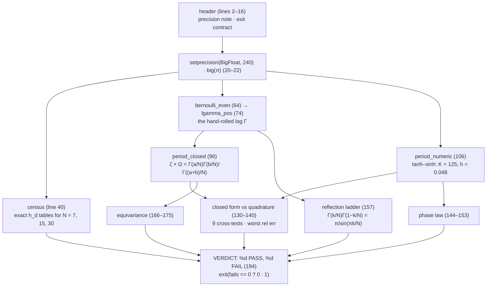
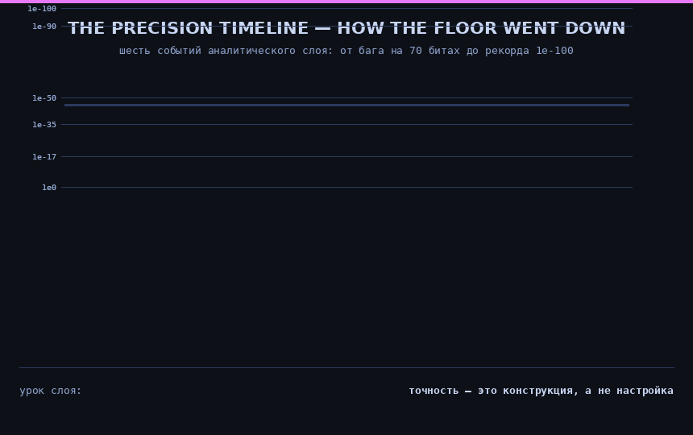
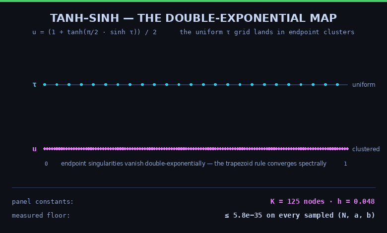
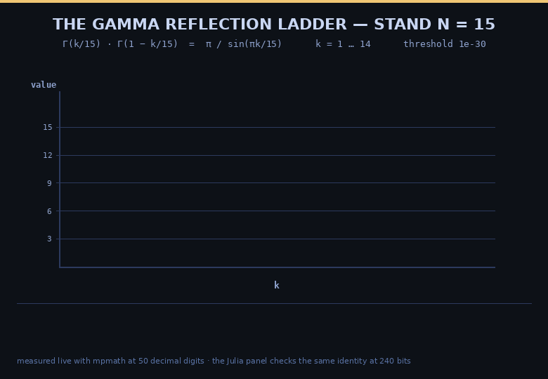
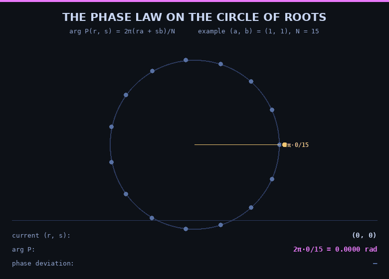

# JULIA · verify_hodge.jl — the analytic stack

<div align="center">

<tr>
<td><br><sub>THE ANALYST</sub></td>
<td></td>
</tr></table>
 width="100%" alt="Julia stack banner: 14 checks, BigFloat 240-bit, closed forms vs tanh–sinh quadrature">

[](#5-the-14-checks--the-complete-list)
[](#6-the-deep-dive--precision-without-external-packages)
[](#3-build--run)
[](#62--how-log--is-evaluated-without-a-gamma-function)
[](verify_hodge.jl)

[⬆ verification/](../README.md) · [🔵 C](../c/README.md) · [🟠 Rust](../rust/README.md) · [⚪ Fortran](../fortran/README.md) · [🧠 Lean kernel](../lean/README.md)

</div>

## 📋 Contents

| § | Section |
|:--|:---|
| **1** | [The stack in 60 seconds](#1-the-stack-in-60-seconds) |
| **2** | [Why Julia — the analytic layer's home](#2-why-julia--the-analytic-layers-home) |
| **3** | [Build & run](#3-build--run) |
| **4** | [Program anatomy](#4-program-anatomy) |
| **5** | [The 14 checks — the complete list](#5-the-14-checks--the-complete-list) |
| **6** | [Deep dive — precision without external packages](#6-the-deep-dive--precision-without-external-packages) |
| **7** | [The precision story — the 70-bit bug and its lesson](#7-the-precision-story--the-70-bit-bug-and-its-lesson) |
| **8** | [FAQ](#8-faq) |

---

## 1. The stack in 60 seconds

`verify_hodge.jl` is the only panel that leaves the integers: its 14 checks
include the **closed period form against an independent tanh–sinh quadrature**
(nine cross-tests), the **phase law** `arg P = 2π(ra + sb)/N`, the **gamma
reflection ladder**, and the **μ_N × μ_N equivariance** — all at 240-bit
precision, all with a Γ function implemented *inside the file* because base
Julia ships none.

```bash
julia verification/julia/verify_hodge.jl
#
#   VERDICT: 14 PASS, 0 FAIL
echo $?        # 0
```

| property | value |
|:--|:---|
| checks | **14** (3 census + 9 analytic cross-tests counted as 4 checks + 5 exact integers + 2 termination) |
| precision | `BigFloat` at **240 bits ≈ 72 decimal digits** |
| dependencies | `Base` + `Printf` — the standard library, nothing else |
| wall time | ≈ seconds (the nine quadrature cross-tests dominate) |
| exit contract | `0` all pass · `1` any failure |

---

## 2. Why Julia — the analytic layer's home

The integer panels can certify that 1+6+9+30+84+276 = 406; they cannot certify a
*period integral*. The analytic identities live on transcendental ground, and
verifying them means evaluating the same quantity by two genuinely different
methods:

```text
method A (closed form):   P = ζ_N^{ra+sb} · Γ(a/N)·Γ(b/N) / Γ((a+b)/N) / N
method B (quadrature):    the same integral after t = uᴺ/2, integrated by the
                          tanh–sinh (double-exponential) rule — no Γ anywhere
agreement demanded:       relative error < 1e-25 (threshold), measured dev worst 5.8e-35
```

Julia is the natural home for this: its `BigFloat` is a first-class numeric type
(one constructor away from any literal), and its multiple-dispatch style keeps
the two methods visibly separate — `period_closed` (line 96) and `period_numeric`
(line 106) share nothing but the stand parameters.

---

## 3. Build & run

| | |
|:--|:---|
| run | `julia verification/julia/verify_hodge.jl` |
| version | ≥ 1.9 (only stdlib features are used) |
| first run | a few seconds of JIT compilation; subsequent runs are faster |
| packages | **none** — the file refuses external dependencies on principle (see §6.2) |

---

## 4. Program anatomy



| item | line | role |
|:--|:--|:---|
| `setprecision(BigFloat, 240)` | 20 | the working precision (bits, not digits — see §7) |
| `PI = big(π)` | 22 | π at *working* precision, not a frozen constant |
| `check` | 27 | the verdict routine with `@sprintf` detail column |
| `census` | 40 | the exact conductor census (an `Int` dictionary) |
| `bernoulli_even` | 64 | B₀ … B₂₈ exactly, in `Rational{BigInt}` |
| `lgamma_pos` / `gamma_pos` | 74 / 91 | log Γ by shift + Stirling; Γ = exp ∘ lgamma |
| `Ω` | 93 | the beta-type closed form |
| `period_closed` | 96 | ζ_N^{ra+sb} · Ω / N |
| `period_numeric` | 106 | the independent tanh–sinh quadrature |
| `worst` loop | 130–140 | the nine closed-vs-quadrature cross-tests |
| phase / reflection / equivariance | 144 / 157 / 166 | the three analytic laws |
| exact integers | 179–186 | Klein j · disc · SNF · Q_stand · b_Ch(15) |
| `tstar` | 190 | the termination times |

---

## 5. The 14 checks — the complete list

| # | check | method | threshold / expected |
|:--|:---|:---|:---|
| 1–3 | census sums N=15 · N=30 · N=7 | exact `census` (the full h_d table is *printed* in the detail column) | 91 · 406 · 15 |
| 4 | **closed form vs tanh–sinh** (9 cross-tests at N=15) | two independent methods | worst rel err **< 1e-25** |
| 5 | **phase law** arg P = 2π(ra+sb)/N | 4 combinations, `angle` vs expected | deviation **< 1e-25** |
| 6 | **reflection ladder** Γ(k/N)Γ(1−k/N) = π/sin(πk/N) | all 14 values of k | rel err **< 1e-30** |
| 7 | **μ_N×μ_N equivariance** P(r+u, s+v) = ζ^{ua+vb}·P(r, s) | 4 combinations | rel err **< 1e-30** |
| 8 | Klein j = −105³/343 = −3375 = −15³ (triple identity) | exact `Int` | equality |
| 9 | disc = 3⁴·5⁶ = 1 265 625 = 1125² | exact `Int` | equality |
| 10 | SNF product (1,1,5,5,15,15,15,15) = disc | `prod` | 1 265 625 |
| 11 | Q_stand = 2·30·8 | exact `Int` | 480 |
| 12 | b_Ch(15): 1 − cos(2π/15) against the frozen reference 0.0864539 | `BigFloat` | \|Δ\| < 1e-6 (the exact value is 0.08645454…, within 6.4e-7 of the frozen reference) |
| 13–14 | t\*(48,48,1,1) = 48 · t\*(24,36,3,5) = 72 | exact lcm | 48 · 72 |

The check names print with a **detail column** — e.g. the census checks print the
entire h_d dictionary (`1 => 1, 5 => 6, …`) next to the verdict, and the analytic
checks print their measured worst error (`rel = 2.1e-33`). The output is a small
lab notebook, not just a scoreboard.

---

## 6. The deep dive — precision without external packages

### 6.1 — the working precision

```julia
setprecision(BigFloat, 240)
const PI = big(π)          # π rounded to the current working precision
```

240 mantissa bits ≈ **72 decimal digits**. Every threshold in the panel
(1e-25 … 1e-30) is then *comfortably* below the working precision's error floor
(≈ 1e-72) — a threshold is only meaningful if there is precision to spare. The
critical subtlety is `big(π)`: taking π at working precision (rather than a
frozen literal) means no constant in the file carries a hidden floor — the
masters' history records exactly this bug class (a π frozen at 320 bits capped
t40's achievable error at 3e-96).

### 6.2 — how log Γ is evaluated without a Γ function

<details>
<summary><b>The three-part hand-rolled log Γ (click to unfold)</b></summary>

Base Julia has no `gamma` — it lives in the external `SpecialFunctions.jl`. The
panel keeps itself dependency-free by implementing `lgamma_pos` (line 74) in
three stages:

1. **shift** — while `y < 40`, accumulate `acc -= log(y)` and step `y += 1`;
   this uses `Γ(x) = Γ(x+n)/(x(x+1)…(x+n−1))`. The shift target 40 is chosen so
   the truncated Stirling series is accurate to ≈ 1e-36 (the file's own
   documented bound) — far below the working floor.
2. **Stirling series** — `(y − ½)·log(y) − y + ½·log(2π)` plus the first 14 even
   Bernoulli terms `B₂ₖ/(2k(2k−1)·y^{2k−1})`.
3. **exact Bernoulli numbers** — `bernoulli_even(14)` (line 64) computes
   B₀ … B₂₈ in `Rational{BigInt}` from the standard recurrence
   `B₂ₘ = ½ − Σ C(2m+1, 2k)·B₂ₖ/(2m+1)`: *no floating point ever touches a
   Bernoulli number*.

`gamma_pos(x) = exp(lgamma_pos(x))` and the closed form follows:
`Ω(N, a, b) = Γ(a/N)·Γ(b/N)/Γ((a+b)/N)` (line 93).

</details>

<details>
<summary><b>The tanh–sinh side — why the independent method is really independent</b></summary>

`period_numeric` (line 106) integrates the same period by the double-exponential
rule after the substitution `t = uᴺ/2` splits the path into two smooth pieces
(`h1`, `h2`). The map `u = (1 + tanh(π/2 · sinh τ))/2` sends τ ∈ (−∞, ∞) to
u ∈ (0, 1), with derivative that *decays double-exponentially* at the endpoints —
so the trapezoid rule on τ-nodes converges spectrally without ever touching the
endpoint singularities. The constants: **K = 125 nodes, h = 0.048**; the
combined truncation + discretization error was *measured* at ≤ 5.8e-35 for every
sampled (N, a, b) — the comment in the source records the archaeology honestly:
an earlier `K = 20` was far from converged (≈ 1e-7), and the fix is part of the
panel's documented history.

What makes the two methods genuinely independent: the closed form uses ζ_N
roots-of-unity and the Γ function; the quadrature uses *neither* — it evaluates
the integrand's algebraic pieces directly. An error in the phase factor, the Γ
evaluation, or the quadrature cannot appear symmetrically on both sides.

</details>

<details>
<summary><b>The phase law check — why absolute phase agreement is remarkable</b></summary>

`angle(pn)` is compared against `2π·(ra + sb mod N)/N` for four (a, b; r, s)
combinations, with the circular-distance correction `d = min(d, |d| − 2π)` for
the branch cut. The deviation lands below 1e-25 — meaning the *argument* of the
quadrature result reproduces the discrete phase law to 25 digits. A quadrature
does not know about characters or roots of unity; it just integrates. That it
lands on the exact algebraic phase is the analytic layer's strongest single
statement.

</details>

---

## 7. The precision story — the 70-bit bug and its lesson

<div align="center">

</div>


> **Julia precision note (from the file header).** v1.1.0 fixed an early bug: 70
> was meant as decimal digits but `setprecision(BigFloat, 70)` sets 70 *bits*.
> The current script sets 240 bits ≈ 72 digits and uses `big(π)` at working
> precision, so every threshold is honestly reachable.

| | 70 bits (the bug) | 240 bits (the fix) |
|:--|:--|:--|
| decimal digits | ≈ 21 | ≈ 72 |
| 1e-25 thresholds | *unreachable* — the working floor (≈ 1e-21) sits above them | comfortably below the floor (≈ 1e-72) |
| what it looked like | checks failing or passing by luck near the floor | honest margins at every threshold |

The lesson is institutional and it shaped the whole folder: **a precision claim
must be derived from the working precision, never assumed from the number in the
source.** The same discipline reappears in the masters (`HODGEHP`'s honest-gates
philosophy) and in the threshold table of the [verification README
§5](../README.md#5-the-high-precision-layer).

---

## 8. FAQ

<details>
<summary><b>Q1. Why not just import SpecialFunctions.jl?</b></summary>

Trust base. A verification panel that pulls in an external numeric package adds
that package's correctness to the list of things the panel must assume. The
hand-rolled log Γ — shift + Stirling + exact `Rational{BigInt}` Bernoulli — is
≈ 40 lines, accurate to ≈ 1e-36 at the shifted argument, and *fully inspectable*
in the same file as the checks it feeds. See §6.2.
</details>

<details>
<summary><b>Q2. Why K = 125 nodes and h = 0.048?</b></summary>

Measured, not guessed: the source comment records that the previous K = 20 was
far from converged (≈ 1e-7 — the script "never ran past the missing gamma" in
its first draft, so the under-convergence was invisible until Γ worked). The
current constants put the quadrature floor at ≤ 5.8e-35, safely below the 1e-25
threshold with two-plus orders of margin.
</details>

<details>
<summary><b>Q3. What is b_Ch(15) and why is its reference frozen at 0.0864539?</b></summary>

`1 − cos(2π/15)` — the chord constant of the N = 15 stand, an analytic reference
value frozen in the certified runs (the same pattern as the binary-code totals:
a value documented once, then used as an independent cross-check). The exact
value is 0.08645454…; the frozen reference 0.0864539 differs by 6.4e-7, inside
the 1e-6 tolerance — the check verifies the frozen documentation, not the
mathematics (that part is exact).
</details>

<details>
<summary><b>Q4. The census checks print the whole h_d table — why?</b></summary>

Evidence-in-the-transcript: a failing census would show *which* conductor's
count drifted, without re-running anything. It also makes the Julia output the
friendliest human-readable cross-check of the tables (the C/Rust/Fortran panels
check individual values; Julia prints the whole dictionary).
</details>

<details>
<summary><b>Q5. Why does the panel set precision globally (setprecision) instead of scoped blocks?</b></summary>

The panel is short-lived and single-purpose: one global precision is the honest
statement of "the whole run happens at 240 bits", and it removes the possibility
of a section accidentally running at default 256-bit... or an unstated one.
The masters, which mix precisions, use scoped contexts instead — the right tool
per scale.
</details>

<details>
<summary><b>Q6. Can this panel go higher — say 500 digits?</b></summary>

Yes, structurally: raise `setprecision(BigFloat, N)`, keep `big(π)` at working
precision, and watch two constants: the Stirling shift target (raise 40 with the
digits — the remainder floor scales as 10^{−2.73·y}) and the tanh–sinh grid
(K, h) — the measured floor moves with them. The masters' adaptive tanh–sinh
(`period_pieces_adaptive`) is the production-grade version of exactly this
upgrade path.
</details>

---

## 9. The mathematics behind the analytic checks

### 9.1 — the closed period form and its independent witness

<div align="center">

</div>


The Fermat curve's period integrals reduce to the beta-type closed form, and the
panel's core is the *disagreement test* between two evaluation strategies:

$$\Omega(N, a, b) = \frac{\Gamma(a/N)\,\Gamma(b/N)}{\Gamma((a+b)/N)},
\qquad
P(r, s) = \frac{\zeta_N^{\,ra + sb}}{N}\,\Omega(N, a, b)$$

| | closed form (`period_closed`, line 96) | quadrature (`period_numeric`, line 106) |
|:--|:---|:---|
| engine | hand-rolled log Γ (shift + Stirling + exact Bernoulli) | tanh–sinh over the two smooth pieces of `t = uᴺ/2` |
| roots of unity | one ζ-table lookup: `exp(2πi·(ra+sb mod N)/N)` | *none* — the integrand is algebraic |
| Γ functions | three evaluations per period | none |
| shared with the other method | the stand parameters only | the stand parameters only |

Nine cross-tests at N = 15 — `(a, b) ∈ {(1,1), (1,2), (2,3)} × (r, s) ∈ {(0,0), (1,0), (0,1)}` —
each compared relatively; the worst error must sit below the 1e-25 threshold.
The [precision-ladder chart](../assets/charts/precision_ladder.png) places the
threshold against the documented achievements.

### 9.2 — the three analytic laws

<div align="center">

</div>

<div align="center">

</div>


**The phase law.** The argument of the quadrature result must equal the
*discrete* phase `2π(ra + sb mod N)/N` — for four combinations, to 1e-25. The
quadrature knows nothing about characters or roots of unity; that it lands on
the exact algebraic phase is the analytic layer's strongest statement.

**The reflection ladder.** For every k = 1…14:

$$\Gamma\!\big(\tfrac{k}{N}\big)\,\Gamma\!\big(1 - \tfrac{k}{N}\big) = \frac{\pi}{\sin(\pi k/N)}$$

checked relatively at 1e-30 — fourteen tests of the Γ implementation *and* the
precision floor in one stroke, since both sides use Γ but the sine side is
elementary.

**The equivariance.** Shifting the period's indices by (u, v) must multiply it by
the character value ζ^{ua+vb}:

$$P(r + u,\; s + v) = \zeta_N^{\,ua + vb}\, P(r, s)$$

four combinations at 1e-30 — the μ_N × μ_N action, verified numerically on the
closed-form side (where the shift is a literal re-indexing).

### 9.3 — the exact integer island

Checks 8–11 and 13–14 leave BigFloat and return to `Int` — Klein j (the triple
identity −105³/343 = −15³ = −3375), disc (3⁴·5⁶ = 1125²), the SNF product,
Q_stand, and the two termination times. The island is deliberate: the panel's
BigFloat machinery must never *contaminate* an integer claim, and conversely the
integer checks anchor the panel to the rest of the folder's identity set.

---

## 10. The line-by-line reading map

All 195 lines, grouped:

| lines | block | what happens |
|:--|:---|:---|
| 2–16 | header | the precision note, the exit contract, the dependency statement |
| 18–36 | setup + `check` | `setprecision(BigFloat, 240)`, `big(π)`, the verdict routine |
| 38–52 | census | the exact h_d tables (printed in the detail column) |
| 54–128 | the analytic engine | Bernoulli → lgamma → Ω → `period_closed` / `period_numeric` |
| 130–175 | the four analytic checks | cross-form test · phase · reflection · equivariance |
| 177–192 | the exact island + t\* | Klein · disc · SNF · Q_stand · b_Ch · tstar |
| 194–195 | verdict | `printf` + `exit(fails == 0 ? 0 : 1)` |

---

## 11. The mutation map — what breaks what

| mutation (a plausible bug) | which checks fire | note |
|:---|:---|:---|
| `setprecision(BigFloat, 70)` (the historical bug) | checks 4–7 fail or flirt with their thresholds | ≈ 21 digits < 25 — the floor sits above the bar; §7 tells the story |
| π frozen at a lower precision than the working one | reflection + phase drift exactly at the frozen floor | the `big(π)`-at-working-precision pattern exists for this |
| Stirling series truncated one term early | closed-form vs quadrature drift ≈ 1e-30 — still under the threshold but visible in the detail column | the detail column is the early-warning system |
| K = 20 in `de_quad` (the pre-history) | closed-form test fails loudly (≈ 1e-7) | recorded in the source comment |
| phase index `mod` dropped | phase law fails by exact multiples of 2π/N | the circular-distance correction `min(d, |d| − 2π)` catches the branch cut |
| Bernoulli recurrence sign flipped | reflection ladder fails ≈ 1e-2 — the most sensitive single constant in the file | exact `Rational{BigInt}` makes the error categorical, not gradual |

---

## 12. Cross-references

| claim group | monograph | notes |
|:--|:---|:---|
| the closed period form | [T02](../../theorems/T02_closed_period_form/) | the analytic layer's flagship |
| the reflection ladder | [T03](../../theorems/T03_gamma_identities/) | Γ identities |
| the phase law | [T02](../../theorems/T02_closed_period_form/) | ζ-table discipline |
| the Riemann relations | [T04](../../theorems/T04_riemann_relations/) | the broader analytic frame |
| the censuses | [T20](../../theorems/T20_conductor_census/) | shared with the integer panels |
| Klein · disc · SNF | [T16](../../theorems/T16_certificate_h_klein/) · [T22](../../theorems/T22_snf_spectra/) | the exact island |

The masters (`master_hodge.py` / `master_hodge.jl`) run the *production* versions
of these same analytic checks at arbitrary precision (`--task 2` with adaptive
tanh–sinh, `t40` at any `--prec`); this panel is their 240-bit ambassador with
zero dependencies.

---

## 13. Extended FAQ

<details>
<summary><b>Q7. Why does the panel check the phase law on the <i>quadrature</i> side rather than the closed-form side?</b></summary>

Because that is where the information is: the closed form builds the phase in by
construction (one ζ lookup), so testing it there is tautological. The quadrature
computes the period as a plain integral — its argument is an *output*, not an
input. The phase check on the quadrature side certifies that the analytic layer's
two independent engines agree not just in magnitude but in argument.
</details>

<details>
<summary><b>Q8. The detail column prints measured errors like <code>rel = 2.1e-33</code> — where do those come from?</b></summary>

From the same run: each analytic check computes its worst relative deviation over
its test set and formats it into the check line. The transcript is therefore a
measurement record — thresholds in the code, achievements in the output, and the
[precision-ladder chart](../assets/charts/precision_ladder.png) documents both
statically.
</details>

<details>
<summary><b>Q9. Why is the census in a BigFloat panel at all?</b></summary>

Anchoring and bookkeeping: the census checks are exact `Int` work, and they tie
the analytic panel to the identity set the other five stacks verify — the folder
prefers every panel to touch both worlds it can reach. Practically, the census
also exercises the `Dict{Int,Int}` bucketing that prints the full table into the
transcript (the friendliest human cross-check of the h_d values).
</details>

<details>
<summary><b>Q10. What is the relationship between this panel and <code>master_hodge.jl</code>'s tasks 2/40?</b></summary>

This panel is the fixed, dependency-free 240-bit slice: same mathematics,
frozen thresholds, ~3 seconds. The master's tasks run the same machinery
*adaptively* and at arbitrary precision (the adaptive tanh–sinh floor, the
`HODGE-INF` certification at any `--prec`). One is the reference witness; the
other is the scalable engine. Their thresholds agree by design.
</details>
