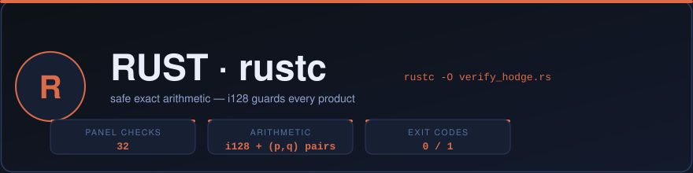
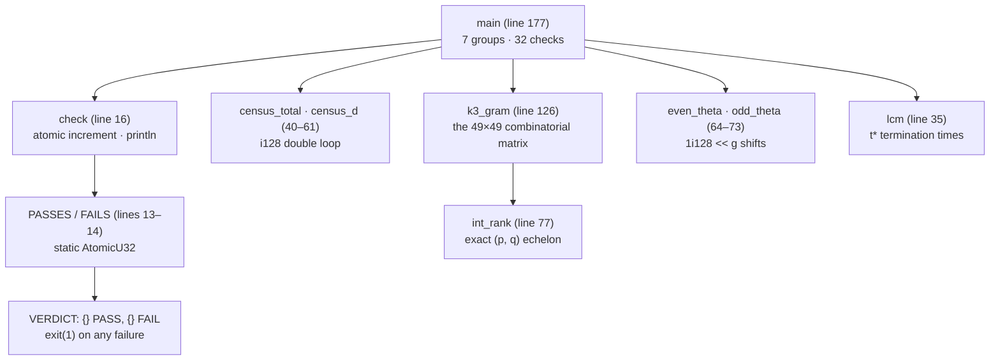

# RUST · verify_hodge.rs — the safe-exact stack

<div align="center">



[](#5-the-32-checks--the-complete-list)
[](#7-the-i128-budget--why-overflow-cannot-happen)
[](#4-program-anatomy)
[](#3-build--run)
[](verify_hodge.rs)

[⬆ verification/](../README.md) · [🔵 C](../c/README.md) · [🧠 Lean kernel](../lean/README.md) · [⚪ Fortran](../fortran/README.md) · [🟡 Julia](../julia/README.md)

</div>

## 📋 Contents

| § | Section |
|:--|:---|
| **1** | [The stack in 60 seconds](#1-the-stack-in-60-seconds) |
| **2** | [Why Rust — what the borrow checker adds to a math panel](#2-why-rust--what-the-borrow-checker-adds-to-a-math-panel) |
| **3** | [Build & run](#3-build--run) |
| **4** | [Program anatomy](#4-program-anatomy) |
| **5** | [The 32 checks — the complete list](#5-the-32-checks--the-complete-list) |
| **6** | [Deep dive — the fraction-based rank](#6-the-deep-dive--the-fraction-based-rank) |
| **7** | [The i128 budget — why overflow cannot happen](#7-the-i128-budget--why-overflow-cannot-happen) |
| **8** | [FAQ](#8-faq) |

---

## 1. The stack in 60 seconds

`verify_hodge.rs` re-derives the identity set in **32 checks** with a distinctive
design decision: every integer is an `i128`, so the question "did anything
overflow?" is not audited — it is *impossible*. The verdict counters are
`AtomicU32`s, the K3 rank runs through an exact `(p, q)` fraction echelon, and the
whole panel is one `rustc` invocation away.

```bash
rustc -O verification/rust/verify_hodge.rs -o vh_rust && ./vh_rust
# HODGE LABORATORY — RUST VERIFICATION PANEL
#
#   [PASS] g(15) = 91
#   ...30 more lines...
#   VERDICT: 32 PASS, 0 FAIL
echo $?        # 0
```

| property | value |
|:--|:---|
| checks | **32** |
| wall time | < 50 ms |
| dependencies | zero — a single file, no cargo, no crates |
| determinism | byte-identical output |
| exit contract | `0` all pass · `1` any failure (explicit `std::process::exit(1)`) |

---

## 2. Why Rust — what the borrow checker adds to a math panel

The other integer panels (C, Fortran) verify identities in environments where the
*programmer* guards against overflow and aliasing. Rust flips the contract: the
compiler guards, and the panel demonstrates the identities in an environment where
an entire bug class is structurally absent. Three concrete payoffs in 237 lines:

1. **`i128` arithmetic.** Every stand magnitude fits in ≤ 21 bits; `i128` gives
   127. The panel would need numbers ~10³⁰ times larger to overflow — see the
   [budget table](#7-the-i128-budget--why-overflow-cannot-happen). No checked
   arithmetic, no overflow branches: the quiet correctness Rust is known for.
2. **`AtomicU32` verdict counters.** `PASSES`/`FAILS` are static atomics
   (lines 13–14) rather than mutable globals — the panel's verdict is
   data-race-free *by construction*, ready for a parallelized future without a
   rewrite.
3. **`rem_euclid` for the mod-4 rules.** The K3 meeting rules need symmetric
   modular arithmetic (`(x % 4 + 4) % 4` in C); Rust's `rem_euclid(4)` (line 142)
   expresses it once, correctly, with a name.

And one anti-payoff worth honesty: Rust does **not** check the mathematics —
32 equalities are only as good as the identities they encode, which is why the
panel exists *alongside* a Lean kernel file that *proves* the structural
identities and four other independent implementations.

---

## 3. Build & run

| route | command | notes |
|:--|:---|:---|
| direct | `rustc -O rust/verify_hodge.rs -o vh_rust && ./vh_rust` | the certified route — no cargo needed |
| edition flag | `rustc -O --edition 2021 …` | works on any rustc ≥ 1.56 (i128 stable since 1.26) |
| clippy | `cargo clippy` inside a wrapper project | compiles clean; the file is warning-free under `-W unused` defaults |

---

## 4. Program anatomy



| item | line | role |
|:--|:--|:---|
| `PASSES` / `FAILS` | 13–14 | `AtomicU32` counters — the verdict is race-free by construction |
| `check` | 16 | compare, print, atomically count |
| `gcd` / `lcm` | 26 / 35 | Euclid; lcm via `a / gcd * b` |
| `census_total` / `census_d` | 40 / 51 | the character triangle and its conductor bucketing |
| `even_theta` / `odd_theta` | 64 / 70 | Arf counts via `1i128 << g` |
| `int_rank` | 77 | exact echelon over ℚ with `(i128, i128)` pairs |
| `k3_gram` | 126 | the 49×49 matrix from the mod-4 meeting rules |
| `main` | 177 | seven groups, 32 checks, the verdict |

---

## 5. The 32 checks — the complete list

| group | checks | values |
|:--|:---|:---|
| genera | `g(15)`, `g(30)`, `g(7)` | 91 · 406 · 15 |
| census sums | N=15, N=30 | 91 · 406 |
| census table N=15 | h(3), h(5), h(15) | 1 · 6 · 84 |
| census table N=30 | h(6), h(10), h(30) (the three largest conductors) | 9 · 30 · 276 |
| K3 | rank over ℚ · isotypy 1+7+7+7 · signature 1+19 | **20** · 22 · 20 |
| Klein | c₄³ = 105³ · \|Δ\|·\|j\| = 343·3375 · j = −c₄³/Δ · (−15)³ | 1 157 625 · 1 157 625 · −3375 · −3375 |
| stand | disc = 81·15625 · 1125² · SNF product · Q_stand | 1 265 625 · 1 265 625 · 1 265 625 · 480 |
| Arf | g=3 even/odd/total · g=1, 2, 4 even | 36 · 28 · 64 · 3 · 10 · 136 |
| termination | t\*(48,48,1,1) · t\*(24,36,3,5) · t\*(12,12,4,6) | 48 · 72 · 6 |
| binary | 48+212+432+114 | 806 |

The SNF product is computed idiomatically —
`[1i128, 1, 5, 5, 15, 15, 15, 15].iter().product()` — turning the identity "the
product of the invariant factors equals the discriminant" into a one-line iterator
chain that the compiler unrolls at `-O`.

<details>
<summary><b>The K3 meeting rules in Rust — closures and euclidean remainders</b></summary>

```rust
let m4 = |x: i128| x.rem_euclid(4);
if (f1 == 0 && f2 == 1) || (f1 == 1 && f2 == 0) {
    return if m4(a1 + b2 - a2 - b1) == 0 { 1 } else { 0 };
}
if (f1 == 0 && f2 == 2) || (f1 == 2 && f2 == 0) {
    let v = if f1 == 0 { a2 - a1 - b1 - b2 - 1 }
            else       { a1 - a2 - b2 - b1 - 1 };
    return if m4(v) == 0 { 1 } else { 0 };
}
if m4(a1 + b1 - a2 - b2) == 0 { 1 } else { 0 }
```

`rem_euclid` is the whole point: in C, `(a1 + b2 - a2 - b1) % 4` on a negative
intermediate returns a negative remainder and the rule silently breaks; the Rust
panel's `rem_euclid(4)` makes "congruent mod 4" mean what the mathematics says.
This is the kind of difference that makes the two panels *independent witnesses*
rather than ports.

</details>

---

## 6. The deep dive — the fraction-based rank

`int_rank` (line 77) is the Rust answer to the same problem C's `k3_rank` solves:
exact Gauss–Jordan elimination, but with ownership-friendly data — a
`Vec<Vec<(i128, i128)>>` of `(numerator, denominator)` pairs instead of a struct
array.

<details>
<summary><b>The row-update step, line by line (the heart of the algorithm)</b></summary>

```rust
// factor f = a[r][col] / a[rank][col] = fp*pq / (fq*pp)
let fnum = fp * pq;
let fden = fq * pp;
for j in 0..n {
    let (ap, aq) = a[r][j];
    let (bp, bq) = a[rank][j];
    // a - f*b = ap/aq - (fnum/fden)*(bp/bq)
    let np = ap * fden * bq - fnum * bp * aq;
    let nq = aq * fden * bq;
    let sg = if nq < 0 { -1i128 } else { 1 };
    let (np, nq) = (np * sg, nq * sg);
    let g = gcd(np.abs(), nq).max(1);
    a[r][j] = (np / g, nq / g);
}
```

Four observations that make this implementation distinctive:

1. **No normalization structure — pairs in flight.** The factor `f` is never
   materialized as a reduced fraction; its numerator and denominator are used
   directly, and reduction happens *once*, at the end of each entry update.
2. **Sign discipline.** The denominator is normalized positive (`sg` flip) before
   the gcd — so `(p, q)` always means `q > 0`, matching the C panel's `fmk`
   convention exactly.
3. **`.max(1)` guard.** When both `np` and `nq` are zero the gcd is 0; `.max(1)`
   keeps the division well-defined — the idiomatic Rust answer to a degenerate
   case the algorithm provably never hits (the entry is being annihilated), but
   the type system cannot know that.
4. **Bounds.** The largest intermediates in the K3 elimination are products of
   four factors each ≤ a few thousand — comfortably inside `i128`'s 127 bits; the
   full budget is tabulated in the [next section](#7-the-i128-budget--why-overflow-cannot-happen).

The result — rank **20** over ℚ — is the same number C computes with its `Frac`
struct and Python with `Fraction`: three independent exact implementations, one
answer.

</details>

<details>
<summary><b>Why the panel's K3 matrix is built by a closure (and why that matters)</b></summary>

`k3_gram` (line 126) builds the matrix with the intersection rules as a local
`inter` closure capturing nothing — a pure function, but scoped. The alternative
(a free function `fn inter(l1, l2)`) would be identical machine code; the closure
keeps the rules *adjacent* to the matrix they build, so reviewing the rules means
reading one function. The 48 lines are indexed `l = 16·f + 4·a + b` exactly as in
C and in [`hodge_planes.py`](../hodge_planes.py) §3 — the three implementations
share the indexing convention, which is what makes their matrices comparable
entry-by-entry.

</details>

---

## 7. The i128 budget — why overflow cannot happen

Every intermediate of the panel, worst case:

| computation | worst intermediate | bits | `i128` headroom |
|:---|:--|:--|:--|
| census counts | 406 | 9 | 118 |
| genus products `(N−1)(N−2)` | 812 | 10 | 117 |
| Klein products `343·3375` | 1 157 625 | 21 | 106 |
| disc `81·15625` | 1 265 625 | 21 | 106 |
| SNF product | 1 265 625 | 21 | 106 |
| Arf `2^{g−1}·(2^g ± 1)`, g ≤ 4 | 256 | 8 | 119 |
| t\* lcm products | 48·48 | 12 | 115 |
| K3 entry updates | ≤ ~10¹² (four-factor products) | ≤ 40 | 87 |
| `1i128 << g` (g ≤ 4) | 16 | 4 | 123 |

The largest number the panel ever forms is ~10¹² against a ceiling of
~1.7·10³⁸: **twenty-six orders of magnitude of headroom**. `checked_*` and
overflow branches would be dead code — their absence *is* the audit.

---

## 8. FAQ

<details>
<summary><b>Q1. Why does the panel avoid <code>u64</code>/<code>usize</code> where possible?</b></summary>

Uniformity: with `i128` everywhere, no conversion between index types and value
types is needed, and no comparison between signed and unsigned can sneak in. The
rank code returns `usize` (it is a vector dimension), converted once at the check
site — `let rank = int_rank(k3_gram()) as i128;`.
</details>

<details>
<summary><b>Q2. Why atomics when the panel is single-threaded?</b></summary>

Insurance with zero cost: `AtomicU32::fetch_add` compiles to one instruction, and
the panel can be parallelized (per-group `rayon` tasks, say) without touching the
verdict logic. It also documents intent — the counters are *shared state*, and
Rust makes shared state say so.
</details>

<details>
<summary><b>Q3. Is the Rust rank implementation identical to C's?</b></summary>

Algorithmically yes (Gauss–Jordan over ℚ), implementation no: different fraction
representation (pairs vs struct), different normalization point (per-entry vs
per-operation), different pivot search (iterator `find` over `None/Some` vs a
labeled break). Same answer, independently arrived at — which is the folder's
whole epistemology.
</details>

<details>
<summary><b>Q4. Why no cargo.toml?</b></summary>

The panel is one file with zero dependencies; a manifest would be ceremony. For
integration into a cargo workspace, wrap it as a `[[bin]]` target with the file as
`src/main.rs` — it compiles unchanged.
</details>

<details>
<summary><b>Q5. What would this panel check if the identity set grows?</b></summary>

Anything expressible in exact integer arithmetic up to ~10³⁰ — which at the
current stand sizes means anything. The natural next additions mirror the six
C checks Rust omits (h(3), h(5), h(15) at N=30, Δ = −7³, disc(v²+7v+14),
g(4) = 3) to bring the two compiled panels to parity; the [cross-reference
matrix](../README.md#-the-cross-reference-matrix--identity--stack) marks the gap.
</details>

---

## 9. The mathematics behind every group

The same eight groups as the C panel, in Rust idiom — this section gives each
group its derivation and its cross-references, so the file can be read as a
self-contained essay.

### 9.1 — genera and censuses (checks 1–11)

The Rust census is the strict triangle again — `for a in 1..n, for _b in
1..(n - a)` — with the underscore marking the unused binding, a small touch that
says "the count *is* the point". The conductor bucketing adds the only
mathematical content: `n / gcd(gcd(n, a), b) == d`.

| stand | the full table the panel checks | sum |
|:--|:---|:--|
| N = 15 | h(3) = 1 · h(5) = 6 · h(15) = 84 | **91** |
| N = 30 | h(6) = 9 · h(10) = 30 · h(30) = 276 (the three largest conductors) | contributes to **406** |

The two sums are checked *independently* of the table — the panel asserts both
`census_total(15) == 91` and the individual buckets, so a bug that preserves the
total but scrambles the buckets (a real class of bug: a conductor-symmetric
miscount) cannot survive.

The proofs of the general statements live in the Lean file
([`chars_length`](../lean/README.md) — the count for every N;
[`census_master`](../lean/README.md#c7--c7--the-master-identity-census_master) —
the Möbius inversion); monographs [T01](../../theorems/T01_genus_fermat/) and
[T20](../../theorems/T20_conductor_census/) own the mathematics.

### 9.2 — the K3 trio (checks 12–14)

```rust
let rank = int_rank(k3_gram()) as i128;
check("K3: exact rank over Q = 20", rank, 20);
check("K3: isotypy 1+7+7+7 = 22 (mu4 decomposition)", 1 + 7 + 7 + 7, 22);
check("K3: signature (1,19): 1 + 19 = rho = 20", 1 + 19, 20);
```

The first line is the heavyweight — 2 401 exact entries built, then eliminated
over ℚ in `(p, q)` pairs. The other two are the character-theoretic readings
documented in the [C README §10.3](../c/README.md#103--the-k3-stand-numbers-checks-1416)
and visualized in the [heatmap](../assets/charts/k3_gram_heatmap.png). Rank 20 =
1 + 19 is the Picard lattice of the Fermat quartic — the number that makes the
K3 stand a K3 *story* and not just a big matrix.

### 9.3 — the Klein quartet (checks 15–18)

Four checks with one deliberate omission: the panel checks `c₄³`, `|Δ|·|j|`, the
*j*-invariant, and `(−15)³` — but not Δ or the quadratic discriminant (those two
live in the C panel; see the cross-reference matrix). The four checks still
chain: `105³ = 1 157 625`, `343·3375 = 1 157 625`, `−105³/343 = −3375`,
`(−15)³ = −3375` — the last two meeting at the same numeral from different
directions, which is the whole aesthetic of the identity set.

### 9.4 — the stand constants (checks 19–22)

```rust
let snf: i128 = [1i128, 1, 5, 5, 15, 15, 15, 15].iter().product();
```

The SNF product as an iterator chain — the invariant factors as data, the
multiplication delegated to the standard library, the identity "product = disc"
asserted against the independently computed `81 * 15625`. The four constants of
the stand (disc, √disc, SNF product, Q_stand) each come from a *different*
formulation; their agreement is the point.

### 9.5 — Arf, termination, binary (checks 23–32)

The Arf functions use the shift idiom `1i128 << g` — the powers of two as literal
bit patterns, with `g ≤ 4` making the shift unconditionally safe (no UB class, no
checked_shl needed). The termination rows reuse the panel's own `gcd`/`lcm` —
Euclid written once, used by census and t\* alike. The binary total
`48 + 212 + 432 + 114 = 806` closes the panel with the identity set's smallest
member.

---

## 10. The line-by-line reading map

All 237 lines, grouped:

| lines | block | what happens |
|:--|:---|:---|
| 1–9 | header | run command, exit contract |
| 11–24 | counters + `check` | `AtomicU32` verdict engine |
| 26–37 | `gcd` / `lcm` | Euclid |
| 39–61 | census | the triangle + conductor bucketing |
| 63–73 | Arf | `even_theta` / `odd_theta` via shifts |
| 75–123 | `int_rank` | exact echelon over ℚ, `(p, q)` pairs |
| 125–175 | `k3_gram` | the 49×49 matrix from the mod-4 rules (`rem_euclid`) |
| 177–237 | `main` | seven groups · 32 checks · the verdict |

---

## 11. The mutation map — what breaks what

| mutation (a plausible bug) | which checks fire | note |
|:---|:---|:---|
| `%` instead of `rem_euclid` in the mod-4 rules | K3 rank ≠ 20 | negative intermediates silently corrupt the meeting graph — the exact bug class the euclidean remainder excludes |
| `1i128 << g` with unbounded g | (not reachable: g ≤ 4 in the check list) | the shift is structural, not a loop |
| sign flip in `(np * sg, nq * sg)` normalization | rank garbage → check 12 fires | the q > 0 convention is load-bearing |
| i128 → i64 in `int_rank` | overflow panic in debug; wrap in release — *the K3 check fires* in debug builds | the debug-build panic is Rust's free extra panel |
| gcd returning 0 for (0, 0) | `.max(1)` guard prevents division by zero in the rank code | deliberate, see §6 |

---

## 12. Cross-references

| claim group | monograph | where the rules are derived |
|:--|:---|:---|
| genera · censuses | [T01](../../theorems/T01_genus_fermat/) · [T20](../../theorems/T20_conductor_census/) | Lean §A–§B |
| K3 lattice | [T08](../../theorems/T08_k3_stand/) | [`hodge_planes.py`](../hodge_planes.py) §3 (four linear equations per pair) |
| Klein | [T16](../../theorems/T16_certificate_h_klein/) | C README §10.4 (the full chain) |
| SNF / disc | [T22](../../theorems/T22_snf_spectra/) | verification README §2.3 |
| Arf | [T09](../../theorems/T09_errata_e8/) | C README §10.6 |

---

## 13. Extended FAQ

<details>
<summary><b>Q6. Is <code>int_rank</code> numerically stable?</b></summary>

The question does not apply: there are no numerics. Every step is exact integer
arithmetic in `(p, q)` pairs — stability is a property of approximations, and
this code has none. The honest analogue is *coefficient growth*: the pairs stay
reduced at every entry update, so the coefficient sizes stay bounded by the
matrix's arithmetic (worst-case intermediates ~10¹², four orders below the i128
ceiling — see the budget table).
</details>

<details>
<summary><b>Q7. Why does the rank code normalize the denominator sign manually instead of using a fraction crate?</b></summary>

Zero dependencies is a property of the panel, and 20 lines of pair arithmetic is
cheaper than a crate — both in compile time and in trust base. The sign flip
`let sg = if nq < 0 { -1 } else { 1 };` plus `gcd(np.abs(), nq).max(1)` is the
complete normalization discipline, inspectable in one glance.
</details>

<details>
<summary><b>Q8. What does <code>debug_assert</code>-style checking add here — nothing?</b></summary>

Deliberately nothing: the panel's checks are *outputs*, not internal invariants.
A debug assertion that fails only in debug builds would make the verdict
build-dependent — the opposite of the byte-stable contract. The only
build-dependent behavior Rust gives this code is the arithmetic panic on overflow
in debug builds, which for these magnitudes (26 orders of headroom) is
unreachable.
</details>

<details>
<summary><b>Q9. Could the panel print the K3 matrix for inspection?</b></summary>

It deliberately does not — the output contract is byte-stable and the matrix is
2 401 entries. The inspection path is the [heatmap
chart](../assets/charts/k3_gram_heatmap.png) (generated from the same rules, with
the rank-20 assertion inside the generator) and the Python recheck, which can
print the full RREF.
</details>

<details>
<summary><b>Q10. Why does the file end with an explicit <code>std::process::exit(1)</code> instead of returning?</b></summary>

Convention symmetry: success is implicit (`main` returning normally exits 0),
failure is explicit. Making the failure path a named call documents that exit
code 1 is a *decision*, not an accident — the mirror image of Fortran's
`stop 1`.
</details>
